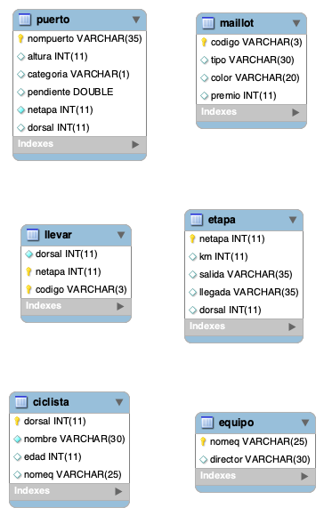

# Práctica 4 Ampliación: Consultas y operaciones CRUD sobre Ciclistas

⬅️ *Pertenece a la unidad* [UP2 · Bloque 2. Operaciones CRUD, transacciones y buenas prácticas](../up2/bloque-2.md)

!!! info "Material necesario"
    Para esta práctica necesitas la base de datos **Ciclistas**. La tienes lista para descargar:

    📦 [Descargar `ciclistas.zip`](../recursos/up2/ciclistas.zip) (`ciclistas.sql`)

## Parte 1

Partiendo de la base de datos adjunta llamada `ciclistas`:

- Conéctate al servidor de MySQL.
- Crea una base de datos llamada `ciclistas`.
- Ejecuta la carga de datos con el fichero `ciclistas.sql`.

!!! tip "Diagrama de la base de datos"
    

## Parte 2

Implementa un menú donde cada opción responda a las siguientes instrucciones sobre los datos almacenados en la base de datos **Ciclistas**:

### Extracción de datos

1. Obtener el nombre y la categoría de los puertos ganados por ciclistas del equipo `Banesto`.
2. Obtener el nombre de cada puerto indicando el número (`netapa`) y los kilómetros de la etapa en la que se encuentra el puerto.
3. Obtener el nombre y el director de los equipos a los que pertenezca algún ciclista mayor de 33 años.
4. Obtener el nombre de los ciclistas con el color de cada maillot que hayan llevado.
5. Obtener pares de nombre de ciclista y número de etapa tal que ese ciclista haya ganado esa etapa habiendo llevado el maillot de color `Amarillo` al menos una vez.
6. Obtener el valor del atributo `netapa` de las etapas que no comienzan en la misma ciudad en que acabó la anterior etapa.
7. Obtener el nombre de los equipos que tengan ciclistas, indicando cuántos tiene cada uno.

### Nuevos datos

8. Crea un equipo.
9. Crea 5 ciclistas asociados al equipo creado.
10. Crea 3 etapas y asóciales como ciclista ganador alguno de los 5 ciclistas creados anteriormente.

---

!!! note "Entrega"
    `ApellidosNombre-ADDP4AMP.zip`
