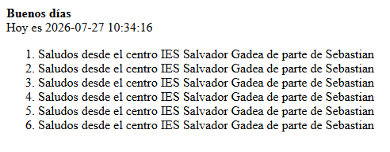
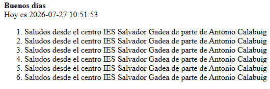

# Práctica 5: Primer controlador REST con Spring Boot

⬅️ *Pertenece a la unidad* [UP3](../up3/bloque-1.md)

## Enunciado

Crea un proyecto con Spring Boot, de acuerdo con las indicaciones siguientes:

- Modifica el archivo `application.properties` para configurar el puerto del servidor en `8081`.
- Añade una variable que contenga el nombre de tu centro educativo.
- Crea un controlador que mapee la ruta `/centro` y devuelva el nombre del centro educativo configurado en el apartado anterior.
- Crea un controlador que recibirá una petición en la ruta `/saludoX?numVeces=6` y devuelva un mensaje de bienvenida personalizado, repetido el número de veces indicado en el parámetro `numVeces` usando SOLO la clase `StringBuilder` **sin usar bucles y comentado hazlo con bucles** y haciendo **comprobaciones de seguridad**.
- Modifica la respuesta del saludo anterior para que devuelva el siguiente formato:
    - Diferenciación en negrita entre las horas del día para hacer un saludo específico:
        - Antes del mediodía → Buenos días
        - Antes de las 20h → Buenas tardes
        - Resto del día → Buenas noches
    - Mostrar el día actual en formato `yyyy-MM-dd HH:mm:ss`
    - Lista ordenada con los saludos
    
    
    
    
    

## Entrega

Capturas de pantalla del navegador mostrando el resultado de la petición a la ruta `/saludoX`y a la ruta `/saludoX?numVeces=4&developer=Sebastian` con tu nombre en una captura y el por defecto en otra captura. Incluye en la entrega la clase con el controlador REST.
