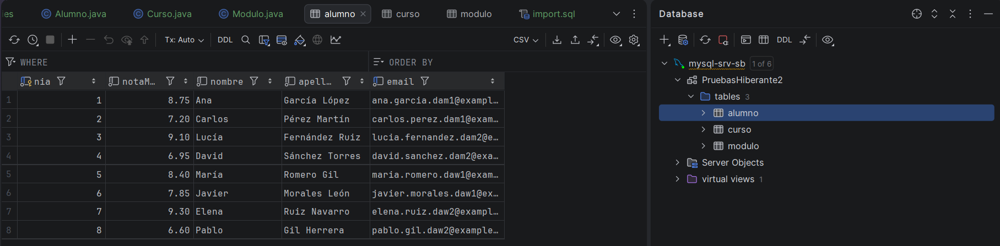
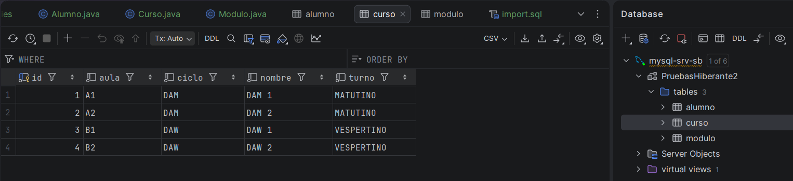
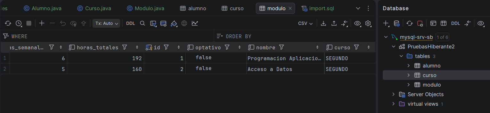
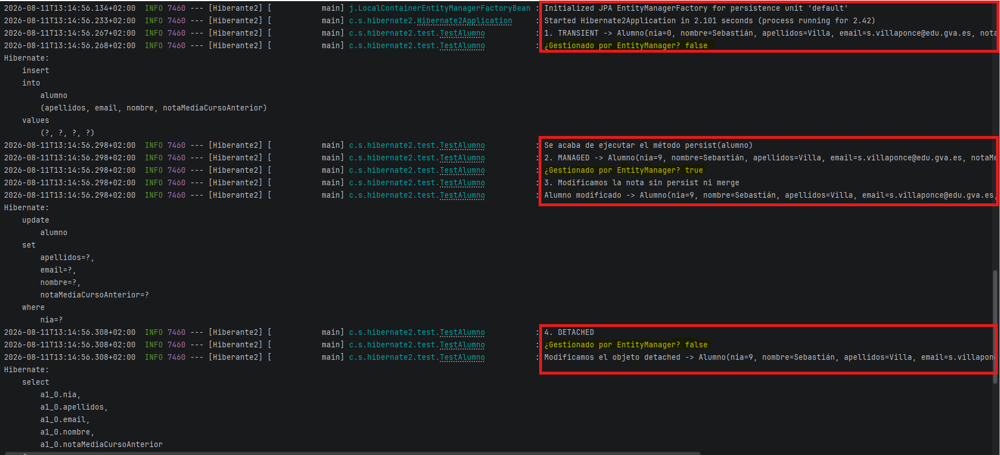

# Práctica 6: Mapeo de la primera entidad con Hibernate


⬅️ *Pertenece a la unidad* [UP4](../up4/bloque-1.md)

## Enunciado

Crea una pequeña base de datos que tenga las siguientes características:

- Debe tener las entidades:
    - Alumno (nia, nombre, apellidos, email, notaMediaCursoAnterior(BigDecimal))
    - Curso (id, nombre, ciclo, aula, Turno(Enum))
    - Modulo (id, nombre,  código de 4 caracteres, horasSemanales, horasTotales, Curso(Enum), optativo, activo)
- Se deben de usar las siguientes anotaciones:
    - Entidad del sistema
    - Tabla de BD con el nombre asociado o nombre por defecto
    - Autogenerardor de `getters y setters, equals, toString y hashCode`
    - Constructor lleno
    - Constructor vacío
    - Clave primaria
    - Clave autogenerada
    - Atributo mapeable varios  atributos de comportamiento
        - Estrategia de generación de clave primaria
        - Nulleable
        - Longitud máxima
        - Valor único
        - Precisión
        - Escala
        - Enumeración mediante String
- Comportamiento: Alumno ← N:1 → Curso ← N:M → Asignatura

## Funcionalidad del sistema

- Generar un programa que autogenere la BD.
- Generar un programa que autogenere los datos de la BD.
- Realizar el mapeo de una sola de las entidades (Alumno). Todavía no es necesario incluir las relaciones, únicamente los atributos y el identificador.
- Añadir un archivo de importación de datos para dicha entidad, con al menos **5 registros por entidad**. Puedes ayudarte aquí de la IA para generar los registros de forma aleatoria.
- Importar los datos al comienzo de la aplicación de forma automática, el fichero debe llamarse `import.sql` para que Hibernate lo lea automáticamente sin ninguna indicación y estar en `resources`.
- Generar y comprobar todos los ciclos de vida básicos de una entidad `(Transient, Managed, Detached y “Merged”)` a través de las operaciones `CRUD` usando el lanzador `CommandLinner`.

## Fichero de importación de datos

```sql
-- Cursos
insert into curso (nombre, ciclo, aula, turno) values ('DAM 1', 'DAM', 'A1', 'MATUTINO');
insert into curso (nombre, ciclo, aula, turno) values ('DAM 2', 'DAM', 'A2', 'MATUTINO');
insert into curso (nombre, ciclo, aula, turno) values ('DAW 1', 'DAW', 'B1', 'VESPERTINO');
insert into curso (nombre, ciclo, aula, turno) values ('DAW 2', 'DAW', 'B2', 'VESPERTINO');

-- Módulos
insert into modulo (nombre, codigo, horas_semanales, horas_totales, curso, optativo, activo) values ('Programacion Aplicaciones Multiplataforma', 'PAM1', 6, 192, 'SEGUNDO', false, true);
insert into modulo (nombre, codigo, horas_semanales, horas_totales, curso, optativo, activo) values ('Acceso a Datos', 'AD01', 5, 160, 'SEGUNDO', false, true);

-- Alumnos
insert into alumno (nombre, apellidos, email, notaMediaCursoAnterior) values ('Ana', 'García López', 'ana.garcia.dam1@example.com', 8.75);
insert into alumno (nombre, apellidos, email, notaMediaCursoAnterior) values ('Carlos', 'Pérez Martín', 'carlos.perez.dam1@example.com', 7.20);

insert into alumno (nombre, apellidos, email, notaMediaCursoAnterior) values ('Lucía', 'Fernández Ruiz', 'lucia.fernandez.dam2@example.com', 9.10);
insert into alumno (nombre, apellidos, email, notaMediaCursoAnterior) values ('David', 'Sánchez Torres', 'david.sanchez.dam2@example.com', 6.95);

insert into alumno (nombre, apellidos, email, notaMediaCursoAnterior) values ('María', 'Romero Gil', 'maria.romero.daw1@example.com', 8.40);
insert into alumno (nombre, apellidos, email, notaMediaCursoAnterior) values ('Javier', 'Morales León', 'javier.morales.daw1@example.com', 7.85);

insert into alumno (nombre, apellidos, email, notaMediaCursoAnterior) values ('Elena', 'Ruiz Navarro', 'elena.ruiz.daw2@example.com', 9.30);
insert into alumno (nombre, apellidos, email, notaMediaCursoAnterior) values ('Pablo', 'Gil Herrera', 'pablo.gil.daw2@example.com', 6.60);
```

## Entrega

Realizar una captura de pantalla de la consola de registro de Spring en la que se vea cómo Hibernate:

- Crea las tablas.
- Importa los datos.
- Comprueba el ciclo de vida creando una clase `TestAlumno` en una carpeta test dentro de java NO EL TEST RAIZ y deja rastro en la consola usando la clase `Logger`.

!!! warning "Test Unitario vs Test de funcionamiento propio"
    La carpeta `test` dentro del paquete `java/com.usuario.proyecto` no es la carpeta `test` que hay en paralelo con la carpeta `main` . La que hay en paralelo con `main` es la carpeta que tendrá los test unitarios para comprobar el comportamiento funcional del programa. La carpeta `test` interna tendrá una clase `TestAlumno` que será para probar de forma interna el funcionamiento automatizado del ciclo de vida de la clase `Alumno` .

## Código e imágenes de solución







Tablas Alumno, Curso y Modulo creadas con datos importados automáticamente. Sin relaciones puestas aún.

```java
// Texto que debería salir en la consola para la primera parte de la actividad
  .   ____          _            __ _ _
 /\\ / ___'_ __ _ _(_)_ __  __ _ \ \ \ \
( ( )\___ | '_ | '_| | '_ \/ _` | \ \ \ \
 \\/  ___)| |_)| | | | | || (_| |  ) ) ) )
  '  |____| .__|_| |_|_| |_\__, | / / / /
 =========|_|==============|___/=/_/_/_/

 :: Spring Boot ::                (v4.1.0)

2026-08-11T11:44:58.521+02:00  INFO 11476 --- [Hiberante2] [           main] c.s.hibernate2.Hibernate2Application     : Starting Hibernate2Application using Java 26.0.1 with PID 11476 (C:\Users\Sebastián\IdeaProjects\Hiberante2\target\classes started by Sebastián in C:\Users\Sebastián\IdeaProjects\Hiberante2)
2026-08-11T11:44:58.524+02:00  INFO 11476 --- [Hiberante2] [           main] c.s.hibernate2.Hibernate2Application     : No active profile set, falling back to 1 default profile: "default"
2026-08-11T11:44:58.804+02:00  INFO 11476 --- [Hiberante2] [           main] .s.d.r.c.RepositoryConfigurationDelegate : Bootstrapping Spring Data JPA repositories in DEFAULT mode.
2026-08-11T11:44:58.815+02:00  INFO 11476 --- [Hiberante2] [           main] .s.d.r.c.RepositoryConfigurationDelegate : Finished Spring Data repository scanning in 7 ms. Found 0 JPA repository interfaces.
2026-08-11T11:44:58.970+02:00  INFO 11476 --- [Hiberante2] [           main] org.hibernate.orm.jpa                    : HHH008540: Processing PersistenceUnitInfo [name: default]
2026-08-11T11:44:59.006+02:00  INFO 11476 --- [Hiberante2] [           main] org.hibernate.orm.core                   : HHH000001: Hibernate ORM core version 7.4.1.Final
2026-08-11T11:44:59.263+02:00  INFO 11476 --- [Hiberante2] [           main] o.s.o.j.p.SpringPersistenceUnitInfo      : No LoadTimeWeaver setup: ignoring JPA class transformer
2026-08-11T11:44:59.281+02:00  INFO 11476 --- [Hiberante2] [           main] com.zaxxer.hikari.HikariDataSource       : HikariPool-1 - Starting...
2026-08-11T11:44:59.513+02:00  INFO 11476 --- [Hiberante2] [           main] com.zaxxer.hikari.pool.HikariPool        : HikariPool-1 - Added connection com.mysql.cj.jdbc.ConnectionImpl@27e44e9c
2026-08-11T11:44:59.514+02:00  INFO 11476 --- [Hiberante2] [           main] com.zaxxer.hikari.HikariDataSource       : HikariPool-1 - Start completed.
2026-08-11T11:44:59.569+02:00  INFO 11476 --- [Hiberante2] [           main] org.hibernate.orm.connections.pooling    : HHH10001005: Database info:
	Database JDBC URL [jdbc:mysql://localhost:3308/PruebasHiberante2?createDatabaseIfNotExist=true]
	Database driver: MySQL Connector/J
	Database dialect: MySQLDialect
	Database version: 26.7
	Default catalog/schema: PruebasHiberante2/undefined
	Autocommit mode: undefined/unknown
	Isolation level: REPEATABLE_READ [default REPEATABLE_READ]
	JDBC fetch size: none
	Pool: DataSourceConnectionProvider
	Minimum pool size: undefined/unknown
	Maximum pool size: undefined/unknown
2026-08-11T11:45:00.115+02:00  INFO 11476 --- [Hiberante2] [           main] org.hibernate.orm.core                   : HHH000489: No JTA platform available (set 'hibernate.transaction.jta.platform' to enable JTA platform integration)
Hibernate: 
    drop table if exists alumno
Hibernate: 
    drop table if exists curso
Hibernate: 
    drop table if exists modulo
Hibernate: 
    create table alumno (
        nia integer not null auto_increment,
        notaMediaCursoAnterior decimal(4,2) not null,
        nombre varchar(50) not null,
        apellidos varchar(100) not null,
        email varchar(100) not null,
        primary key (nia)
    ) engine=InnoDB
Hibernate: 
    create table curso (
        id integer not null auto_increment,
        aula varchar(50) not null,
        ciclo varchar(50) not null,
        nombre varchar(50) not null,
        turno enum ('MATUTINO','VESPERTINO') not null,
        primary key (id)
    ) engine=InnoDB
Hibernate: 
    create table modulo (
        activo bit not null,
        codigo varchar(4) not null,
        horas_semanales integer not null,
        horas_totales integer not null,
        id integer not null auto_increment,
        optativo bit not null,
        nombre varchar(50) not null,
        curso enum ('PRIMERO','SEGUNDO') not null,
        primary key (id)
    ) engine=InnoDB
Hibernate: 
    alter table alumno 
       add constraint UKdlqu0nadbeiwn48uty3rus51y unique (email)
Hibernate: insert into curso (nombre, ciclo, aula, turno) values ('DAM 1', 'DAM', 'A1', 'MATUTINO')
Hibernate: insert into curso (nombre, ciclo, aula, turno) values ('DAM 2', 'DAM', 'A2', 'MATUTINO')
Hibernate: insert into curso (nombre, ciclo, aula, turno) values ('DAW 1', 'DAW', 'B1', 'VESPERTINO')
Hibernate: insert into curso (nombre, ciclo, aula, turno) values ('DAW 2', 'DAW', 'B2', 'VESPERTINO')
Hibernate: insert into modulo (nombre, codigo, horas_semanales, horas_totales, curso, optativo, activo) values ('Programacion Aplicaciones Multiplataforma', 'PAM1', 6, 192, 'SEGUNDO', false, true)
Hibernate: insert into modulo (nombre, codigo, horas_semanales, horas_totales, curso, optativo, activo) values ('Acceso a Datos', 'AD01', 5, 160, 'SEGUNDO', false, true)
Hibernate: insert into alumno (nombre, apellidos, email, notaMediaCursoAnterior) values ('Ana', 'García López', 'ana.garcia.dam1@example.com', 8.75)
Hibernate: insert into alumno (nombre, apellidos, email, notaMediaCursoAnterior) values ('Carlos', 'Pérez Martín', 'carlos.perez.dam1@example.com', 7.20)
Hibernate: insert into alumno (nombre, apellidos, email, notaMediaCursoAnterior) values ('Lucía', 'Fernández Ruiz', 'lucia.fernandez.dam2@example.com', 9.10)
Hibernate: insert into alumno (nombre, apellidos, email, notaMediaCursoAnterior) values ('David', 'Sánchez Torres', 'david.sanchez.dam2@example.com', 6.95)
Hibernate: insert into alumno (nombre, apellidos, email, notaMediaCursoAnterior) values ('María', 'Romero Gil', 'maria.romero.daw1@example.com', 8.40)
Hibernate: insert into alumno (nombre, apellidos, email, notaMediaCursoAnterior) values ('Javier', 'Morales León', 'javier.morales.daw1@example.com', 7.85)
Hibernate: insert into alumno (nombre, apellidos, email, notaMediaCursoAnterior) values ('Elena', 'Ruiz Navarro', 'elena.ruiz.daw2@example.com', 9.30)
Hibernate: insert into alumno (nombre, apellidos, email, notaMediaCursoAnterior) values ('Pablo', 'Gil Herrera', 'pablo.gil.daw2@example.com', 6.60)
2026-08-11T11:45:00.338+02:00  INFO 11476 --- [Hiberante2] [           main] j.LocalContainerEntityManagerFactoryBean : Initialized JPA EntityManagerFactory for persistence unit 'default'
2026-08-11T11:45:00.440+02:00  INFO 11476 --- [Hiberante2] [           main] c.s.hibernate2.Hibernate2Application     : Started Hibernate2Application in 2.149 seconds (process running for 2.569)
2026-08-11T11:45:00.445+02:00  INFO 11476 --- [Hiberante2] [ionShutdownHook] j.LocalContainerEntityManagerFactoryBean : Closing JPA EntityManagerFactory for persistence unit 'default'
2026-08-11T11:45:00.447+02:00  INFO 11476 --- [Hiberante2] [ionShutdownHook] com.zaxxer.hikari.HikariDataSource       : HikariPool-1 - Shutdown initiated...
2026-08-11T11:45:00.452+02:00  INFO 11476 --- [Hiberante2] [ionShutdownHook] com.zaxxer.hikari.HikariDataSource       : HikariPool-1 - Shutdown completed.

Process finished with exit code 0
```

!!! tip "La forma de un CommandLineRunner"
    **El método anotado con `@Bean` devuelve un objeto de tipo `CommandLineRunner`. Como `CommandLineRunner` es una** [interfaz funcional](https://docs.spring.io/spring-boot/api/java/org/springframework/boot/CommandLineRunner.html)**, Java nos permite crear ese objeto mediante una expresión lambda en lugar de tener que implementar la interfaz mediante una clase anónima.**

    **Una interfaz funcional** es una interfaz que contiene **un único método abstracto**. Gracias a esta característica, Java puede asociar una expresión lambda con la implementación de ese único método. En el caso de `CommandLineRunner`, el método abstracto es:

    ```java
    void run(String...args)
    ```

    Por ello, la lambda:

    ```java
    args -> testAlumno.ejecutar();
    ```

    representa la implementación de ese método `run()`. El parámetro `args` corresponde a los argumentos de línea de comandos que recibe la aplicación al iniciarse y, aunque en este caso no se utilicen, deben aparecer porque forman parte de la firma del método.

    Finalmente, cuando Spring Boot termina de arrancar y ha creado todos los Beans de la aplicación, detecta automáticamente el Bean de tipo `CommandLineRunner` e invoca su método `run()`. Como nuestra implementación consiste en llamar a:

    ```java
    testAlumno.ejecutar();
    ```

    ese será el código que se ejecutará automáticamente al iniciar la aplicación.

La salida de la segunda parte debería ser algo así:

```java
2026-08-11T13:09:39.355+02:00  INFO 15268 --- [Hiberante2] [           main] j.LocalContainerEntityManagerFactoryBean : Initialized JPA EntityManagerFactory for persistence unit 'default'
2026-08-11T13:09:39.465+02:00  INFO 15268 --- [Hiberante2] [           main] c.s.hibernate2.Hibernate2Application     : Started Hibernate2Application in 2.057 seconds (process running for 2.394)
2026-08-11T13:09:39.500+02:00  INFO 15268 --- [Hiberante2] [           main] c.s.hibernate2.test.TestAlumno           : 1. TRANSIENT -> Alumno(nia=0, nombre=Sebastián, apellidos=Villa, email=s.villaponce@edu.gva.es, notaMediaCursoAnterior=8.88)
2026-08-11T13:09:39.501+02:00  INFO 15268 --- [Hiberante2] [           main] c.s.hibernate2.test.TestAlumno           : ¿Gestionado por EntityManager? false
Hibernate: 
    insert 
    into
        alumno
        (apellidos, email, nombre, notaMediaCursoAnterior) 
    values
        (?, ?, ?, ?)
2026-08-11T13:09:39.539+02:00  INFO 15268 --- [Hiberante2] [           main] c.s.hibernate2.test.TestAlumno           : 2. MANAGED -> Alumno(nia=9, nombre=Sebastián, apellidos=Villa, email=s.villaponce@edu.gva.es, notaMediaCursoAnterior=8.88)
2026-08-11T13:09:39.539+02:00  INFO 15268 --- [Hiberante2] [           main] c.s.hibernate2.test.TestAlumno           : ¿Gestionado por EntityManager? true
2026-08-11T13:09:39.539+02:00  INFO 15268 --- [Hiberante2] [           main] c.s.hibernate2.test.TestAlumno           : 3. Modificamos la nota sin persist ni merge
2026-08-11T13:09:39.539+02:00  INFO 15268 --- [Hiberante2] [           main] c.s.hibernate2.test.TestAlumno           : Alumno modificado -> Alumno(nia=9, nombre=Sebastián, apellidos=Villa, email=s.villaponce@edu.gva.es, notaMediaCursoAnterior=9.51)
Hibernate: 
    update
        alumno 
    set
        apellidos=?,
        email=?,
        nombre=?,
        notaMediaCursoAnterior=? 
    where
        nia=?
2026-08-11T13:09:39.556+02:00  INFO 15268 --- [Hiberante2] [           main] c.s.hibernate2.test.TestAlumno           : 4. DETACHED
2026-08-11T13:09:39.556+02:00  INFO 15268 --- [Hiberante2] [           main] c.s.hibernate2.test.TestAlumno           : ¿Gestionado por EntityManager? false
2026-08-11T13:09:39.556+02:00  INFO 15268 --- [Hiberante2] [           main] c.s.hibernate2.test.TestAlumno           : Modificamos el objeto detached -> Alumno(nia=9, nombre=Sebastián, apellidos=Villa, email=s.villaponce@edu.gva.es, notaMediaCursoAnterior=5.00)
Hibernate: 
    select
        a1_0.nia,
        a1_0.apellidos,
        a1_0.email,
        a1_0.nombre,
        a1_0.notaMediaCursoAnterior 
    from
        alumno a1_0 
    where
        a1_0.nia=?
2026-08-11T13:09:39.580+02:00  INFO 15268 --- [Hiberante2] [           main] c.s.hibernate2.test.TestAlumno           : 5. MERGE -> vuelve a estar gestionado
2026-08-11T13:09:39.580+02:00  INFO 15268 --- [Hiberante2] [           main] c.s.hibernate2.test.TestAlumno           : Original gestionado: false
2026-08-11T13:09:39.580+02:00  INFO 15268 --- [Hiberante2] [           main] c.s.hibernate2.test.TestAlumno           : Devuelto por merge gestionado: true
Hibernate: 
    update
        alumno 
    set
        apellidos=?,
        email=?,
        nombre=?,
        notaMediaCursoAnterior=? 
    where
        nia=?
2026-08-11T13:09:39.615+02:00  INFO 15268 --- [Hiberante2] [ionShutdownHook] j.LocalContainerEntityManagerFactoryBean : Closing JPA EntityManagerFactory for persistence unit 'default'
2026-08-11T13:09:39.616+02:00  INFO 15268 --- [Hiberante2] [ionShutdownHook] com.zaxxer.hikari.HikariDataSource       : HikariPool-1 - Shutdown initiated...
2026-08-11T13:09:39.622+02:00  INFO 15268 --- [Hiberante2] [ionShutdownHook] com.zaxxer.hikari.HikariDataSource       : HikariPool-1 - Shutdown completed.

Process finished with exit code 0
```

Imágenes de la solución por consola implementada: 




En el punto 4 se busca el alumno asociado no el último modificado.
En el punto 5 se sobrescribe  el alumno asociado respecto el alumno que estaba modificado.
