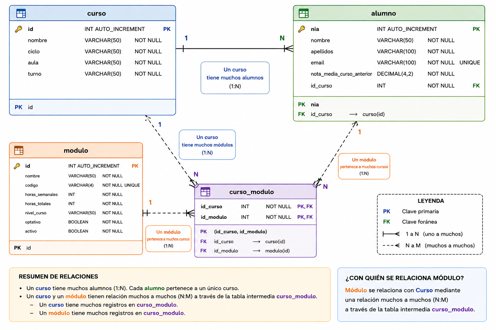

# Práctica 7: Relaciones entre entidades con Hibernate


⬅️ *Pertenece a la unidad* [UP5](../up5/bloque-1.md)

### 1. Objetivo

En la actividad anterior creaste las entidades básicas de una pequeña base de datos utilizando **JPA e Hibernate**, pero todavía no establecimos relaciones entre ellas.

En esta segunda parte vas a completar el modelo haciendo que las entidades se relacionen entre sí y dejando que **Hibernate genere automáticamente la estructura de la base de datos**.

Trabajaremos exclusivamente con las siguientes entidades:

- `Alumno`
- `Curso`
- `Modulo`

El objetivo principal es aprender a implementar y comprobar relaciones **1:N** y **N:M** utilizando JPA/Hibernate.

### 2. Modelo que debes implementar

La aplicación debe representar la siguiente situación:

#### Alumnos y cursos

Un **curso puede tener muchos alumnos**, pero cada **alumno pertenece a un único curso**.

Por tanto:

```
Curso 1 ───────── N Alumno
```

#### Cursos y módulos

Un **curso está formado por varios módulos** y un mismo **módulo puede estar asociado a varios cursos**.

Por tanto:

```
Curso N ───────── M Modulo
```

El modelo completo será:

```
Alumno N ───── 1 Curso N ───── M Modulo
```

Debes decidir cómo representar estas relaciones mediante las anotaciones de JPA estudiadas en el tema.

### 3. Mapeo de las entidades

Partiendo de las entidades desarrolladas en la actividad anterior, completa su mapeo.

#### `Alumno`

Debe conservar, como mínimo, información sobre:

- NIA.
- Nombre.
- Apellidos.
- Correo electrónico.
- Nota media del curso anterior.

Además, deberá quedar asociado al `Curso` al que pertenece.

#### `Curso`

Debe contener, como mínimo:

- Identificador.
- Nombre.
- Ciclo.
- Aula.
- Turno.

Además, desde un curso deberá ser posible conocer:

- Los alumnos que pertenecen a él.
- Los módulos asociados al curso.

#### `Modulo`

Debe contener, como mínimo:

- Identificador.
- Nombre.
- Código.
- Horas semanales.
- Horas totales.
- Nivel del curso.
- Si es optativo.
- Si está activo.

Desde un módulo deberá ser posible conocer los cursos en los que se imparte.

### 4. Requisitos de las relaciones

Las relaciones deberán ser **bidireccionales**, de manera que podamos navegar por los objetos Java en ambos sentidos.

Por ejemplo, dado un curso debemos poder consultar sus alumnos y, dado un alumno, conocer su curso.

Del mismo modo, dado un curso debemos poder consultar sus módulos y, dado un módulo, conocer los cursos en los que se imparte.

Debes identificar correctamente:

- La cardinalidad de cada relación.
- Qué entidad es propietaria de cada relación.
- Qué entidad representa el lado inverso.
- Dónde debe almacenarse la clave foránea en la relación 1:N.
- Cómo debe representarse en la base de datos la relación N:M.

> **Importante:** presta especial atención a los métodos `toString()`, `equals()` y `hashCode()` generados por Lombok cuando existen relaciones bidireccionales. Evita posibles problemas de recursión infinita.
> 

### 5. Métodos auxiliares para gestionar las relaciones

No basta con definir correctamente las anotaciones de Hibernate. También debemos mantener **coherentes los objetos Java**.

Implementa métodos auxiliares que permitan, como mínimo:

```
Añadir un alumno a un curso.
Eliminar un alumno de un curso.

Añadir un módulo a un curso.
Eliminar un módulo de un curso.
```

Estos métodos deberán mantener actualizados **los dos lados de la relación**.

Por ejemplo, cuando añadamos un alumno a un curso, después de ejecutar la operación deberá cumplirse conceptualmente:

```
Curso → contiene al Alumno
Alumno → referencia al Curso
```

Haz lo mismo para la relación entre `Curso` y `Modulo`.

### 6. Importación de datos

Crea un archivo SQL de importación que permita disponer de datos desde el inicio de la aplicación.

Debes introducir suficientes registros para poder comprobar correctamente las relaciones. Como mínimo, deberán existir:

- Varios cursos.
- Al menos **10 alumnos**.
- Al menos **5 módulos**.
- Al menos **2 cursos (1º y 2º DAM)**.
- Al menos **10 asociaciones entre cursos y módulos**.

Los datos deben permitir comprobar claramente tanto la relación **1:N** como la relación **N:M**.

Ten en cuenta el **orden de inserción de los datos** para no violar las restricciones de integridad referencial.

Puedes utilizar una IA generativa para ayudarte a generar datos ficticios, pero deberás revisar el SQL generado y comprender qué información se está insertando.

### 7. Prueba de las relaciones

Crea una clase de prueba que sea ejecutada automáticamente al iniciar la aplicación mediante un `CommandLineRunner`.

Esta clase deberá utilizar `EntityManager` para comprobar que las relaciones funcionan correctamente.

Realiza las siguientes operaciones:

1. Recupera de la base de datos un `Curso` existente.
2. Muestra sus datos por consola.
3. Muestra todos los alumnos que pertenecen a ese curso.
4. Muestra todos los módulos asociados al curso.
5. Crea un nuevo `Alumno`.
6. Añade el alumno al curso utilizando el método auxiliar correspondiente.
7. Recupera un `Modulo` existente.
8. Asocia dicho módulo al curso utilizando el método auxiliar correspondiente.
9. Guarda los cambios necesarios.
10. Comprueba en el log qué operaciones SQL ha generado Hibernate.

#### Antes de ejecutar responde las preguntas y después compara con los resultados

**ANTES Y DESPUÉS de lanzar la aplicación, intenta predecir y analizar en comentarios del código:**

- ¿En qué tabla se reflejará la incorporación del nuevo alumno?
- ¿Qué ocurrirá con la clave foránea que relaciona `Alumno` y `Curso`?
- ¿Qué tabla se modificará al asociar un módulo a un curso?
- ¿Cuántos `INSERT` o `UPDATE` esperas que genere Hibernate?

Después ejecuta el programa y compara tu predicción con el **SQL generado por Hibernate**.

### 8. Ampliación: eliminación de relaciones

Una vez comprobado el funcionamiento anterior, utiliza también los métodos auxiliares de eliminación.

Realiza las siguientes operaciones:

- Elimina un alumno de un curso.
- Elimina la asociación entre un módulo y un curso.

**ANTES Y DESPUÉS** de ejecutar, responde en tu código:

> **¿Eliminar una relación significa necesariamente eliminar las entidades de la base de datos?**
> 

Observa posteriormente el SQL generado por Hibernate y explica brevemente qué ha ocurrido en cada caso.

### 9. Comprobación de la base de datos

Una vez ejecutada correctamente la aplicación, utiliza **MySQL Workbench** para comprobar el modelo generado por Hibernate.

Tu base de datos deberá contener las tablas correspondientes a:

```
Alumno
Curso
Modulo
```

y las estructuras adicionales necesarias para representar las relaciones.

Genera el **diagrama ER** de la base de datos y comprueba visualmente:

- La relación entre `Alumno` y `Curso`.
- La relación entre `Curso` y `Modulo`.
- Las claves primarias.
- Las claves foráneas.
- La estructura utilizada para representar la relación N:M.

### 10. Entrega

Entrega las siguientes capturas de pantalla **EN UN PDF**:

1. **Log de Hibernate durante la creación de la base de datos**, donde puedan observarse las tablas y restricciones generadas.
2. **Log de la importación de datos**, donde puedan observarse las inserciones realizadas.
3. **Log de la prueba realizada con `CommandLineRunner`**, mostrando las consultas y modificaciones realizadas por Hibernate.
4. **Diagrama EER de MySQL Workbench**, donde aparezcan claramente las entidades y sus relaciones.
5. **Salida de la aplicación**, mostrando un curso junto con sus alumnos y módulos asociados.
6. Las respuestas **ANTES Y DESPUÉS DE LA EJECUCIÓN DEL CÓDIGO. AMBAS.**

Además, incluye una breve explicación de:

- Cómo se ha implementado la relación `Alumno-Curso`.
- Cómo se ha implementado la relación `Curso-Modulo`.
- Qué diferencias has observado en la base de datos entre una relación **1:N** y una relación **N:M**.

### Resultado esperado

Al finalizar la actividad deberás ser capaz de relacionar lo que ocurre en los tres niveles:

```
        MODELO JAVA
     Alumno ↔ Curso ↔ Modulo
              │
              ▼
        ANOTACIONES JPA
              │
              ▼
      MODELO RELACIONAL
 alumno ── curso ── curso_modulo ── modulo
              │
              ▼
       SQL DE HIBERNATE
```

El objetivo no es únicamente conseguir que la aplicación funcione, sino **comprender cómo las relaciones entre objetos Java se transforman en claves foráneas, tablas y registros dentro de una base de datos relacional**.

!!! note "Herramientas de diseño"
    MySQL Workbench dispone de esta herramienta. También puedes encontrar otras herramientas de diseño de bases de datos online, como:

    `https://www.erdgo.com/`

    En este caso debes proporcionarle el archivo de creación de tu base de datos, que puedes generar con la herramienta `mysqldump` o con la funcionalidad de exportación de tu herramienta de gestión de bases de datos.



Diagrama E-R de ejemplo generado por IA
