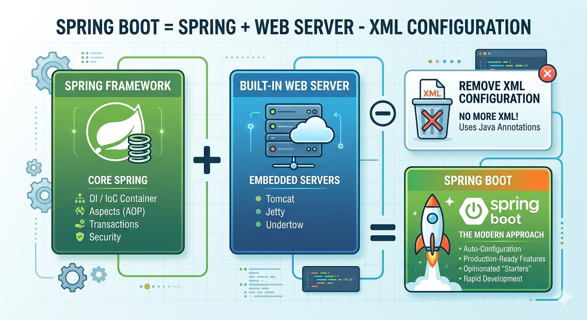
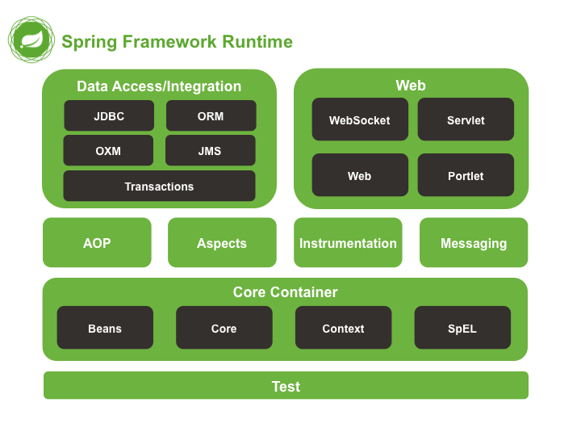
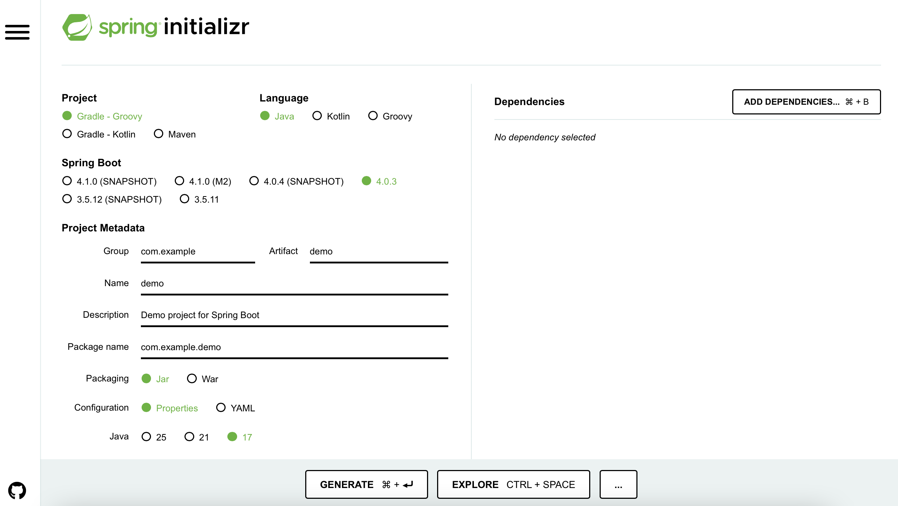
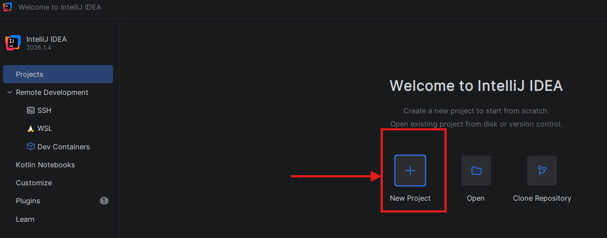
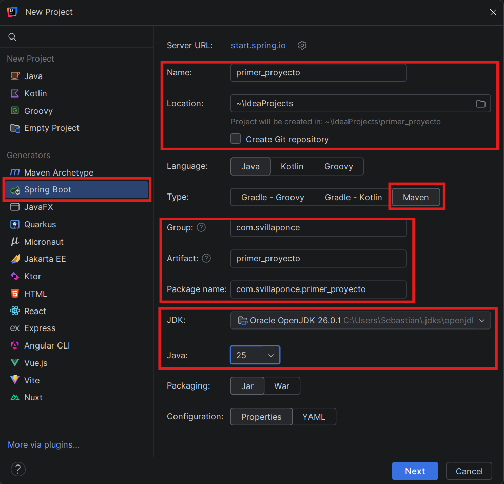
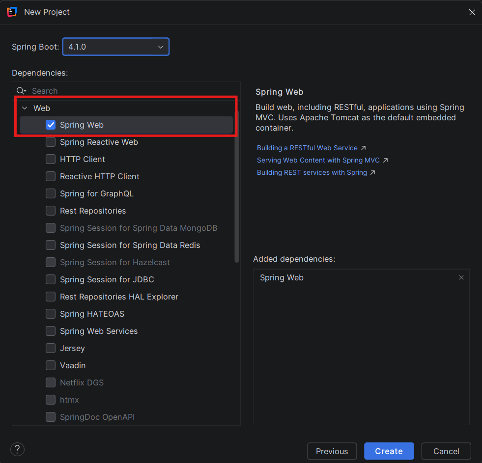
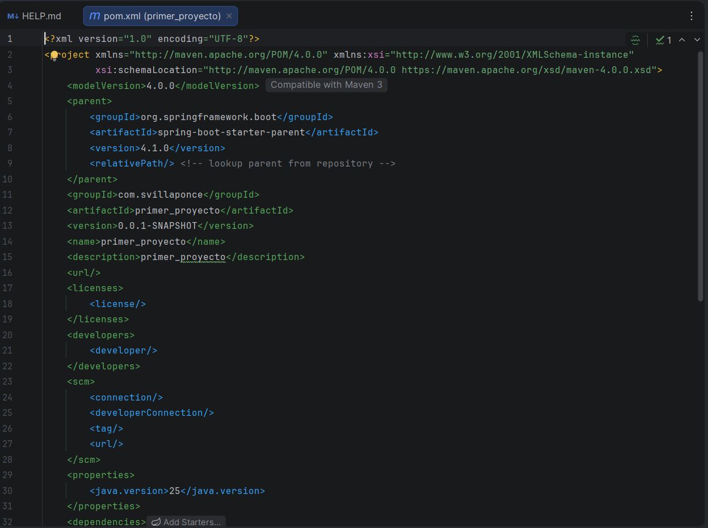
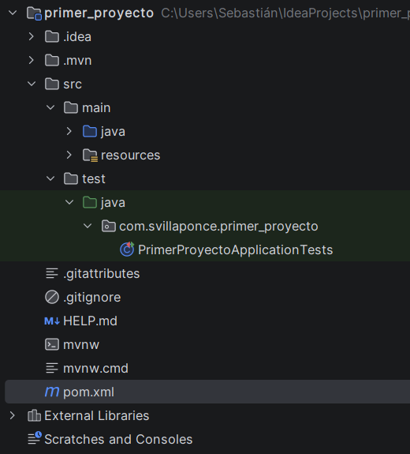

# Bloque 1. Spring y Spring Boot

## 1. ¿Qué es Spring?

Spring es posiblemente el framework más utilizado hoy en día para la creación de aplicaciones en Java. Se define como un entorno o banco de trabajo formado por una serie de herramientas, reglas y bibliotecas de clases que facilitan enormemente la tarea de programar. Fue creado por Rod Johnson hacia el año 2003 para solucionar la gran complejidad de la tecnología Java Enterprise Edition (J2EE) de aquel momento.

!!! tip "¿Qué es un framework?"
    Un framework es un conjunto de herramientas, reglas y bibliotecas de clases que facilitan enormemente la tarea de programar.

    Visto desde el punto de vista de un programador, no es más que un conjunto de funciones de bibliotecas empaquetadas que cargaremos en nuestro programa para facilitar y agilizar nuestra tarea.

Para ofrecer estas comodidades al programador, el framework se basa en los siguientes principios:

**Inyección de dependencias (DI):** técnica o patrón de diseño utilizado como una de las formas de inversión de control (IOC) para promover un acoplamiento débil. Es decir, cuando una clase necesita otra clase (dependencia), en lugar de crear el objeto dentro de la propia clase, Spring lo suministra o lo inyecta.

**Modularidad:** Proporciona modularidad, ofreciendo entre otras:

- Escalabilidad de la aplicación sin necesidad de modificar las clases.
- Evita la dependencia entre clases.
- Desarrollo sencillo con **POJOs** (Plain Old Java Objects).
- Minimiza el código **boilerplate** (código repetitivo simple que no hace más que aumentar las líneas de código).

**Programación Orientada a Aspectos (AOP):** Permite una modularización mucho mayor para hacer una separación muy clara de las diferentes tareas que cada clase debe realizar en nuestra aplicación.

Simplifica el acceso a los datos gracias al ORM (Object Relational Mapping).

**Origen y propósito:** Mientras que J2EE era complejo, lento y consumía muchos recursos, Spring nació como una alternativa simple y ligera.

**Desarrollo con POJOs:** Spring permite el desarrollo sencillo mediante POJOs (Plain Old Java Objects), que son objetos o clases simples que no necesitan heredar de otras ni implementar interfaces complejas.

Con las aplicaciones J2EE (Java 2 Platform, Enterprise Edition) anteriores a Spring, teníamos que crear Servlets. Un servlet es una aplicación que se ejecuta en un servidor, preparada para responder a solicitudes HTTP. Más tarde tenemos JSP (Java Server Pages), que permiten combinar elementos HTML y configuraciones XML con fragmentos de código Java para generar contenido dinámicamente.

Todo esto provoca que tengamos que lanzar un servidor de aplicaciones por un lado y añadir la aplicación para ejecutarla y servirla como otra página. Podemos utilizar Servlets para escribir una aplicación web, pero hay muchos detalles intrínsecos que controlar: validación, REST, cuerpo de la solicitud/respuesta para JSON, vinculación de formularios, etc. Esto implica que gran parte de nuestro código se dedica a controlar las capas inferiores de comunicación.

Con el framework Spring, realmente utilizamos servlets, pero libera al programador de esta pesada tarea, gestionándola automáticamente. Esto permite al programador centrarse en la lógica de la aplicación, sin tener que gestionar los niveles inferiores de comunicaciones, como veremos más adelante.

## 2. ¿Qué es Spring Boot?

Aunque Spring se impuso como herramienta para desarrollar aplicaciones Java, todavía existía una cierta complejidad a la hora de configurar y poner en marcha un proyecto Spring. Por ello, en 2014, surgió Spring Boot, que es una extensión de Spring que simplifica todavía más el proceso de creación de aplicaciones Spring.

Spring Boot se define como un acelerador de Spring, permitiéndonos indicar una serie de convenciones (comportamientos) que realizan tareas pesadas de configuración de archivos por nosotros. Esto supone la eliminación de complejas configuraciones manuales que se realizaban con XML.

Además, Spring Boot incorpora un servidor web integrado (normalmente Tomcat), lo que ya nos permite ejecutar la aplicación directamente sin necesidad de desplegarla en un servidor de aplicaciones externo. Esto facilita enormemente el desarrollo y la prueba de aplicaciones Spring.

La siguiente infografía resume qué es Spring Boot.

Imagen generada por el autor con Gemini.

## 3. Conceptos teóricos

!!! note "Simplemente una visión general"
    En este apartado se presentan conceptos teóricos relacionados con Spring. No es necesario entender todos estos conceptos para comenzar a trabajar con Spring Boot, pero es útil tener una visión general del framework.

Vamos a revisar algunas de las partes más importantes del framework Spring. Simplemente se revisa lo que incorpora, sin entrar en detalles de sus partes.

Core de Spring

### I. Core Container

El contenedor principal proporciona los módulos básicos:

- **Core** y **Beans** forman el esqueleto del framework, conteniendo la función de inyección de dependencias y dando soporte a los objetos POJO. Cabe aclarar que un Bean es un POJO, aunque tiene algunas características adicionales.
- **Context** hereda sus características del módulo Beans y puede complementarse con funciones para la internacionalización o la carga de recursos. Además, da soporte a características de Java Enterprise como EJB y JMX (Java Management Extensions). **Context-support** facilita la integración de bibliotecas de otros proveedores en Spring.
- **Spring-expression** contiene el Spring Expression Language (SPeL), una extensión del Unified Expression Language de la especificación JSP-2.1 (Java Server Pages).

### II. AOP e instrumentación

Para permitir la programación orientada a aspectos, el Spring Framework contiene el módulo **spring-aop**. El componente **spring-instrument** proporciona soporte para la implementación de carga de objetos y clases de manipulación para su uso en algunos servidores.

### III. Mensajería

Para servir como base para aplicaciones basadas en mensajes, el Spring Framework se basa en algunas de las funciones de encriptación del proyecto Spring Integration, como **Message**, **MessageChannel** o **MessageHandler**. Este módulo recibe el nombre de **spring-messaging**.

### IV. Acceso a Datos/Integración

Los módulos de esta categoría están diseñados para proporcionar a las aplicaciones Java las herramientas para interactuar con otras aplicaciones, así como controlar el acceso a los datos.

- **spring-jdbc** proporciona una capa de abstracción que define la manera en que un cliente accede a la base de datos y ahorra la codificación complicada típica de JDBC.
- **spring-orm** ofrece capas de integración para acceder a bases de datos relacionales en interfaces ORM populares.
- **spring-tx** (da soporte a la gestión de transacciones programáticas para todas las clases y POJOs).
- **spring-oxm** (capa de abstracción para el mapeo de objetos o XML).
- **spring-jms**, un módulo con funciones para la producción y procesamiento de mensajes.

### V. Web

En esta categoría se encuentran los módulos específicos para aplicaciones web: **spring-web**, **spring-webmvc** y **spring-websocket**. Además, esta aplicación Java ha añadido funciones de integración típicas orientadas a la web como una función de carga multipart o un cliente HTTP. El módulo **spring-webmvc** también es conocido como **web servlet** y es el que contiene las implementaciones de Spring para la ejecución del patrón de arquitectura **modelo-vista-controlador (MVC)** y servicios web **REST**.

### VI. Test

El módulo **spring-test** permite comprobar la funcionalidad de los componentes de tu aplicación Java. Así, con la ayuda de frameworks adicionales como **JUnit** o **TestNG**, puedes realizar pruebas unitarias (centradas en un solo componente) así como pruebas de integración.

## 4. Spring Initializr

Muy bien, ¿y cómo empezamos un proyecto Spring Boot? Pues la manera más rápida es utilizando el servicio de **Spring Initializr**, que es una herramienta en línea que permite generar un proyecto Spring Boot preconfigurado con las dependencias y las opciones que necesitas. La herramienta la encontramos aquí: [https://start.spring.io/](https://start.spring.io/). 

[start.spring.io](https://start.spring.io/)

Esta herramienta no es más que un asistente que nos permite configurar nuestro proyecto Spring Boot de manera rápida y sencilla. Nos permite seleccionar las dependencias que necesitamos, como por ejemplo Spring Web, Spring Data JPA, Spring Security, etc., y generar un proyecto con la estructura básica y los archivos de configuración necesarios para comenzar a desarrollar nuestra aplicación. Al final del asistente nos permite descargar un archivo ZIP con el proyecto generado, con las dependencias y la configuración que hemos seleccionado.

!!! note "¿Qué genera realmente?"
    El mismo asistente que tenemos en la web de Spring Initializr lo podemos encontrar como plugin en IDEs como Eclipse o IntelliJ, así que trabajaremos directamente sobre el IDE, como veremos a continuación.

### 4.1. Creación de un proyecto Spring Boot con Spring Initializr

Aquí encontraréis varias capturas de pantalla con el proceso. Desde IntelliJ, cread un nuevo proyecto:

!!! note "¿Qué es cada cosa?"
    **Group ID (groupId):** Organización que desarrolla la aplicación. Es el nombre del dominio invertido. (p. ej. org.iessalvadorgadea). Funciona como el paquete raíz del código y garantiza la unicidad del proyecto dentro de una organización.

    **Artifact ID (artifactId):** Es el nombre único del proyecto o del archivo resultante (JAR o WAR). Es como se llamará el paquete final de tu aplicación (p. ej. servicios-clientes, api-rest). Se recomienda utilizar minúsculas y guiones.

    **Version:** Identifica la etapa de desarrollo. Una versión con **SNAPSHOT** indica que está en desarrollo activo, mientras que las versiones numéricas (p. ej. 1.0.0) indican lanzamientos estables.

    Para nuestras prácticas, utilizad vuestro nombre en el **Group ID** y el nombre del proyecto en el **Artifact ID**. La versión se considerará “estable”.

Y finalmente seleccionad las dependencias. En nuestro proyecto inicial, seleccionad **Spring Web**.

Y cuando el proceso termine, encontraréis una estructura de proyecto con un **pom.xml** configurado.

Y la estructura como sigue:

Ya tenemos nuestro proyecto Spring Boot creado y configurado. Ahora podemos comenzar a desarrollar nuestra aplicación. Dejaremos para más adelante una primera ejecución.
