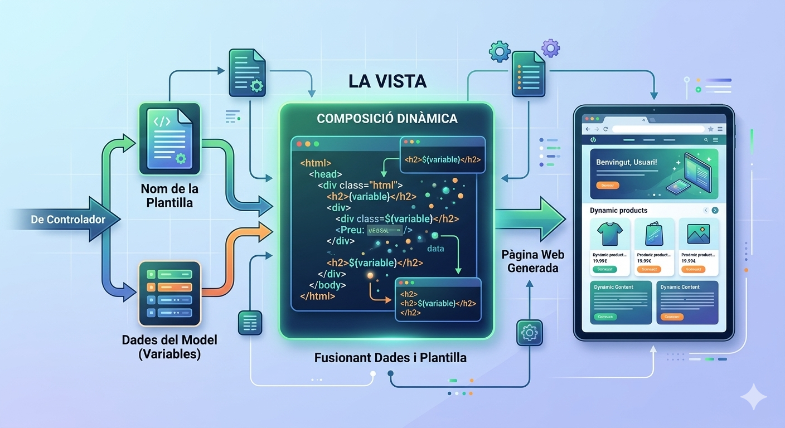
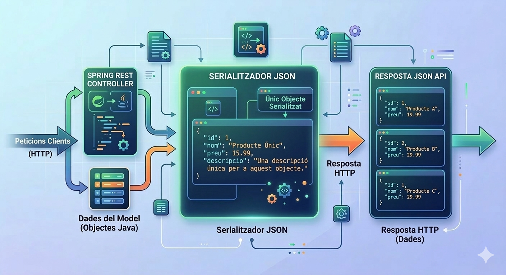
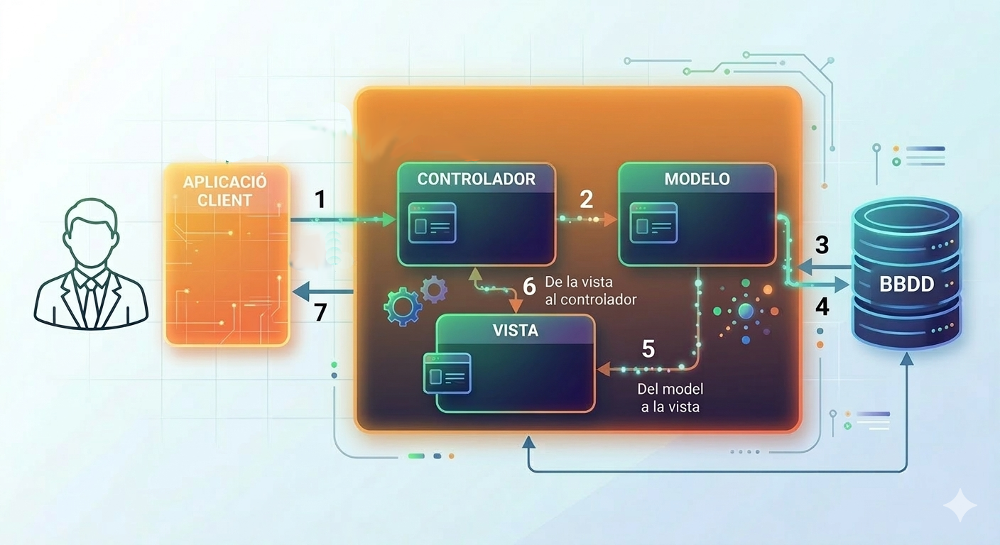

# Bloque 2. Modelo, Vista, Controlador (MVC)

## 1. Definición

El patrón de diseño **Modelo-Vista-Controlador (MVC)** es una arquitectura de programación que separa una aplicación en tres componentes principales: el **Modelo**, la **Vista** y el **Controlador**. En ella cada parte se encarga de una responsabilidad diferente.

Aplicado a los servidores web, el **Modelo** representa los datos y la lógica de negocio, la **Vista** es la representación visual de los datos (como por ejemplo una página web) y el **Controlador** gestiona las interacciones del usuario, procesa las solicitudes y actualiza el Modelo y la Vista en consecuencia.

### 1.1. Modelo

Es la parte de la aplicación que se encarga de gestionar los datos. El Modelo es responsable de recuperar, procesar y almacenar los datos, así como de aplicar las reglas de negocio. En el contexto de una aplicación web, el Modelo puede incluir clases que representan las entidades del dominio, así como servicios que gestionan la lógica de negocio.

En nuestro caso utilizaremos un ORM (Hibernate) para gestionar la persistencia de los datos, por lo que el Modelo estará formado por las clases de entidad y los repositorios que gestionan el acceso a la base de datos.

### 1.2. Vista

La vista, dependiendo del tipo de servidor que estamos creando, puede existir o no.

#### I. Vista generada por el controlador

Si estamos haciendo una aplicación web completa, la vista será la página web generada dinámicamente a partir de las peticiones del cliente. Para generar estas páginas se utiliza una serie de plantillas (*templates*) que permiten combinar código HTML con datos procedentes del modelo.

La fusión de estos dos elementos es la página web dinámica que se devuelve al cliente.

Imagen generada por el autor con Gemini.

En Spring se suele utilizar el motor de plantillas **Thymeleaf** para generar las páginas web dinámicas. Puedes encontrar más información en [https://www.thymeleaf.org](https://www.thymeleaf.org/)

[Thymeleaf](https://www.thymeleaf.org/)

#### II. Sin Vista → API REST

A veces no necesitamos generar una página web, sino que simplemente queremos devolver datos al cliente. Estamos hablando de una **API REST**, donde la vista no es más que los datos en formato **JSON** o **XML**. En este caso, la Vista es simplemente la representación de los datos que el Modelo proporciona al Controlador. Existirá un motor de conversión entre objetos Java y JSON, como **Jackson**, que se encarga de convertir los datos del Modelo a formato JSON para devolverlos al cliente.

Al final es el cliente quien se encarga de mostrar estos datos al usuario, ya sea a través de otra aplicación web, una aplicación móvil o cualquier otro tipo de **frontend**.

Imagen generada por el autor con Gemini.

### 1.3. Controlador

El controlador es la parte de la aplicación que gestiona las interacciones del usuario. Recibe las solicitudes del cliente, procesa la información y decide qué acción tomar.

La gran ventaja de Spring respecto a los antiguos **servlets** es que el controlador no se encarga de atender las peticiones a bajo nivel, ni de analizar las peticiones del cliente (*request*), ni de generar las respuestas (*response*). Simplemente pondremos las peticiones que queremos atender y el framework se encargará de todo el proceso de gestión de las peticiones, desde la recepción hasta la respuesta. Esto nos permite centrarnos en la lógica de negocio y en la gestión de los datos, sin preocuparnos por la gestión de las peticiones y respuestas a bajo nivel.

## 2. Viaje de las peticiones

De forma gráfica, el viaje de una petición a través del patrón MVC sería el siguiente:

Imagen generada por el autor con Gemini.

1. El usuario está utilizando la aplicación cliente (normalmente un navegador o aplicación cliente), y realiza una solicitud a través del protocolo HTTP, también conocida como una **HTTP_REQUEST**. Estas solicitudes son recibidas por el **Controlador**. El controlador gestiona la lista de operaciones o eventos que puede procesar, determinados por su propio código.
2. Habitualmente el controlador no podrá suministrar la información por sí mismo, por lo que necesitará una consulta o modificación de los datos. Pasará los parámetros proporcionados en la solicitud al **Modelo**. Esta capa accede a los datos, realizando los pasos 3 y 4 a través de operaciones del SGBD. La tarea del modelo se ha dividido en dos pasos:
    - Consultar la base de datos.
    - Recuperación de la consulta de la base de datos.
3. El **Modelo** transfiere el conjunto de resultados obtenidos a la **Vista**.
4. La **Vista** es la responsable de recibir los datos y presentarlos o darles el formato adecuado, según el tipo de aplicación (web (HTML) o API REST (JSON)).
5. El **Controlador** devuelve la presentación generada por la vista a la aplicación cliente, a través de la respuesta **HTTP_RESPONSE**.

Es el momento de crear nuestro primer controlador. Continuamos en el siguiente capítulo.
