# Bloque 3. Primer controlador

## 1. Primera ejecución

Veamos qué archivos se han creado en nuestro proyecto. Como podéis ver, solo una clase con una función principal:

```java
package com.svillaponce.primer_proyecto;

import org.springframework.boot.SpringApplication;
import org.springframework.boot.autoconfigure.SpringBootApplication;

@SpringBootApplication
public class PrimerProyectoApplication {

    public static void main(String[] args) {
        SpringApplication.run(PrimerProyectoApplication.class, args);
    }

}
```

Se ejecutará una **SpringApplication**, de la misma manera que se ejecuta un **Thread**. Esta clase inicializa y lanza la aplicación Spring, con argumentos, si los hay.

### 1.1. Anotación `@SpringBootApplication`

En Spring Boot, es muy común aplicar múltiples anotaciones a la clase principal. Pero comúnmente, la mayoría de los desarrolladores aplican principalmente 3 anotaciones.

- **`@Configuration`:** Disponible desde la versión 3 de Spring, nos ofrece la posibilidad de realizar una anotación que se encargará de definir la clase que la posee como una clase de configuración. Esta configuración para el framework Spring se basará en anotaciones. Y no como en sus orígenes, que se basaba en XML, lo que lo hacía más complejo. Otro propósito de esta anotación será permitir la inyección de dependencias.
- **`@EnableAutoConfiguration`:** La configuración automática de Spring Boot intenta configurar automáticamente tu aplicación Spring en función de cualquier dependencia de jar que hayas añadido. Si, por ejemplo, pones un HSQLDB (sistema de gestión de bases de datos) en tu classpath, y no has configurado manualmente ningún bean de conexión a la base de datos, Spring Boot configura automáticamente una base de datos en memoria.
- **`@ComponentScan`:** Se utiliza junto con **`@Configuration`** para decir a Spring dónde buscar los componentes, y será dentro del paquete que hemos anotado. Solo teniendo que escribirlo una vez, pudiendo hacer que todos los paquetes sean hijos del paquete de la clase padre (la que contiene el **main**). Básicamente, esto dice a Spring dónde debe buscar todos los componentes.

Para poder utilizar este paquete de tres anotaciones, Spring Boot nos ofrece **`@SpringBootApplication`** como la unión de las tres anotaciones explicadas anteriormente y algunas más.

!!! tip "Consejo"
    Spring como aplicación web:

    - no interactúa con el usuario directamente, y esperará y servirá a muchos clientes. Por esta razón, no es una buena idea hacer programas interactivos con usuarios.
    - no tendrá entradas desde consola, pero sí es buena idea imprimir mensajes en la consola, mediante logs ya que es la manera más fácil de ver qué está pasando en la aplicación.

Para ejecutar nuestra aplicación Spring:


Y aparecerá en la consola un registro similar a:

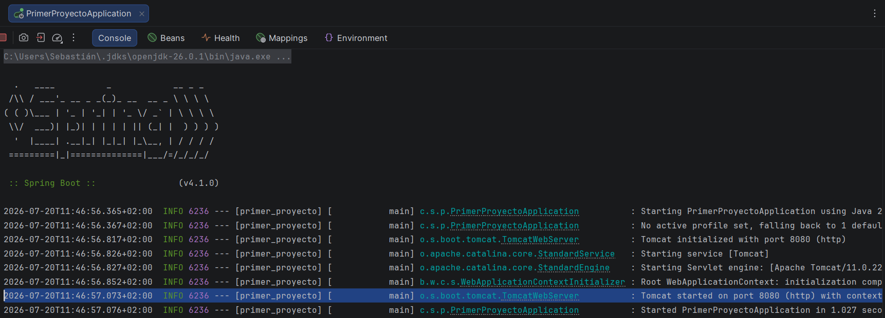

La primera cosa importante que debéis ver es el puerto en el que el servidor Tomcat está escuchando. Por defecto es el puerto **8080**:

```java
... Tomcat started on port(s): 8080 (http) with context path
```

Y cuando detenemos nuestro programa:

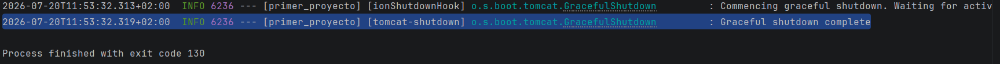

```java
... [tomcat-shutdown] o.s.boot.tomcat.GracefulShutdown : Graceful shutdown complete
```

!!! tip "Consejo"
    Recordad que es muy útil leer todos estos mensajes, especialmente cuando algo no funciona como se espera.

Para mostrar que nuestro programa funciona correctamente, necesitamos probar el puerto específico y después ir a nuestro navegador y escribir [**http://localhost:8080**](http://localhost:8080).

[http://localhost:8080](http://localhost:8080)

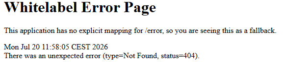

El mensaje de error que obtenemos **Whitelabel Error Page**, no es un error en absoluto, ya que no hemos programado ningún controlador, es decir, el servidor está funcionando, pero no está sirviendo nada.

## 2. `application.properties`

El alma de los proyectos Spring Boot es el archivo **`application.properties`**, donde podemos configurar la base de nuestro proyecto. El archivo **`application.properties`** se encuentra en **`src/main/resources/application.properties`**.

Este archivo, como todos los archivos de propiedades, tiene una estructura de **pareja atributo-valor.** Muchos valores de los atributos están preestablecidos, y se pueden crear otros según nuestras necesidades, como pueden ser constantes de nuestro programa o contraseñas.

```java
# puerto de escucha
server.port = 9090

app.name = Hola desde Spring
app.developer = Sebastian Villa Ponce
```

!!! note "Corrector de código"
    En este caso, hemos cambiado el puerto de escucha a **9090**, y hemos creado dos propiedades más, **app.name** y **app.developer**, que son propiedades personalizadas que podemos utilizar en nuestro programa.

    Es probable que tu editor de código no reconozca las propiedades y las subraye. No es un error, simplemente significa que no son propiedades preestablecidas.

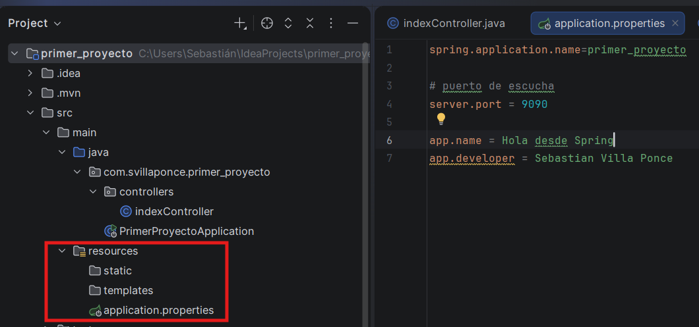

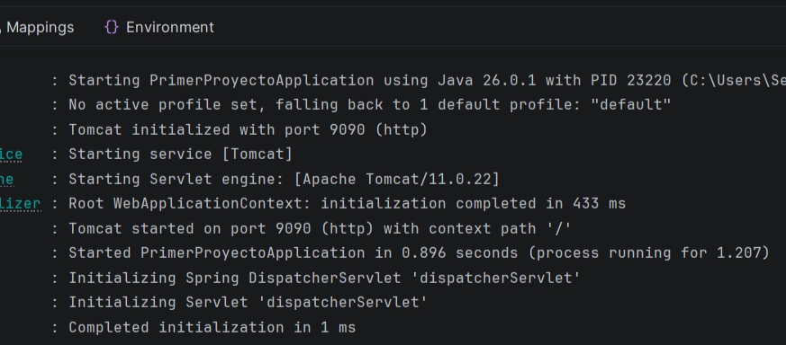

Si volvemos a ejecutar nuestra aplicación, debemos cambiar el puerto en el navegador para acceder a nuestro servidor.

!!! tip "Consejo"
    Poco a poco iremos completando con más propiedades nuestro archivo **`application.properties`**, como conexiones a BBDD o configuraciones de seguridad. Podéis ver (casi) todas las propiedades visitando esta [página web](https://docs.spring.io/spring-boot/docs/current/reference/html/application-properties.html).

    [docs.spring.io](https://docs.spring.io/spring-boot/docs/current/reference/html/application-properties.html)

!!! warning "Peligro"
    **Spring Tool Suite →** Me he encontrado veces que el proyecto da algún error al copiar y pegar código de algún **`application.properties`** de Internet o mío propio. No poner acentos ni caracteres especiales como **ñ** o **ç**.

    **IntelliJ →** No he tenido este problema, pero si lo tenéis, podéis probar a cambiar la codificación del archivo a **UTF-8**. Para hacer esto, haced clic derecho sobre el archivo **`application.properties`**, después en **File → File Properties → File Encoding**, y seleccionad **UTF-8**. **Lo normal es que para los ficheros `.properties` no os deje modificar la codificación de `UTF-8` .**

    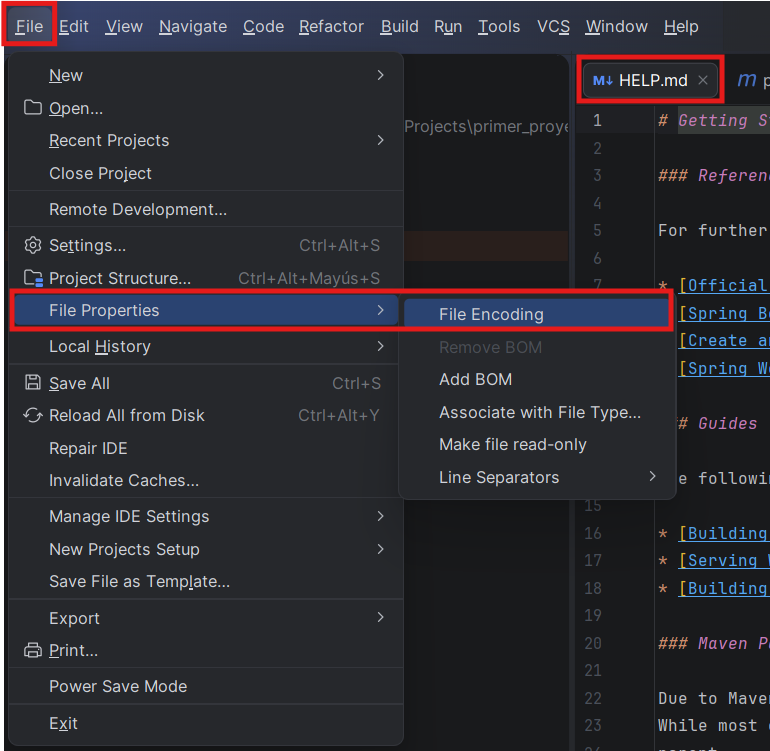

    

## 3. Controladores y Controlador Rest

Un controlador es el responsable de responder a eventos que le generan los potenciales clientes. Normalmente, estos eventos son acciones (solicitudes o **requests**) que los clientes envían al servidor, y el controlador es el responsable de procesar estas solicitudes y devolver una respuesta adecuada (respuesta o **response**).

!!! note "Similitud"
    En un contexto de la vida real, un controlador es como un camarero; él o ella está esperando detrás de la barra hasta que llegue un cliente. El cliente pide una coca-cola, y el camarero, si la tiene, la servirá. Después llega otro cliente, y pide un café, y entonces el camarero lo sirve. Otro cliente llega, y pide un té verde, y el camarero dice que no lo puede servir, porque no tiene. Una y otra vez... El camarero servirá todo lo que el cliente quiera, si puede.

    El camarero puede requerir de alguien más para elaborar el producto, como puede ser el cocinero, pero el camarero es el responsable de servirlo al cliente. El camarero es el controlador, y el cocinero es un servicio que el controlador puede utilizar para elaborar el producto que el cliente ha pedido.

Desde el punto de vista informático, el controlador será un subproceso (gobernado por un hilo de ejecución o **Thread**) que estará en un bucle infinito. Cuando recibe una petición, si la tiene dentro de su catálogo de peticiones (la carta del camarero), el controlador lanzará otro hilo de ejecución para procesar la petición, y el controlador volverá a su bucle infinito, esperando a que llegue otra petición. El controlador es el responsable de gestionar las peticiones y de delegarlas a los servicios que sean necesarios para procesarlas.

!!! question "¿Tengo que lanzar hilos de ejecución para cada petición?"
    No, no es necesario. Spring Boot se encarga de gestionar los hilos de ejecución por nosotros. Cuando una petición llega al controlador, Spring Boot lanza un hilo de ejecución para procesarla, y cuando la petición ha sido procesada, el hilo de ejecución se cierra automáticamente.

### 3.1. Paquete `controllers`

Vamos a crear un controlador, pero primero, tenemos que crear un paquete que contenga este controlador. Antes hablábamos de la anotación **`@SpringBootApplication`**, que es equivalente a tener 3 anotaciones. Una de ellas era **`@ComponentScan`**. Esta anotación hace que Spring busque en los paquetes y subpaquetes de la clase principal para encontrar componentes. Por esta razón, es una buena práctica crear un paquete que contenga los controladores, y este paquete debe ser un subpaquete del paquete de la clase principal. A este paquete lo llamaremos **`controllers`**.

Para hacer esto, haced clic derecho sobre el paquete que contiene el **main**. De esta manera, cuando vayamos a poner el nombre directamente nos aparecerá el **com.example** y solo tendremos que añadir un **`.`** y el nombre del paquete hijo. Si no, tendríamos que escribir el nombre completo del paquete.

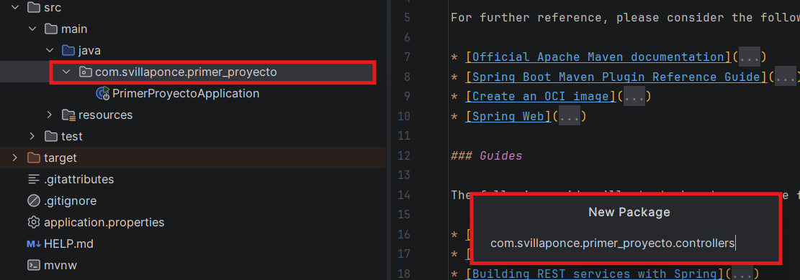

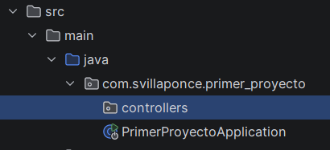

Vamos a crear una clase sencilla que controle el índice de nuestra aplicación. Por esta razón, debemos crear dentro del paquete **`controllers`** la clase **`indexController.java`**. Recordad que índice se refiere al dominio principal de nuestro servidor/aplicación.

!!! question "Ayudemos a entender el comportamiento de las clases"
    Es una buena práctica establecer nombres de clases descriptivos siguiendo reglas sencillas para entender el comportamiento de la clase. Así, una clase llamada **`clientController`** es el controlador que mapea información sobre **`Client`**, y **`filmController.java`** trata sobre **`Films`**. Es decir, añadiremos el sufijo del comportamiento de dicha clase.

Una vez nuestra clase ha sido creada, debemos configurarla. Añadiendo el siguiente código a nuestra clase **indexController.java**:

```java
@Controller
public class indexController {

    @GetMapping("/")
    @ResponseBody
    public String helloWorld() {
        return "Hello from Spring";
    }

}
```

Mirad nuestras anotaciones:

- **`@Controller`** → dice a Spring que esta clase es un controlador. Es una especialización de **`@Component`**, y como Spring explora todo el **`classpath`**, se detecta automáticamente. Spring se encargará de mapear los recursos que contiene dicha clase.
- **`@GetMapping("/")`** → es un método del controlador. Definimos una ruta ("/") en nuestro servidor que atenderá la petición HTTP, y escuchamos el método **GET**. Hablaremos más adelante, pero puedes intuir que hay otros métodos como **`@PostMapping`**, **`@PutMapping`**, **`@DeleteMapping`**, etc. que escuchan otros tipos de peticiones HTTP.
- **`@ResponseBody`** → dice al controlador que serialice el valor de retorno (una cadena en nuestro ejemplo) a JSON y lo envíe dentro del cuerpo (**BODY**) del **`http_response`** al cliente que llama al controlador. Si no ponemos esta anotación...

!!! info "Funcionamiento exacto de `@ResponseBody`"
    Normalmente, cuando un método de un controlador devuelve un **String**, Spring asume que es el nombre de una vista y el **`ViewResolver`** intentará renderizar una página web mediante unas definiciones de plantillas.

    Como nosotros queremos hacer una **API Rest**, no necesitamos renderizar ninguna página web, sino que queremos devolver datos. Por esta razón, debemos añadir la anotación **`@ResponseBody`** a nuestro método. Entonces el tipo devuelto se transforma y se inyecta dentro del cuerpo de la respuesta. Si se devuelve un objeto, como haremos más adelante, generalmente la biblioteca **Jackson**, que viene por defecto en Spring Boot, tomará este objeto y lo transformará automáticamente a un formato como JSON antes de enviarlo al cliente.

Ahora, si intentamos recargar la página en el navegador, en lugar de un mensaje de error, obtendremos el valor devuelto por el controlador.

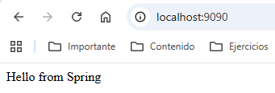

Añadimos otro controlador y veamos cómo cargar las propiedades de nuestro archivo **`application.properties`**:

```java
// dentro de la clase indexController.java
@Value("${app.name}")
String saludo;

@GetMapping("/hola")
@ResponseBody
public String hola() {
    return saludo;
}
```

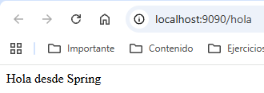

Respuesta a la petición [http://localhost:9090/hola](http://localhost:9090/hola)

### 3.2. Forzando las respuestas

Como habrás podido observar, nuestros métodos deben devolver toda la información dentro del cuerpo de la respuesta. Entonces estamos anotándolos todos como **`@ResponseBody`**. Pero si queremos que todos los métodos de un controlador devuelvan la información dentro del cuerpo de la respuesta, podemos anotar la clase con **`@RestController`** en lugar de **`@Controller`**. Esta anotación es una especialización de **`@Controller`** que incluye **`@ResponseBody`** por defecto, por lo que no será necesario anotar cada método con **`@ResponseBody`**.

Además, si queremos forzar que todos los métodos escuchen dentro de una ruta concreta (que es muy común), podemos anotar la clase con **`@RequestMapping("/api")`**, y entonces todos los métodos escucharán dentro de la ruta **/api**. Por ejemplo, el método **`hola()`** escuchará dentro de la ruta **`/api/hola`**. Así finalmente, nuestro controlador quedaría así:

```java
@RestController
@RequestMapping("/api")
public class indexController {

    @GetMapping()
    public String helloWorld() {
        return "Hello from Spring";
    }

    @Value("${app.name}")
    String saludo;

    @GetMapping("/hola")
    public String hola() {
        return saludo;
    }
}
```

## 4. Recibiendo parámetros a través de la URL

Nuestros controladores pueden recibir información desde el cliente de 3 maneras diferentes:

1. A través de la **URL**, mediante **parámetros de consulta**.
2. A través de la **URL**, mediante **parámetros de ruta**.
3. A través del **cuerpo de la petición**, mediante un **objeto JSON**.

Vamos a ver unos ejemplos de cada uno de estos casos, ya que serán ampliados más adelante.

### 4.1. Parámetros de consulta

Son los parámetros que se envían a través de la URL después del símbolo **?**. Por ejemplo, si tenemos la URL [http://localhost:9090/api/saludo?nombre=Sebas](http://localhost:9090/api/saludo?nombre=Sebas), el parámetro de consulta es **`nombre`** y su valor es **`Sebas`**.

Podemos recibir este parámetro de consulta en nuestro controlador mediante la anotación **`@RequestParam`**. Por ejemplo:

```java
@GetMapping("/saludo")
public String saludo(
    @RequestParam String nombre,
    @RequestParam(name="años", required=false, defaultValue="18") int edad){
    return "Hola " + nombre + ". Tienes " + edad + " años.";
}
```

!!! warning "Atención"
    En `@RequestParam`, `defaultValue` siempre debe ser un `String`, aunque el parámetro sea `int`.

!!! warning "Errores comunes"
    Si el parámetro de consulta es **obligatorio** y no se proporciona, Spring Boot devolverá un error **400 (Bad Request)** al cliente.

    Si en `@RequestParam` usas el atributo `name` para dar un nombre personalizado DIFERENTE, se tiene que respetar en la URL el nombre que se espera, si no quieres un nombre diferente al de la variable original, no uses el atributo.

La anotación **`@RequestParam`** indica que necesita un parámetro que cumpla las restricciones que se piden por código (si las tiene). Si no ponemos nada el nombre será el mismo que el nombre del parámetro del método, pero si queremos que sea diferente, podemos especificarlo con las siguientes propiedades importantes:

- **`name`** o **`value`** → el nombre del parámetro de consulta que queremos recibir en la `URL`. Si el nombre del parámetro de consulta es el mismo que el nombre del parámetro del método, no es necesario especificar esta propiedad.
- **`required`** → indica si el parámetro de consulta es obligatorio o no. Por defecto es **`true`**, pero si lo ponemos a **`false`**, el **parámetro** de consulta será **opcional**.
- **`defaultValue`** → **si** el **parámetro** de consulta es **opcional**, podemos especificar un **valor** por **defecto** que se utilizará si el parámetro de consulta no se proporciona.

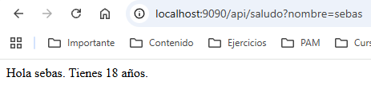


### 4.2. Parámetros de ruta

En este caso nos encontramos con parámetros que forman parte de la ruta, y no de la consulta. Por ejemplo:

Si tenemos la URL [http://localhost:9090/api/saludo/Sebas](http://localhost:9090/api/saludo/Sebas), el parámetro de ruta es **Sebas**.

Por ejemplo [http://localhost:9090/api/pelis/17/actores](http://localhost:9090/api/pelis/17/actores), estamos solicitando de la película con **ID 17** todos los actores.

```java
@GetMapping("/cursos/{year}")
public String cursoAnyo(
        @PathVariable(name = "year", required = true) int any){
    return "Estamos en el curso del año " + any;
}
```

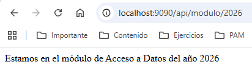

### 4.3. Parámetros del cuerpo de la petición

Dejaremos este tipo de parámetros para más adelante, ya que necesitaremos crear un objeto para recibir la información desde las aplicaciones cliente. Básicamente, se trata de recibir un objeto JSON en el cuerpo de la petición y mapearlo a un objeto Java mediante la anotación **`@RequestBody`**.

---

➡️ **Práctica de esta unidad:** [Práctica 5](../practicas/practica-up3-1.md)
