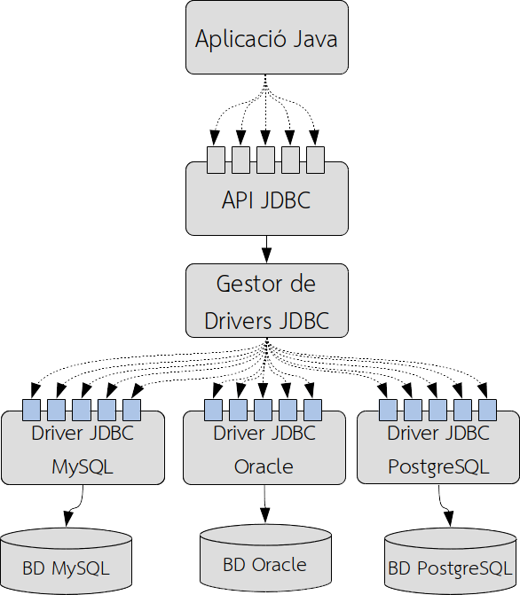
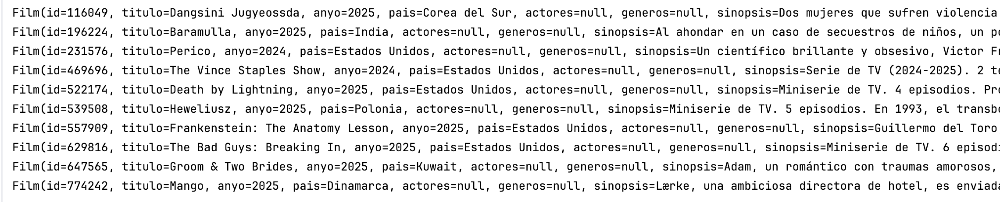

# Bloque 2. Desfase `Objeto-Relacional`. JDBC

## 1. ¿Qué es JDBC? (Java Database Connectivity)

JDBC (*Java Database Connectivity*) es una API (*Application Programming Interface*) de Java que permite a los desarrolladores conectarse a bases de datos y ejecutar consultas SQL desde sus aplicaciones Java. JDBC proporciona un conjunto de interfaces y clases que facilitan la comunicación entre una aplicación Java y una base de datos relacional.



Dicho de otra manera, JDBC es un puente que comunica nuestras aplicaciones Java con un SGBD. La ventaja que ofrece es que, si cambiamos el SGBD subyacente, no es necesario modificar el código de nuestra aplicación, ya que JDBC se encarga de gestionar las diferencias entre los distintos SGBD.

Como podemos ver, las aplicaciones Java acceden a los diferentes métodos que la API especifica como interfaces, pero son los controladores (*drivers*) los que acceden realmente a la base de datos.

Cabe destacar que las aplicaciones pueden utilizar varios controladores JDBC simultáneamente y acceder, por tanto, a múltiples bases de datos. La aplicación especifica un controlador JDBC utilizando una URL (*Universal Resource Locator*) al gestor de controladores, y este es el responsable de establecer correctamente las conexiones con las bases de datos a través de los controladores.

## 2. ¿Qué es el desfase Objeto-Relacional?

Los **Sistemas de Gestión de Bases de Datos (SGBD)** se basan principalmente en el modelo **Entidad-Relación (E/R)**, donde la información se almacena en diversas **tablas relacionadas** entre sí. Es una tecnología sencilla y eficiente, que ha resistido el paso de los años y que sigue siendo el modelo utilizado por la mayoría de las bases de datos y SGBD en la actualidad. A pesar de su éxito, el modelo presenta algunas limitaciones, como la representación de información poco estructurada o compleja.

Los modelos conceptuales nos ayudan a modelar una realidad compleja y se basan en un proceso de **abstracción de la realidad**. Cada modelo tiene una forma de capturar esa realidad, pero todos ellos están más próximos a la forma de pensar del ser humano que a la memoria de un ordenador.

Cuando modelamos una base de datos, utilizamos el modelo conceptual **Entidad-Relación** y, posteriormente, realizamos un **proceso de transformación a tablas y normalización** de dicho modelo para obtener un **modelo de datos relacional**.

En el caso de la **programación orientada a objetos**, intentamos representar la realidad mediante **objetos** y las relaciones entre ellos. Este es otro tipo de modelo conceptual, pero cuyo objetivo es representar la misma realidad que el modelo relacional.

Así pues, tenemos dos aproximaciones diferentes para representar la realidad de un problema:

- El **modelo relacional** de la base de datos.
- El **modelo orientado a objetos** de nuestras aplicaciones.

Una de las principales dificultades son las relaciones entre entidades, ya que en el **modelo relacional** se representan mediante **claves ajenas**, almacenando únicamente el campo identificador de la entidad relacionada, mientras que en el **modelo orientado a objetos** se representan mediante **referencias a otros objetos**.

Otro problema, independiente de las relaciones, es el proceso de carga de datos, ya que en el modelo relacional toda la información se carga en forma de tablas, representadas en Java por la clase `ResultSet`. Es tarea del programador convertir esa información en objetos.

Sería muy interesante poder recuperar directamente objetos y referencias, en lugar de claves ajenas que haya que resolver para acceder a la información necesaria. Para ello existen las **ORM (*Object-Relational Mapping*)**, que son herramientas que permiten mapear las tablas de la base de datos a clases y objetos de Java, y gestionar automáticamente las relaciones entre ellos.

## **3. Procedimiento clásico de lectura de datos**

Antes de pasar a los ORM, revisemos un ejemplo básico de cómo leer datos de una base de datos MySQL utilizando JDBC. Supongamos que tenemos una base de datos MySQL con una tabla `film`:


Queremos obtener las películas que hay en la base de datos.

```java
public static void main(String[] args) {

    String user = "root";
    String pass = "******";
    String port = "3308";
    String host = "localhost";
    String database = "filmaffinity";
    String connectionUrl = "jdbc:mysql://" + host + ":" + port + "/" + database;

    Connection conn = null;
    try {
        conn = DriverManager.getConnection(connectionUrl, user, pass);

        String SQL = "Select * from film";
        Statement st = conn.createStatement();
        ResultSet rs = st.executeQuery(SQL);

        List<Film> peliculas = new ArrayList<>();
        while (rs.next()) {
            Film f = new Film();
            f.setId(rs.getString("id"));
            f.setTitulo(rs.getString("titulo"));
            f.setAnyo(rs.getInt("anyo"));
            f.setPais(rs.getString("pais"));
            f.setSinopsis(rs.getString("sinopsis"));
            f.setNota(rs.getFloat("nota"));
            peliculas.add(f);
        }

        for (Film f : peliculas) {
            System.out.println(f);
        }

        rs.close();
        conn.close();

    } catch (SQLException e) {
        throw new RuntimeException(e);
    }
}
```

El resultado será la impresión de todas las películas que hay en la base de datos, con sus correspondientes datos.



!!! note "Observaciones"
    - El código de conexión a la base de datos está ***hard coded***, es decir, los datos de conexión están escritos directamente en el código. En una aplicación real, estos datos se encontrarían en un archivo de configuración para facilitar el mantenimiento y mejorar la seguridad.
    - El proceso de lectura de datos es muy manual y propenso a errores, ya que es necesario gestionar las conexiones, las consultas SQL y la conversión de los datos del `ResultSet` a objetos Java.
    - Piensa cuánto crecería el código si quisiéramos cargar, por ejemplo, los actores que participan en cada película.

    Pasemos al siguiente apartado para ver cómo los **ORM** pueden ayudarnos a simplificar este proceso.
