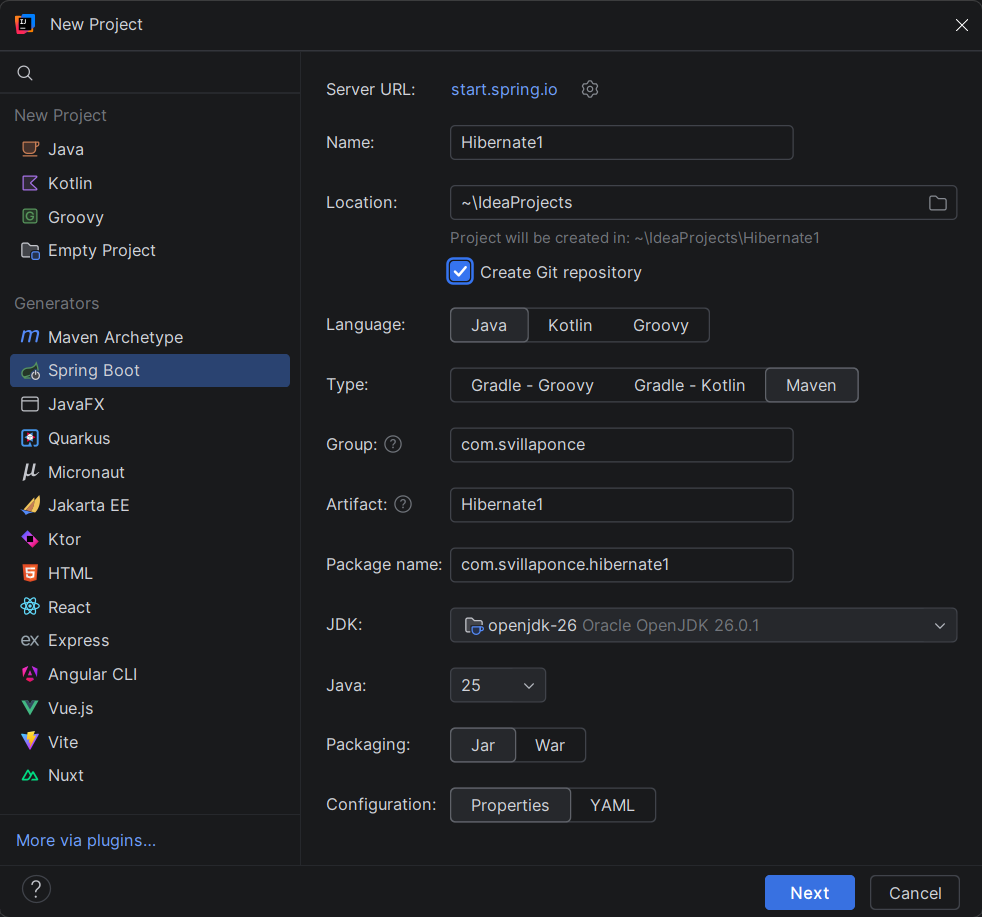
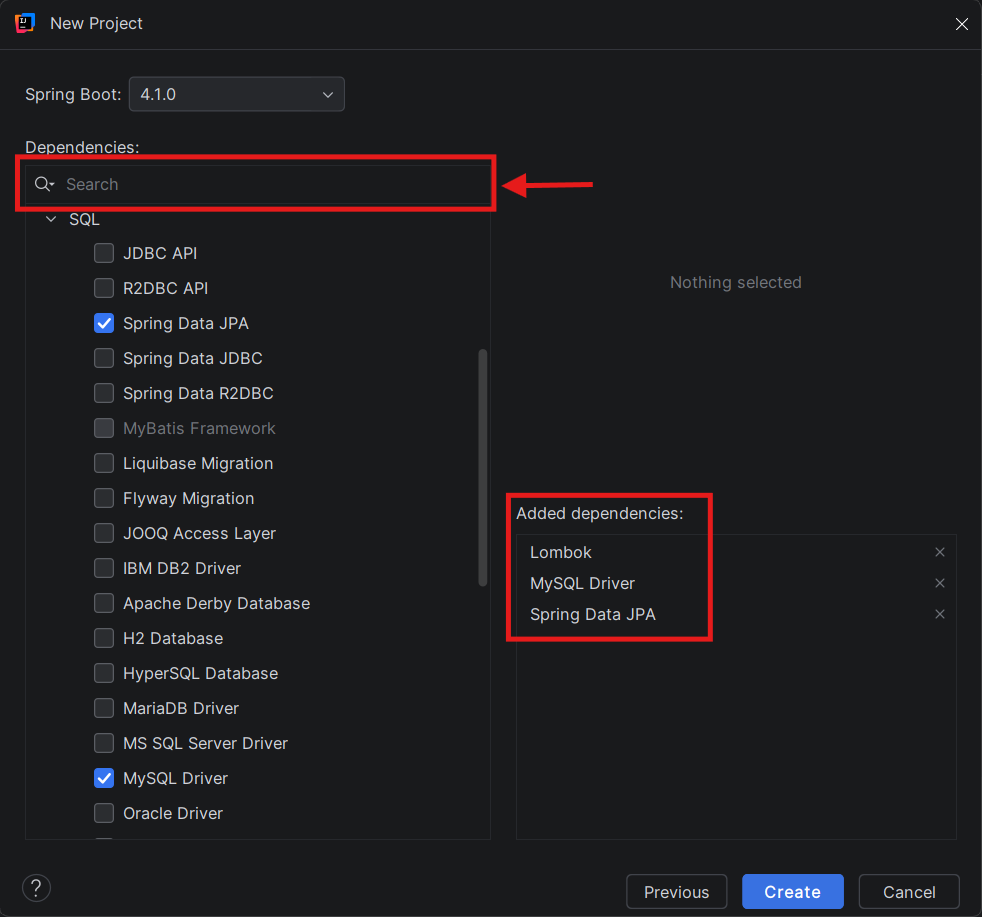
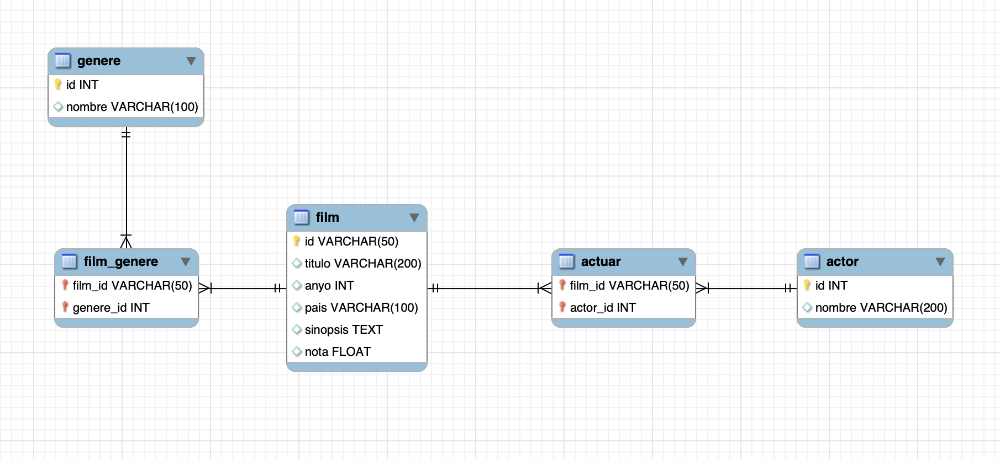
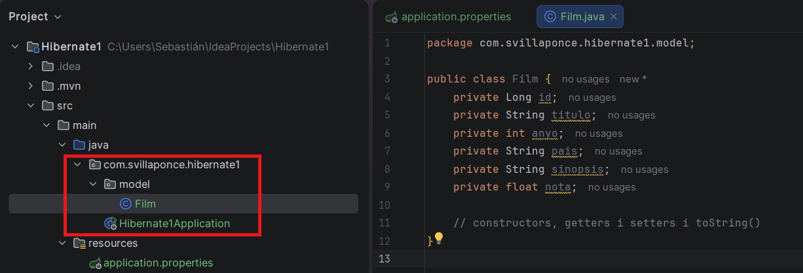
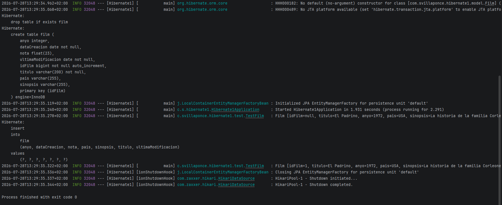
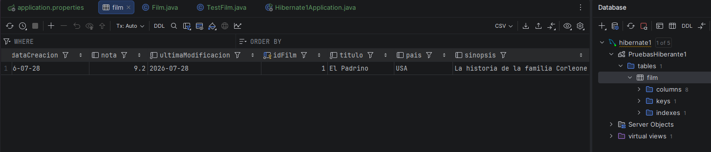

# Bloque 3. Hibernate. Mapeo de Entidades


## 1. ¿Qué es Hibernate?

[**Hibernate**](https://hibernate.org/) es un framework ORM para Java que facilita la correspondencia de atributos entre una base de datos relacional y el modelo de objetos de nuestra aplicación mediante archivos XML o anotaciones en los *beans* de entidad. Es un software libre distribuido bajo la licencia GPL 2.0, por lo que puede utilizarse en aplicaciones comerciales.

La función principal de Hibernate es ofrecer al programador las herramientas necesarias para **definir su modelo de datos y las relaciones entre ellos**, de manera que sea el propio ORM quien interactúe con la base de datos, mientras que el desarrollador se dedica a manipular objetos.

Con ello, el programador puede centrarse en la lógica de negocio, mientras que Hibernate se encarga de las operaciones de persistencia y consulta sobre la base de datos.

Además, ofrece un lenguaje de consulta denominado **HQL (Hibernate Query Language)**, de forma que sea el propio ORM quien traduzca este lenguaje al correspondiente de cada motor de base de datos, manteniendo así la portabilidad a costa de un ligero aumento en el tiempo de ejecución.

Con HQL las consultas se realizan sobre los objetos y sus atributos, en lugar de sobre las tablas y columnas de la base de datos, como ocurre con SQL.

!!! note
    ### ¿Qué necesito hacer con Hibernate?

    Inicialmente, Hibernate requería configuraciones muy detalladas mediante archivos XML. Era habitual encontrar:

    - `hibernate.cfg.xml`, donde se detallaban las propiedades de conexión a la base de datos, el dialecto SQL que debía utilizarse, las clases que se iban a mapear, etc.
    - Para cada clase que se iba a mapear, un archivo XML donde se especificaban las propiedades de la clase, como el nombre de la tabla a la que se asociaba, los atributos correspondientes a las columnas de la tabla, las relaciones con otras clases, etc.
    - Una clase de configuración (`HibernateUtil`) donde se cargaba el archivo `hibernate.cfg.xml` y se creaba el `SessionFactory`, que posteriormente se utilizaba para obtener las sesiones de conexión a la base de datos.

!!! tip
    ### ¿Qué tendré que hacer con Spring?

    - **Mapeo dentro de las clases mediante anotaciones JPA (Java Persistence API).** Afortunadamente, en la actualidad pueden utilizarse anotaciones en las clases de entidad para definir toda esta información, evitando así la necesidad de crear archivos XML. Esto hace que el código sea más limpio y fácil de mantener, ya que toda la información relacionada con la persistencia de los datos se encuentra en un único lugar: **las clases de entidad**.
    - **Configuración mediante el archivo `application.properties`.** Además, Spring Boot se encarga de configurar Hibernate automáticamente a partir de las propiedades que indiquemos en el archivo `application.properties`.
    - **Se elimina la necesidad de crear una clase de configuración para Hibernate**, ya que Spring realiza esta tarea automáticamente.

## 2. JPA (Java Persistence API)

JPA es una especificación de Java que define un conjunto de interfaces y anotaciones para la gestión de la persistencia de datos en aplicaciones Java. Está diseñada para ser utilizada con diferentes implementaciones de ORM, indicando cómo debe realizarse el mapeo entre las clases de entidad y las tablas de la base de datos, así como las relaciones entre ellas.

Los principales objetivos de JPA son:

- **Evitar el "SQL de bajo nivel".** En lugar de tener que escribir consultas de texto como `INSERT INTO usuarios VALUES (...)` utilizando JDBC, JPA permite trabajar directamente con objetos Java (*Entities*). JPA traduce automáticamente las operaciones a SQL.
- **Simplificar las operaciones CRUD.** Las operaciones básicas de Crear, Leer, Actualizar y Eliminar datos se reducen a simples llamadas a métodos, como `persist()`, `find()` o `remove()`.
- **Independencia de la base de datos (Portabilidad).** Si cambiamos de MySQL a PostgreSQL, con JPA el cambio resulta prácticamente transparente. El proveedor de JPA (como Hibernate) se encarga de generar el dialecto SQL específico para la nueva base de datos sin necesidad de reescribir las consultas.
- **Gestión de relaciones y tablas.** Permite mapear fácilmente las tablas y relaciones de la base de datos. Además, permite comprobar que las clases coinciden con la estructura de la base de datos o incluso generar la base de datos a partir de las clases de entidad.

### 2.1. Un poco de historia

Conviene indicar que **JPA es una especificación, no una implementación**. Esto significa que JPA define cómo debe comportarse un ORM, pero no es un ORM por sí mismo. Para utilizar JPA necesitamos una implementación concreta que siga dicha especificación.

Inicialmente, Oracle creó las especificaciones empresariales de Java, conocidas como **Java EE**. Durante muchos años, la implementación fue propietaria de Oracle y utilizaba el espacio de nombres `javax`. Todos los paquetes estándar comenzaban por `javax.*` (por ejemplo, `javax.persistence.Entity`).

Hacia el año 2017, Oracle decidió ceder todo este ecosistema a la **Fundación Eclipse** para que fuera gestionado por la comunidad de software libre. Oracle cedió el código, pero no la marca registrada **Java**, por lo que la Fundación Eclipse no podía seguir publicando nuevas versiones bajo el nombre `javax`.

Finalmente, la Fundación Eclipse renombró **Java EE** como **Jakarta EE**. A partir de la versión 9 de Jakarta EE se produjo el cambio más importante: todos los paquetes `javax.*` pasaron a denominarse obligatoriamente `jakarta.*`.

## 3. Preparamos nuestro proyecto

Vamos a comenzar a utilizar Hibernate en nuestra aplicación Spring Boot.

Crearemos un nuevo proyecto Spring:



Añadimos las siguientes dependencias:

- **MySQL Driver:** Para conectar con la base de datos MySQL.
- **Spring Data JPA:** Para utilizar las funcionalidades de JPA e Hibernate.
- **Lombok:** Librería para Java que reduce el código repetitivo ***(boilerplate code)*** mediante anotaciones.



### 3.1. Definición de la conexión con la base de datos

Para configurar la conexión con la base de datos, vamos al archivo `application.properties` y añadimos las siguientes propiedades:

```java
# Driver JDBC
spring.datasource.driver-class-name=com.mysql.cj.jdbc.Driver

# Conexión al SGBD
spring.datasource.url=jdbc:mysql://localhost:3308/PruebasHibernate1?createDatabaseIfNotExist=true
spring.datasource.username=root
spring.datasource.password=toor

# Configuración de SQL
spring.jpa.show-sql=true
spring.jpa.properties.hibernate.format_sql=true
# spring.jpa.properties.hibernate.dialect=org.hibernate.dialect.MySQLDialect

# hbm2DDL. Valores: none, validate, update, create y create-drop
spring.jpa.hibernate.ddl-auto=create

# Respetar el nombre de las tablas y columnas
spring.jpa.hibernate.naming.physical-strategy=org.hibernate.boot.model.naming.PhysicalNamingStrategyStandardImpl
```

!!! note
    #### hbm2DDL - Hibernate Mapping to Data Definition Language

    En el entorno de Hibernate, **hbm2DDL** es una propiedad que controla cómo Hibernate gestiona el esquema de la base de datos. Esta propiedad dispone de varios valores posibles, cada uno con un comportamiento diferente:

    - **`create`** → Hibernate eliminará el esquema de la base de datos existente (las tablas) y creará un nuevo esquema basado en las entidades definidas en las clases Java. Esto significa que se perderán todos los datos existentes al iniciar la aplicación. Es útil durante el desarrollo cuando se desea comenzar con una base de datos limpia en cada ejecución. Al detener la aplicación, las tablas permanecerán en el SGBD.
    - **`create-drop`** → Similar a `create`, pero además Hibernate eliminará el esquema de la base de datos cuando finalice la ejecución de la aplicación.
    - **`validate`** → Hibernate comprobará que el esquema de la base de datos coincide con las entidades definidas en las clases Java. Si existe alguna discrepancia, Hibernate lanzará una excepción y la aplicación no se iniciará. No realiza ningún cambio sobre la base de datos.
    - **`update`** → Hibernate validará el esquema de la base de datos y, si detecta cambios, realizará las modificaciones necesarias para que el esquema coincida con las entidades definidas en las clases Java. Es útil durante el desarrollo cuando se desea conservar los datos existentes y, al mismo tiempo, mantener actualizado automáticamente el esquema de la base de datos. No elimina los datos existentes.
    - **`none`** → Hibernate no realizará ninguna acción relacionada con el esquema de la base de datos. Es útil en entornos de producción donde se desea tener un control total sobre el esquema y evitar que Hibernate realice modificaciones automáticas.

Con esta configuración ya podemos comenzar a crear nuestras clases de entidad y comprobar cómo Hibernate las mapea automáticamente a la base de datos.

## 4. Mapeo de entidades

Vamos a mapear, mediante un ejemplo, una nueva entidad `Film`, tal y como se muestra en el siguiente esquema:



Necesitaremos crear inicialmente un nuevo paquete dentro del paquete que contiene nuestra aplicación. Lo llamaremos **`model`**.

Dentro de este paquete crearemos una nueva clase **`Film`**, que será nuestra entidad.

Su contenido será el siguiente:

```java
public class Film {
    private Long id;
    private String titulo;
    private int anyo;
    private String pais;
    private String sinopsis;
    private float nota;

    // constructors, getters i setters i toString()
}
```



!!! warning "Importante"
    Si es la primera vez que utilizas anotaciones en Java, debes tener en cuenta que las anotaciones afectan a las variables, métodos o clases a las que están asociadas. Las anotaciones están asociadas al elemento al que preceden inmediatamente.

    Por ejemplo, la sobrescritura de los métodos `toString()` se realiza mediante la siguiente sintaxis:

    ```java
    @Override
    public String toString() {}
    ```

Vamos a añadir las anotaciones de JPA para que Hibernate pueda mapear esta clase a una tabla de la base de datos. El resultado final será el siguiente:

### 4.1. Anotación `@Entity`

Esta anotación se utiliza para marcar una clase como una **entidad**, es decir, como una clase que representa una tabla de la base de datos.

### 4.2. Anotación `@Table`

Esta anotación se utiliza para especificar el nombre de la tabla de la base de datos a la que se mapea la entidad. **Si no se especifica, Hibernate utilizará el nombre de la clase como nombre de la tabla por defecto.**

Si queremos cambiarlo, deberemos indicar la propiedad `name` de la anotación `@Table`.

Por el momento, nuestra clase quedaría de la siguiente forma:

```java
import jakarta.persistence.Entity;
import jakarta.persistence.Id;
import jakarta.persistence.Table;   

@Entity
@Table(name = "films")
public class Film {
    // pendiente (Film != films)
}
```

### 4.3. Anotación `@Column`

La anotación `@Column` se utiliza para especificar las propiedades de una columna de la base de datos que corresponde a un atributo de una clase de entidad. Esta anotación puede utilizarse para personalizar el mapeo entre el atributo de la clase y la columna de la base de datos, así como para definir restricciones y características específicas de la columna.

| Modificador y tipo | Elemento opcional | Descripción |
| --- | --- | --- |
| `String` | `columnDefinition` | (Opcional) Fragmento de SQL que se utiliza al generar el DDL para la columna. |
| `boolean` | `insertable` | (Opcional) Indica si la columna se incluye en las sentencias SQL `INSERT` generadas por el proveedor de persistencia. |
| `int` | `length` | (Opcional) Longitud de la columna. |
| `String` | `name` | (Opcional) Nombre de la columna. |
| `boolean` | `nullable` | (Opcional) Indica si la columna de la base de datos puede ser nula. |
| `int` | `precision` | (Opcional) Precisión para una columna decimal (numérica exacta). |
| `int` | `scale` | (Opcional) Escala para una columna decimal (numérica exacta). |
| `String` | `table` | (Opcional) Nombre de la tabla que contiene la columna. |
| `boolean` | `unique` | (Opcional) Indica si la columna es una clave única. |
| `boolean` | `updatable` | (Opcional) Indica si la columna se incluye en las sentencias SQL `UPDATE` generadas por el proveedor de persistencia. |

!!! note
    #### **No todas son válidas**

    Las características de las columnas pueden variar según el tipo de datos que se esté mapeando. Por ejemplo, la propiedad `length` es aplicable a columnas de tipo cadena (`String`), mientras que `precision` y `scale` son aplicables a columnas de tipo numérico decimal.

    Es importante revisar la documentación de JPA y Hibernate para asegurarse de que se están utilizando las propiedades correctas para el tipo de datos que se está mapeando, ya que en algunos casos también dependen del SGBD subyacente.

### 4.4. Anotaciones `@Id` y `@GeneratedValue`

Estas anotaciones son fundamentales, ya que indican que el atributo al que afectan será la **clave primaria** de la tabla de la base de datos y que su valor será **generado automáticamente** por el SGBD.

---

### 4.5. Anotación `@Transient`

Esta anotación se utiliza para indicar que un atributo de una clase de entidad **no debe mapearse** a una columna de la base de datos. Es decir, este atributo **no será persistente** y no se almacenará ni se recuperará de la base de datos.

Esto tiene sentido cuando un atributo solo nos interesa durante el tiempo de ejecución de la aplicación, pero no queremos que forme parte de la representación de nuestra entidad en la base de datos.

### 4.6. Anotaciones de marcado temporal

Para finalizar, vamos a ver algunas otras anotaciones que podemos utilizar para definir nuestras entidades, especialmente cuando queremos conocer el momento en el que se guarda un registro en la base de datos o el momento de su última actualización. Estas anotaciones son:

- **`@CreationTimestamp`** → Esta anotación se utiliza para marcar un atributo de una clase de entidad como un campo de marca de tiempo de creación. Cuando se guarda una nueva instancia de la entidad en la base de datos, Hibernate asignará automáticamente la fecha y la hora actuales a este atributo.
- **`@UpdateTimestamp`** → Esta anotación se utiliza para marcar un atributo de una clase de entidad como un campo de marca de tiempo de actualización. Cada vez que se realiza una actualización sobre una instancia de la entidad y se guarda en la base de datos, Hibernate actualizará automáticamente la fecha y la hora actuales de este atributo.

!!! note "Algunas consideraciones"
    Lo más importante es tener claro que **no será necesario manipular estos atributos manualmente**, ya que Hibernate se encargará de gestionarlos automáticamente cada vez que se realice una operación de inserción o actualización en la base de datos.

    Estas anotaciones **no pertenecen al paquete `jakarta.persistence`**, sino que son específicas de Hibernate y se encuentran en el paquete `org.hibernate.annotations`. Se incluyen por la utilidad que pueden tener al desarrollar aplicaciones.

## 5. Código final de la clase `Film`

El código completo de la clase `Film`, con todas las anotaciones y métodos, sería el siguiente:

```java
import java.time.LocalDate;
import java.util.Objects;

import org.hibernate.annotations.CreationTimestamp;
import org.hibernate.annotations.UpdateTimestamp;

import jakarta.persistence.*;

@Entity
@Table(name = "film")
public class Film {

    @Id
    @GeneratedValue(strategy = GenerationType.IDENTITY)
    private Long idFilm;

    @Column(nullable = false, length = 200)
    private String titulo;

    @Column
    private int anyo;

    @Column
    private String pais;

    @Column
    private String sinopsis;

    @Column
    private float nota;

    @Transient
    private boolean vista;

    @UpdateTimestamp
    private LocalDate ultimaModificacion;

    @CreationTimestamp
    private LocalDate dataCreacion;

    public Film(String titulo, int anyo, String pais, String sinopsis, float nota) {
        this.titulo = titulo;
        this.anyo = anyo;
        this.pais = pais;
        this.sinopsis = sinopsis;
        this.nota = nota;
    }

    // Getters y setters

    public Long getIdFilm() {
        return idFilm;
    }

    public void setIdFilm(Long idFilm) {
        this.idFilm = idFilm;
    }

    public String getTitulo() {
        return titulo;
    }

    public void setTitulo(String titulo) {
        this.titulo = titulo;
    }

    public int getAnyo() {
        return anyo;
    }

    public void setAnyo(int anyo) {
        this.anyo = anyo;
    }

    public String getPais() {
        return pais;
    }

    public void setPais(String pais) {
        this.pais = pais;
    }

    public String getSinopsis() {
        return sinopsis;
    }

    public void setSinopsis(String sinopsis) {
        this.sinopsis = sinopsis;
    }

    public float getNota() {
        return nota;
    }

    public void setNota(float nota) {
        this.nota = nota;
    }

    @Override
    public String toString() {
        return "Film [idFilm=" + idFilm + ", titulo=" +
                titulo + ", anyo=" + anyo + ", pais=" +
                pais + ", sinopsis=" + sinopsis + ", nota=" + nota + "]";
    }

    @Override
    public int hashCode() {
        return Objects.hash(anyo, idFilm, nota, pais, sinopsis, titulo);
    }

    @Override
    public boolean equals(Object obj) {
        if (this == obj)
            return true;
        if (obj == null)
            return false;
        if (getClass() != obj.getClass())
            return false;

        Film other = (Film) obj;

        return anyo == other.anyo
                && Objects.equals(idFilm, other.idFilm)
                && Float.floatToIntBits(nota) == Float.floatToIntBits(other.nota)
                && Objects.equals(pais, other.pais)
                && Objects.equals(sinopsis, other.sinopsis)
                && Objects.equals(titulo, other.titulo);
    }
}
```

!!! note
    #### **Automatización con Hiberanate**

    A partir de este momento, Hibernate ya dispone de toda la información necesaria para mapear la clase `Film` a una tabla de la base de datos. Cuando la aplicación se inicie, y dependiendo del valor configurado en `spring.jpa.hibernate.ddl-auto`, **Hibernate creará, actualizará o validará automáticamente la estructura de la tabla correspondiente**.

!!! warning "Uso de SonarQube como mejora de buenas prácticas"
    SonarQube recomienda el uso de la librería `java.time` en lugar de otras como `java.utils` o `java.sql`  para la gestión de fechas y horas.

## 6. Ejecución del proyecto

Ha llegado el momento de poner en marcha el proyecto y comprobar qué ocurre. El problema es que necesitamos crear un objeto y guardarlo en la base de datos, pero todavía no hemos creado ningún controlador ni ningún servicio.

Para ello, podemos crear un paquete nuevo llamado `test` dentro de nuestro paquete principal `com.autor.proyecto` y una clase de prueba, `TestFilm`, donde crearemos un objeto `Film` y lo guardaremos en la base de datos mediante `Hibernate`.

A continuación veremos todos los detalles del código y la conocida **inyección de dependencias de Spring**.

```java
package test;

import org.slf4j.Logger;
import org.slf4j.LoggerFactory;
import org.springframework.stereotype.Component;
import org.springframework.transaction.annotation.Transactional;

import com.svillaponce.hibernate1.model.Film;

import jakarta.persistence.EntityManager;
import jakarta.persistence.PersistenceContext;

@Component      
public class TestFilm {
    
    private static final Logger myLog=LoggerFactory.getLogger(TestFilm.class);

    @PersistenceContext 
    private EntityManager entityManager;

    @Transactional      
    public void ejecutar() {
        
        Film f= new Film("El Padrino", 1972, "USA", "La historia de la familia Corleone", 9.2f);
        myLog.info(f.toString());

        
        entityManager.persist(f);

        
        myLog.info(f.toString());
    }
}
```

### 6.1. Funcionamiento del código

#### I. Declaración de la clase

```java
@Component
public class TestFilm {
```

- `@Component` registra la clase como un **Bean de Spring**.
- Spring será el encargado de crear automáticamente una instancia de esta clase.
- Al iniciar el proyecto, el propio Spring será quien haga una instancia nueva de la clase con `new` .

---

#### II. Logger

```java
private static final Logger myLog = LoggerFactory.getLogger(TestFilm.class);
```

Permite escribir mensajes en la consola mediante:

```java
myLog.info("Mensaje");
```

Es el mecanismo recomendado por Spring frente a `System.out.println()`.

| `System.out.println()` | `Logger` |
| --- | --- |
| Solo imprime texto en consola. | Permite registrar mensajes con distintos niveles de importancia. |
| No puede filtrarse fácilmente. | Se puede configurar qué mensajes mostrar (`INFO`, `DEBUG`, `ERROR`, etc.). |
| No incluye información adicional. | Puede mostrar automáticamente la fecha, la hora, el hilo de ejecución o la clase que genera el mensaje. |
| Siempre escribe en la salida estándar. | Puede escribir en consola, en archivos de log o en sistemas de monitorización sin cambiar el código. |
| Es adecuado para pruebas rápidas. | Es la herramienta recomendada para aplicaciones reales. |

---

#### III. Inyección del `EntityManager`

```java
@PersistenceContext
private EntityManager entityManager;
```

Spring inyecta automáticamente un objeto `EntityManager`, que será el encargado de interactuar con la base de datos.

Con él podremos realizar operaciones como:

- Guardar entidades (`persist`)
- Buscar entidades (`find`)
- Actualizar entidades (`merge`)
- Eliminar entidades (`remove`)

!!! info "¿Quién crea entonces el `EntityManager` si este objeto es una interfaz?"
    Cuando arranca la aplicación, Spring Boot detecta que tienes:

    - Spring Data JPA.
    - Un driver de MySQL.
    - La configuración en `application.properties`.

    Con esa información:

    1. Crea la conexión con la base de datos.
    2. Configura Hibernate.
    3. Crea un `EntityManagerFactory`.
    4. A partir de esa fábrica obtiene los `EntityManager` necesarios.
    5. Los inyecta donde los solicites mediante `@PersistenceContext`.

    Es decir, Spring hace internamente algo parecido a:

    ```java
    EntityManager em = entityManagerFactory.createEntityManager();
    ```

    La gestión de `EntityManager` debe y tiene que ser hecha por Spring.

!!! warning "Gestión de una entidad con EntityManager"
    Cuando se inicia una transacción (`@transactional`) con su código `ejecutar()` , a partir de que un objeto es persistido (`entityManager.persist(f);`) y hasta que termine la transacción, un objeto pasará a una lista interna del `em` gestionada por eventos en los que CUALQUIER CAMBIO EN CUALQUIER MOMENTO EN EL OBJETO ya sea de inserción, actualización o borrado será gestionado automáticamente por `Hiberanate` , lo que implica la creación y ejecución de las consultas especificas que se comunicarán con la BD los hará `Hibernate`.

---

#### IV. Método de prueba

```java
@Transactional
public void ejecutar() {
```

- `@Transactional` indica que todo el método se ejecutará dentro de una única transacción.
- Si ocurre algún error, `Hibernate` realizará automáticamente un **ROLLBACK**.

---

#### V. Crear una entidad

```java
Film f = newFilm("El Padrino", 1972, "USA", "La historia de la familia Corleone", 9.2f
);
```

Se crea un objeto Java en memoria. Todavía **no existe** en la base de datos.

---

#### VI. Mostrar el objeto

```java
myLog.info(f.toString());
```

Antes de guardarlo, el identificador (`idFilm`) será `null`.

---

#### VII. Guardar la entidad

```java
entityManager.persist(f);
```

`Hibernate` genera automáticamente una sentencia similar a:

```java
INSERT INTO film (...) VALUES (...);
```

y almacena el objeto en la base de datos.

---

#### VIII. Mostrar el resultado

```java
myLog.info(f.toString());
```

Después del `persist()`, `Hibernate` actualiza automáticamente el objeto y asigna el identificador generado por la base de datos. Es decir, ahora el `id` que era `null` será el `id` generado en BD.

### 6.2. Llamada a FilmTest

Ahora necesitaremos llamar al método anterior desde la clase principal de la aplicación (`Hibernate1Application`) para comprobar el resultado.

```java
private static final Logger myLog =LoggerFactory.getLogger(Hibernate1Application.class);

    public static void main(String[] args) {
        SpringApplication.run(Hibernate1Application.class, args);
    }

    @Bean   
    public CommandLineRunner run(TestFilm runner) {
        return args -> {
            runner.executar();
        };
    }
```

El código que hemos añadido indica a Spring que cree un **Bean** de tipo `CommandLineRunner`, el cual se ejecutará automáticamente cuando la aplicación se inicie.

Este **Bean** llamará al método `ejecutar()` de la clase `TestFilm`, donde hemos creado y guardado nuestro objeto `Film` en la base de datos.

La ejecución del código debería mostrar algo similar a:


Donde se aprecia la aplicación de la configuración del archivo `application.properties` .



En la imagen se aprecia la creación de la Tabla automáticamente y la inserción de forma autónoma gestionada por Hibernate.



!!! tip "Siguiente nivel"
    Esta ejecución automatizada es el paso siguiente a lo aprendido en Programación respecto al uso de Reflexión y clases genéricas para intentar automatizar la gestión de la comunicación con la BD. 
    Ya podéis odiar al profesor de programación 😉 .

### 6.3. Flujo del programa

```
┌────────────────────────────────────────────────────────────────┐
│                  1. ARRANCA LA APLICACIÓN                      │
│                  Hibernate1Application.main()                  │
└────────────────────────────────────────────────────────────────┘
                            │
                            ▼
┌────────────────────────────────────────────────────────────────┐
│                 2. SPRING BOOT SE INICIALIZA                   │
├────────────────────────────────────────────────────────────────┤
│ ✓ Lee application.properties                                   │
│ ✓ Crea la conexión con MySQL                                   │
│ ✓ Configura Hibernate                                          │
│ ✓ Crea el EntityManagerFactory                                 │
└────────────────────────────────────────────────────────────────┘
                            │
                            ▼
┌────────────────────────────────────────────────────────────────┐
│              3. SPRING ESCANEA EL PROYECTO                     │
├────────────────────────────────────────────────────────────────┤
│ Busca clases con anotaciones como:                             │
│                                                                │
│   @Component                                                   │
│   @Service                                                     │
│   @Repository                                                  │
│   @Controller                                                  │
└────────────────────────────────────────────────────────────────┘
                            │
                            ▼
┌────────────────────────────────────────────────────────────────┐
│                  4. CREA LOS BEANS                             │
├────────────────────────────────────────────────────────────────┤
│                CONTENEDOR DE SPRING                            │
│                                                                │
│  ┌────────────────────┐                                        │
│  │ TestFilm           │  ← Bean                                │
│  ├────────────────────┤                                        │
│  │ EntityManager      │  ← Bean                                │
│  ├────────────────────┤                                        │
│  │ DataSource         │  ← Bean                                │
│  └────────────────────┘                                        │
└────────────────────────────────────────────────────────────────┘
                            │
                            ▼
┌────────────────────────────────────────────────────────────────┐
│          5. INYECCIÓN DE DEPENDENCIAS                          │
├────────────────────────────────────────────────────────────────┤
│ Spring detecta:                                                │
│                                                                │
│ @PersistenceContext                                            │
│ private EntityManager entityManager;                           │
│                                                                │
│ y "enchufa" automáticamente el EntityManager                   │
│ dentro de TestFilm.                                            │
└────────────────────────────────────────────────────────────────┘
                            │
                            ▼
┌────────────────────────────────────────────────────────────────┐
│        6. BUSCA UN CommandLineRunner                           │
├────────────────────────────────────────────────────────────────┤
│ ¿Existe un Bean CommandLineRunner?                             │
│                                                                │
│             Sí                                                 │
└────────────────────────────────────────────────────────────────┘
                            │
                            ▼
┌────────────────────────────────────────────────────────────────┐
│            7. SPRING EJECUTA run()                             │
└────────────────────────────────────────────────────────────────┘
                            │
                            ▼
┌────────────────────────────────────────────────────────────────┐
│                 run() llama a:                                 │
│                                                                │
│              testFilm.executar()                               │
└────────────────────────────────────────────────────────────────┘
                            │
                            ▼
┌────────────────────────────────────────────────────────────────┐
│                  8. TU CÓDIGO                                  │
├────────────────────────────────────────────────────────────────┤
│ Film f = new Film(...);                                        │
│ entityManager.persist(f);                                      │
└────────────────────────────────────────────────────────────────┘
                            │
                            ▼
┌────────────────────────────────────────────────────────────────┐
│                     HIBERNATE                                  │
├────────────────────────────────────────────────────────────────┤
│ Genera automáticamente:                                        │
│                                                                │
│ INSERT INTO film (...) VALUES (...);                           │
└────────────────────────────────────────────────────────────────┘
                            │
                            ▼
┌────────────────────────────────────────────────────────────────┐
│                       MYSQL                                    │
├────────────────────────────────────────────────────────────────┤
│ Guarda el registro                                             │
│ Genera el ID                                                   │
└────────────────────────────────────────────────────────────────┘
                            │
                            ▼
┌────────────────────────────────────────────────────────────────┐
│                     FIN                                        │
│        El objeto Film ya está persistido                       │
└────────────────────────────────────────────────────────────────┘
```

## 7. Conclusión

Hemos conseguido que, a partir de una clase Java, se cree una tabla en la base de datos y se almacene un registro en ella, todo ello gracias a `Hibernate` y JPA.

Esto facilita enormemente el trabajo del programador, ya que permite centrarse únicamente en el desarrollo del código Java, delegando en `Hibernate` la generación y ejecución de las sentencias SQL necesarias para interactuar con la base de datos.

No obstante, siempre es recomendable revisar las instrucciones SQL que `Hibernate` genera para asegurarnos de que son correctas y eficientes. En algunos casos, especialmente cuando se trabaja con relaciones complejas o consultas personalizadas, `Hibernate` puede generar sentencias SQL que no sean óptimas.

A continuación, para finalizar la unidad, veremos algunas mejoras y funcionalidades adicionales que ofrece `Hibernate`.
