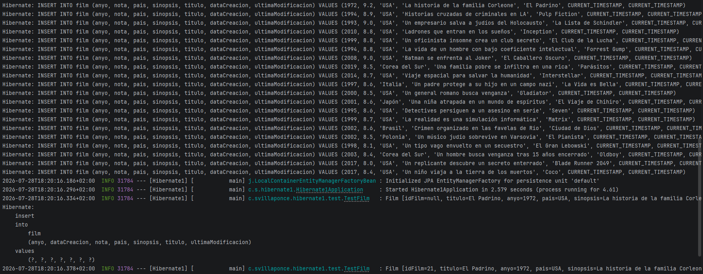
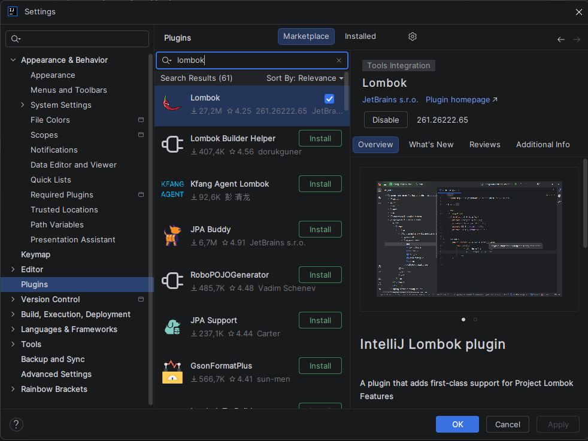
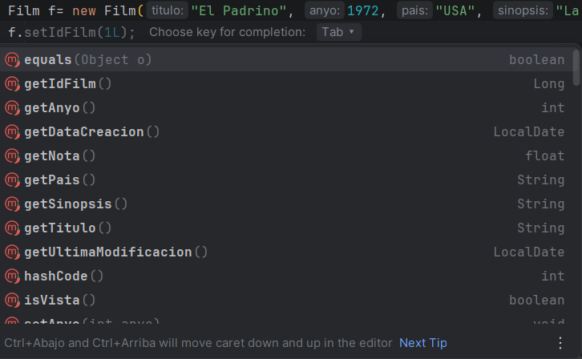

# Bloque 4. Mejoras del proyecto. Importaciones. Proyecto Lombok

## 1. Importación de datos

Una vez finalizada la parte anterior, hemos visto cómo podemos crear la estructura de la base de datos. De momento lo hemos hecho con una única entidad, aunque iremos incorporando más a medida que avance el proyecto.

Sin embargo, la estructura creada está vacía, sin datos, lo que resulta poco útil. Para solucionarlo, podemos introducir los datos manualmente o, como veremos en esta parte, importarlos desde archivos externos.

Hibernate permite realizar una carga automática de datos en la base de datos mediante archivos **SQL** o **CSV**. Para ello, debemos crear un archivo llamado **`data.sql`** o **`import.sql`** dentro de la carpeta **`src/main/resources`** de nuestro proyecto.

Este archivo contendrá las sentencias SQL necesarias para insertar los datos en la base de datos.

Un ejemplo de archivo **`import.sql`** sería el siguiente:

```sql
INSERT INTO film (anyo, nota, pais, sinopsis, titulo, dataCreacion, ultimaModificacion) 
VALUES (1972, 9.2, 'USA', 'La historia de la familia Corleone', 'El Padrino', CURRENT_TIMESTAMP, CURRENT_TIMESTAMP);
INSERT INTO film (anyo, nota, pais, sinopsis, titulo, dataCreacion, ultimaModificacion) 
VALUES (1994, 8.9, 'USA', 'Historias cruzadas de criminales en LA', 'Pulp Fiction', CURRENT_TIMESTAMP, CURRENT_TIMESTAMP);
...
```

!!! warning
    ### Importar datos

    Recuerda que el archivo debe estar ubicado en la carpeta **`src/main/resources`** del proyecto y que su nombre debe ser **`data.sql`** o **`import.sql`**.

    #### `import.sql`

    Asimismo, si queremos tener un mayor control sobre la creación de las tablas, podemos crear un archivo **`schema.sql`** con las sentencias SQL necesarias para crearlas.

    En este caso, el archivo **`schema.sql`** se ejecutará antes que **`import.sql`**, garantizando que las tablas estén creadas antes de insertar los datos.

```sql
INSERT INTO film (anyo, nota, pais, sinopsis, titulo, dataCreacion, ultimaModificacion) VALUES (1972, 9.2, 'USA', 'La historia de la familia Corleone', 'El Padrino', CURRENT_TIMESTAMP, CURRENT_TIMESTAMP);
INSERT INTO film (anyo, nota, pais, sinopsis, titulo, dataCreacion, ultimaModificacion) VALUES (1994, 8.9, 'USA', 'Historias cruzadas de criminales en LA', 'Pulp Fiction', CURRENT_TIMESTAMP, CURRENT_TIMESTAMP);
INSERT INTO film (anyo, nota, pais, sinopsis, titulo, dataCreacion, ultimaModificacion) VALUES (1993, 9.0, 'USA', 'Un empresario salva a judíos del Holocausto', 'La Lista de Schindler', CURRENT_TIMESTAMP, CURRENT_TIMESTAMP);
INSERT INTO film (anyo, nota, pais, sinopsis, titulo, dataCreacion, ultimaModificacion) VALUES (2010, 8.8, 'USA', 'Ladrones que entran en los sueños', 'Inception', CURRENT_TIMESTAMP, CURRENT_TIMESTAMP);
INSERT INTO film (anyo, nota, pais, sinopsis, titulo, dataCreacion, ultimaModificacion) VALUES (1999, 8.8, 'USA', 'Un oficinista insomne crea un club secreto', 'El Club de la Lucha', CURRENT_TIMESTAMP, CURRENT_TIMESTAMP);
INSERT INTO film (anyo, nota, pais, sinopsis, titulo, dataCreacion, ultimaModificacion) VALUES (1994, 8.8, 'USA', 'La vida de un hombre con bajo coeficiente intelectual', 'Forrest Gump', CURRENT_TIMESTAMP, CURRENT_TIMESTAMP);
INSERT INTO film (anyo, nota, pais, sinopsis, titulo, dataCreacion, ultimaModificacion) VALUES (2008, 9.0, 'USA', 'Batman se enfrenta al Joker', 'El Caballero Oscuro', CURRENT_TIMESTAMP, CURRENT_TIMESTAMP);
INSERT INTO film (anyo, nota, pais, sinopsis, titulo, dataCreacion, ultimaModificacion) VALUES (2019, 8.5, 'Corea del Sur', 'Una familia pobre se infiltra en una rica', 'Parásitos', CURRENT_TIMESTAMP, CURRENT_TIMESTAMP);
INSERT INTO film (anyo, nota, pais, sinopsis, titulo, dataCreacion, ultimaModificacion) VALUES (2014, 8.7, 'USA', 'Viaje espacial para salvar la humanidad', 'Interstellar', CURRENT_TIMESTAMP, CURRENT_TIMESTAMP);
INSERT INTO film (anyo, nota, pais, sinopsis, titulo, dataCreacion, ultimaModificacion) VALUES (1997, 8.6, 'Italia', 'Un padre protege a su hijo en un campo nazi', 'La Vida es Bella', CURRENT_TIMESTAMP, CURRENT_TIMESTAMP);
INSERT INTO film (anyo, nota, pais, sinopsis, titulo, dataCreacion, ultimaModificacion) VALUES (2000, 8.5, 'USA', 'Un general romano busca venganza', 'Gladiator', CURRENT_TIMESTAMP, CURRENT_TIMESTAMP);
INSERT INTO film (anyo, nota, pais, sinopsis, titulo, dataCreacion, ultimaModificacion) VALUES (2001, 8.6, 'Japón', 'Una niña atrapada en un mundo de espíritus', 'El Viaje de Chihiro', CURRENT_TIMESTAMP, CURRENT_TIMESTAMP);
INSERT INTO film (anyo, nota, pais, sinopsis, titulo, dataCreacion, ultimaModificacion) VALUES (1995, 8.6, 'USA', 'Detectives persiguen a un asesino en serie', 'Seven', CURRENT_TIMESTAMP, CURRENT_TIMESTAMP);
INSERT INTO film (anyo, nota, pais, sinopsis, titulo, dataCreacion, ultimaModificacion) VALUES (1999, 8.7, 'USA', 'La realidad es una simulación informática', 'Matrix', CURRENT_TIMESTAMP, CURRENT_TIMESTAMP);
INSERT INTO film (anyo, nota, pais, sinopsis, titulo, dataCreacion, ultimaModificacion) VALUES (2002, 8.6, 'Brasil', 'Crimen organizado en las favelas de Río', 'Ciudad de Dios', CURRENT_TIMESTAMP, CURRENT_TIMESTAMP);
INSERT INTO film (anyo, nota, pais, sinopsis, titulo, dataCreacion, ultimaModificacion) VALUES (2002, 8.5, 'Polonia', 'Un músico judío sobrevive en Varsovia', 'El Pianista', CURRENT_TIMESTAMP, CURRENT_TIMESTAMP);
INSERT INTO film (anyo, nota, pais, sinopsis, titulo, dataCreacion, ultimaModificacion) VALUES (1998, 8.1, 'USA', 'Un tipo vago envuelto en un secuestro', 'El Gran Lebowski', CURRENT_TIMESTAMP, CURRENT_TIMESTAMP);
INSERT INTO film (anyo, nota, pais, sinopsis, titulo, dataCreacion, ultimaModificacion) VALUES (2003, 8.4, 'Corea del Sur', 'Un hombre busca venganza tras 15 años encerrado', 'Oldboy', CURRENT_TIMESTAMP, CURRENT_TIMESTAMP);
INSERT INTO film (anyo, nota, pais, sinopsis, titulo, dataCreacion, ultimaModificacion) VALUES (2017, 8.0, 'USA', 'Un replicante descubre un secreto enterrado', 'Blade Runner 2049', CURRENT_TIMESTAMP, CURRENT_TIMESTAMP);
INSERT INTO film (anyo, nota, pais, sinopsis, titulo, dataCreacion, ultimaModificacion) VALUES (2017, 8.4, 'USA', 'Un niño viaja a la tierra de los muertos', 'Coco', CURRENT_TIMESTAMP, CURRENT_TIMESTAMP);
```

Podemos comprobar en el registro (**log**) que las instrucciones SQL se han ejecutado correctamente.



### 2. ¿Qué es Lombok?

Vamos a presentar otra herramienta que puede ayudarnos a mejorar nuestro proyecto y a reducir la cantidad de código que debemos escribir. Se trata de **Lombok**. Lombok es una biblioteca para Java que permite generar código automáticamente mediante anotaciones.

Gracias a Lombok es posible reducir el denominado **código *boilerplate***, como los *getters*, *setters*, constructores, etc., permitiéndonos centrarnos en la lógica de negocio de nuestro proyecto.

!!! abstract "Definición"
    Se denomina **código *boilerplate*** a aquel código que es necesario para que el programa funcione, pero que no aporta ningún valor añadido a la lógica de negocio.

    Se caracteriza por ser código repetitivo y susceptible de generarse automáticamente, algo que ya realizan la mayoría de los IDE, como **Eclipse**, **IntelliJ IDEA**, entre otros.

!!! question "Curiosidad"
    El nombre **Lombok** proviene de una isla de Indonesia, y su logotipo es una **guindilla (chile)**.

    Guarda cierta similitud con **Java**, cuyo nombre también procede de una isla de Indonesia y cuyo logotipo es una **taza de café**.

    

### 3. Instalación de Lombok

Lombok debe utilizarse de dos formas, ya que tiene una doble funcionalidad:

- Por un lado, está la **biblioteca de Lombok**, que debemos añadir como dependencia en nuestro proyecto.
- Por otro lado, está el **plugin de Lombok**, que debemos instalar en nuestro IDE para que este reconozca las anotaciones de Lombok y genere automáticamente el código correspondiente.

Comenzaremos con la instalación en nuestro IDE, ya que el procedimiento depende del entorno de desarrollo utilizado. A continuación veremos cómo realizar la instalación tanto en **Eclipse** como en **IntelliJ IDEA**, que son los IDE más utilizados.

!!! question "Instalación en IntelliJ"
    Para instalar el plugin de **Lombok** en **IntelliJ IDEA**, debemos seguir los siguientes pasos:

    1. Abrir **IntelliJ IDEA** y acceder a **File → Settings → Plugins**.
    2. Buscar **"Lombok"** en el buscador de plugins.
    3. Seleccionar el plugin **Lombok** y hacer clic en **Install**.
    4. Reiniciar **IntelliJ IDEA** para que los cambios surtan efecto.

    La información actualizada sobre la instalación puede consultarse en la página oficial de Lombok:

    [IntelliJ IDEA](https://projectlombok.org/setup/intellij)



Una vez instalado Lombok en nuestro IDE, solo nos queda añadir la dependencia de Lombok a nuestro proyecto para poder utilizar todas sus funcionalidades.

Para ello, debemos modificar la siguiente dependencia al archivo **`pom.xml`** de nuestro proyecto.

!!! warning "Keep Calm"
    Esta actualización del `pom.xml` solo es necesaria  si quereis tener un proyecto con `Lombok` pero no habéis iniciado un proyecto `Spring`. Con la versión **Ultimate** de **IntelliJ** que tenemos los proyectos traen automáticamente la dependencia, por lo que NO ES NECESARIO cambiar el `pom.xml`.

```java
// ANTES
<dependency>
    <groupId>org.projectlombok</groupId>
    <artifactId>lombok</artifactId>
    <optional>true</optional>
</dependency>

// AHORA
<dependency>
    <groupId>org.projectlombok</groupId>
    <artifactId>lombok</artifactId>
    <version>1.18.44</version>
    <scope>provided</scope>
</dependency>

// ANTES
<plugin>
    <groupId>org.springframework.boot</groupId>
    <artifactId>spring-boot-maven-plugin</artifactId>
    <configuration>
        <excludes>
            <exclude>
                <groupId>org.projectlombok</groupId>
                <artifactId>lombok</artifactId>
            </exclude>
        </excludes>
    </configuration>
</plugin>

// AHORA
 <plugin>
    <groupId>org.apache.maven.plugins</groupId>
    <artifactId>maven-compiler-plugin</artifactId>
    <configuration>
        <annotationProcessorPaths>
            <path>
                <groupId>org.projectlombok</groupId>
                <artifactId>lombok</artifactId>
                <version>1.18.44</version>
            </path>
        </annotationProcessorPaths>
    </configuration>
</plugin>
```

### 4. Anotaciones de Lombok

Lombok incorpora una serie de anotaciones que pueden aplicarse a las clases, a los atributos o a ambos para generar código automáticamente.

Las anotaciones de clase más habituales son las siguientes:

- **`@Getter` / `@Setter`**: Generan automáticamente los métodos *getter* y *setter* de los atributos de la clase.
    - Aplicada sobre un **atributo** → Genera el *getter* y el *setter* de ese atributo.
    - Aplicada sobre una **clase** → Genera los *getters* y *setters* de todos los atributos de la clase.
- **`@ToString`**: Genera automáticamente el método `toString()` para la clase. Si queremos evitar que algún atributo aparezca en el `toString()`, podemos utilizar la anotación **`@ToString.Exclude`** sobre dicho atributo.
- **`@EqualsAndHashCode`**: Genera automáticamente los métodos `equals()` y `hashCode()` para la clase. Si queremos evitar que algún atributo participe en `equals()` y `hashCode()`, podemos utilizar la anotación **`@EqualsAndHashCode.Exclude`** sobre ese atributo.
- **`@Data`**: Genera automáticamente los métodos *getter*, *setter*, `toString()`, `equals()` y `hashCode()` para la clase. Es una anotación que combina las anteriores, por lo que, si utilizamos **`@Data`**, no es necesario utilizar el resto de estas anotaciones.
- **`@NoArgsConstructor`**: Genera automáticamente un constructor sin argumentos para la clase.
- **`@AllArgsConstructor`**: Genera automáticamente un constructor con todos los argumentos de la clase.

Puedes encontrar más anotaciones en la página oficial de Lombok:

[Stable](https://projectlombok.org/features)

### 5. Resultado final

Con todo lo anterior, nuestra entidad **`Film`** reduce considerablemente su tamaño y la cantidad de código que contiene, presentando un aspecto mucho más limpio y legible.

Todo ello sin perder ninguna funcionalidad.

```java
@Entity
@Table(name = "film")
@Data
@NoArgsConstructor
public class Film {

    @Id
    @GeneratedValue(strategy = GenerationType.IDENTITY)
    private Long idFilm;

    @Column(nullable = false,length = 200)
    private String titulo;

    @Column
    private int anyo;

    @Column
    private String pais;

    @Column
    private String sinopsis;

    @Column
    private float nota;

    @Transient
    private boolean vista;

    @UpdateTimestamp
    @ToString.Exclude
    @EqualsAndHashCode.Exclude
    private  LocalDate ultimaModificacion;

    @CreationTimestamp
    @ToString.Exclude
    @EqualsAndHashCode.Exclude
    private LocalDate dataCreacion;

    // constructor
    public Film(String titulo, int anyo, String pais, String sinopsis, float nota) {
        this.titulo = titulo;
        this.anyo = anyo;
        this.pais = pais;
        this.sinopsis = sinopsis;
        this.nota = nota;
    }
}
```

Pese a no tener nada construido ni implementado, en la ejecución de la imagen se pueden ver todos los métodos disponibles.



!!! tip "...y a partir de ahora"
    A partir de ahora, cada vez que creemos una nueva entidad, podremos utilizar las anotaciones de **Lombok** para generar automáticamente gran parte del código.

    No obstante, todavía iremos encontrando algunas anotaciones más que incorporaremos conforme avancemos en el desarrollo del proyecto.

---

➡️ **Práctica de esta unidad:** [Práctica 6](../practicas/practica-up4-1.md)
