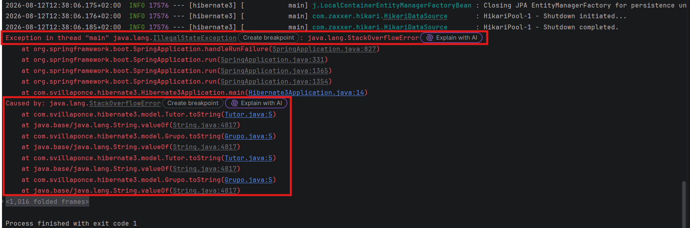
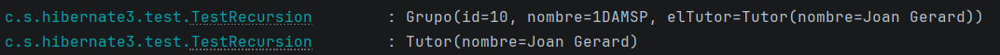
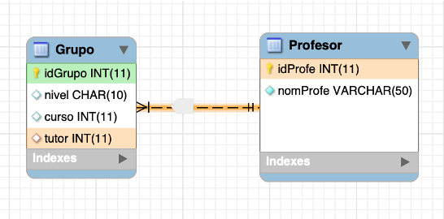
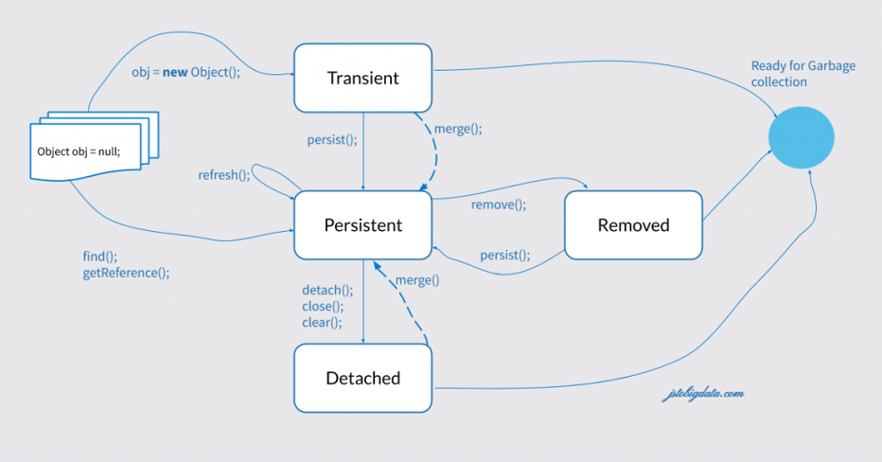
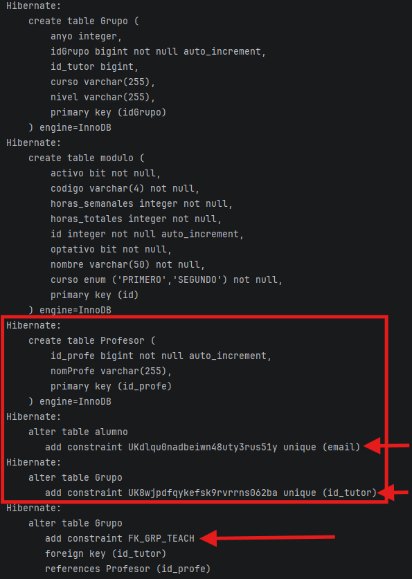
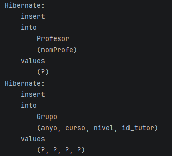

# Bloque 1. Relaciones a 1 a 1

## 1. Relaciones (Propiedades y comportamientos)

### 1.1. Cardinalidad

Como ya sabemos, las relaciones son la forma que tenemos de indicar cómo se comportan las entidades unas respecto de otras. Las relaciones se pueden clasificar en tres tipos, atendiendo a su cardinalidad:

- **Relaciones 1 a 1 (1:1):** Una entidad solo se relaciona con una única entidad al otro lado. Un profesor dirige la tesis de un único alumno, y cada alumno solo tiene un director de tesis.
- **Relaciones 1 a muchos (1:N):** Una entidad se relaciona con muchas entidades al otro lado, pero las entidades del otro lado solo se relacionan con una única entidad del primer lado. Un profesor es tutor de muchos alumnos, pero cada alumno solo tiene un tutor.
- **Relaciones muchos a muchos (N:M):** Una entidad se relaciona con muchas entidades al otro lado, y las entidades del otro lado también se relacionan con muchas entidades del primer lado. Un alumno puede estar matriculado en muchas asignaturas, y una asignatura puede tener muchos alumnos matriculados.

### 1.2. Direccionalidad

Un concepto que en el diseño de la base de datos se olvida, pero que es muy importante a la hora de diseñar aplicaciones con relaciones, es el de la direccionalidad.

#### Unidireccional ➡️

Diremos que una relación es **unidireccional** cuando accedemos al objeto relacionado desde otro objeto (propietario). Por ejemplo, si montamos un motor en un coche, lo lógico es que el propietario sea el coche, y desde este obtendremos el motor. En este caso, dentro del objeto `Coche` aparecerá un objeto `Motor`, y el `Motor` no tendrá una existencia propia.

!!! tip "Composición de objetos"
    Este concepto se vio el curso pasado como ***Composición de objetos,*** esto se basa en la lógica de que un objeto que refleja una realidad contiene y gestiona objetos internos que tiene en propiedad, al igual que un coche gestiona su propio motor, ventilación y electrónica, podemos ver el ejemplo de un **Ordenador**. Un **ordenador** tiene un **conjunto de componentes** (placa base, procesador, gráfica, alimentación…), cuando un ordenador se enciende se espera que funcione y para ello debe haber una **configuración y sincronización entre sus propios componentes** que gestiona el propio ordenador. 

```java
class Motor {
	// Atributos y métodos del motor.
}

class Coche {
	// Atributos y métodos del coche.
	private Motor motor;
}
```

#### Bidireccional ↔️

Son relaciones en las cuales los elementos relacionados suelen tener **el mismo peso o entidad**. Por ejemplo, un `Grupo` de un instituto y un `Tutor`. Desde un grupo tiene sentido conocer al tutor, y también podemos desde un profesor (el tutor), acceder al grupo que tutoriza. En este caso, dentro del objeto `Grupo` tenemos una referencia al objeto `Tutor` y viceversa.

```java
class Grupo {
	// Atributos y métodos del grupo.
	private Tutor tutor;
}

class Tutor {
	// Atributos y métodos del tutor.
	private Grupo grupo;
}
```

### 1.3. ⚠ Bucles infinitos ⚠

Mucho cuidado con estas relaciones bidireccionales, independientemente de la cardinalidad, ya que debemos tener en cuenta que, si no controlamos correctamente las referencias, podemos generar **bucles infinitos** en situaciones sencillas.

Revisa los siguientes bloques de código y ejecútalos para comprobar qué ocurre:

#### Bucle infinito 🔄

Si intentamos obtener toda la información, siempre podemos encontrarnos con que no podemos parar:

```java
@Data
public class Grupo {
    private int id;
    private String nombre;

    public Grupo(int id, String nombre) {
        this.id = id;
        this.nombre = nombre;
    }

    private Tutor elTutor;
}

@Data
public class Tutor {
    private String nombre;
    private Grupo elGrupo;

    public Tutor(String nombre) {
        this.nombre = nombre;
    }
}

@Component
public class TestRecursion {

    private static final Logger myLog = LoggerFactory.getLogger(TestRecursion.class);

    public void ejecutar() {
        Grupo g = new Grupo(10, "1DAMSP");
        Tutor t = new Tutor("Joan Gerard");

        g.setElTutor(t);
        t.setElGrupo(g);

        // imprimimos el grupo
        myLog.info(g.toString());
        myLog.info(t.toString());
    }
}
```

En la clase `main()`:

```java
@Bean
public CommandLineRunner pruebasRecursion(TestRecursion runner) {
    return args -> {
        runner.ejecutar();
    };
}
```

En este momento, el **grupo** tiene una **referencia** al **tutor**, y el **tutor** tiene una **referencia** al **grupo**. Si intentamos imprimir el grupo, el método `toString()` de la clase `Grupo` intentará imprimir el tutor, y el método `toString()` de la clase `Tutor` intentará imprimir el grupo, y así sucesivamente, generando un **bucle infinito**.



#### Ocultar algo

En esta solución optamos por evitar mostrar la información referenciada en alguna clase y, por tanto, evitamos el bucle infinito. Para ello, utilizaremos las anotaciones de Lombok:

- **`@ToString.Exclude`** → Elimina el campo anotado de la implementación interna de Lombok de `toString()`.
- **`@EqualsAndHashCode.Exclude`** → Elimina el campo anotado de la implementación interna de Lombok de `equals()` y `hashCode()`.

```java
@Data
class Tutor {
    private String nombre;

    @ToString.Exclude
    @EqualsAndHashCode.Exclude
    private Grupo elGrupo;

    public Tutor(String nombre) {
        this.nombre = nombre;
    }
}
```

En este caso, he decidido eliminarlo de `Tutor`. Entonces, al imprimir el **tutor** no aparecerá la información referenciada del grupo, pero al imprimir el **grupo** sí que aparecerá la información referenciada del tutor.

De esta manera evitamos el bucle infinito, pero mantenemos la información referenciada en una de las clases.



#### Aplanar relaciones

Como el problema es que los métodos `toString()` de las clases se llaman entre ellos, vamos a evitar esto programando de manera clásica el `toString()` de al menos una clase y controlando nosotros mismos las referencias. En este caso, optaremos por programar el `toString()` de la clase `Tutor`.

El concepto de **aplanar** se utiliza siempre que convertimos un objeto en un atributo básico, como por ejemplo un `String`, un `int`, etc.

```java
@Data
class Tutor {
    private String nombre;

    @EqualsAndHashCode.Exclude
    private Grupo elGrupo;

    public Tutor(String nombre) {
        this.nombre = nombre;
    }

    public String toString() {
        return "Tutor(nombre=" + this.nombre
                + ", tutoriza a: " + this.elGrupo.getNombre() + ")";
    }
}
```

Entonces, al imprimir el tutor, el `toString()` de la clase `Tutor` no intentará imprimir el grupo, sino que únicamente mostrará el nombre del grupo, evitando así el bucle infinito. Al imprimir el grupo sí que aparecerá la información referenciada del tutor.

## 2. Relaciones 1 a 1

Para la explicación de los ejemplos, veremos primero el diseño y la posterior implementación en la base de datos de cada caso y cómo se gestiona con Hibernate.

Para este ejemplo representaremos una relación **1:1 entre Grupo y Profesor**, donde se puede ver que un **Grupo tiene un Tutor**, y un **Tutor solo puede tutorizar un Grupo**.



### 2.1. Relación unidireccional 1 a 1

Comenzamos por la clase **no propietaria de la relación**, es decir, la clase que NO CONTIENE LA CLAVE FORÁNEA. En este caso, `Profesor` es la clase no propietaria, ya que `Grupo` tiene la clave foránea que apunta al tutor. Por tanto, comenzamos por la clase `Profesor`, muy fácil, porque no necesitamos hacer nada.

```java
@Data
@NoArgsConstructor
@Entity
@Table(name="Profesor")
public class Profesor {

    @Id
    @GeneratedValue(strategy=GenerationType.IDENTITY)
    private Long idProfe;

    @Column
    private String nomProfe;

    public Profesor(String nomProfe) {
        this.nomProfe= nomProfe;
    }
}
```

Y ahora, la clase que contiene la clave ajena. Aquí debemos marcar que un `Grupo` necesita un `Profesor` como tutor. Veámoslo y comentemos las anotaciones:

```java
@Data
@NoArgsConstructor
@Entity
@Table(name = "Grupo")
public class Grupo implements Serializable {

    @Id
    @GeneratedValue(strategy = GenerationType.IDENTITY)
    private Long idGrupo;

    @Column
    private String nivel;

    @Column
    private String curso;

    @Column
    private int anyo;

    @OneToOne(cascade = CascadeType.ALL)
    @JoinColumn(
        name = "id_tutor",
        referencedColumnName = "idProfe",
        unique = true,
        foreignKey = @ForeignKey(name = "FK_GRP_TEACH"))
    private Profesor tutor;

    public Grupo(String nivel, String curso, int anyo) {
        this.nivel = nivel;
        this.curso = curso;
        this.anyo = anyo;
    }
}
```

!!! tip "Aclaración del código"
    Este código define una relación **1:1 unidireccional** entre `Grupo` y `Profesor`, donde **Grupo es el propietario de la relación**.

    ```java
    @OneToOne(cascade=CascadeType.ALL)
    @JoinColumn(
    	name="id_tutor",
    	referencedColumnName="idTeacher",
    	unique=true,
    	foreignKey= @ForeignKey(name="FK_GRP_TEACH"))
    private Profesor tutor;
    ```

    - **`@OneToOne`** → Indica que cada `Grupo` puede tener asociado **un único `Profesor`** como tutor.
    - **`cascade = CascadeType.ALL`** → Las operaciones realizadas sobre `Grupo` se propagan al `Profesor` asociado (`persist`, `merge`, `remove`, etc.).
    - **`@JoinColumn`** → Indica que la tabla `Grupo` tendrá la **clave foránea** de la relación.
    - **`name = "id_tutor"`** → La columna FK creada en `Grupo` se llamará `id_tutor`.
    - **`referencedColumnName = "idTeacher"`** → `id_tutor` apunta a la columna `idTeacher` de `Profesor`.
    - **`unique = true`** → Un mismo profesor no puede aparecer como tutor de dos grupos. Esto garantiza el **1:1** a nivel de base de datos.
    - **`@ForeignKey(name = "FK_GRP_TEACH")`** → Da el nombre `FK_GRP_TEACH` a la restricción de clave foránea.

    En la base de datos queda conceptualmente:

    ```
    Profesor
    ┌───────────┬─────────────┐
    │ idTeacher │ name        │
    └─────▲─────┴─────────────┘
          │
          │ FK_GRP_TEACH
          │
    ┌─────┴─────┬──────────┬─────────┐
    │ idGroup   │ ...      │ id_tutor│
    └───────────┴──────────┴─────────┘
    Grupo
    ```

    La idea fundamental es: **`Grupo` guarda la FK `id_tutor`, que referencia al `idTeacher` de un `Profesor`, y `unique=true` impide que ese profesor sea tutor de más de un grupo.**

En este caso se está usando la clase `Profesor` como sustituto de la clase `Tutor`. Debemos hacer los cambios pertinentes en caso de completar el ejemplo en la clase `TestRecursion`. Los cambios se pueden realizar como prueba en la clase `TestRecursion` para seguir el hilo o hacerlo en otra clase de prueba, el código resuelto está más adelante como clase `Test1_1` .

!!! danger "Relaciones y Clase Profesor"
    Las relaciones y clases actuales son un ejemplo para introducir las diferentes relaciones así como las anotaciones relacionadas para automatizar el proceso. Estas relaciones para que sean adecuadas y coherentes deben estar todas creadas y definidas en un diagrama Entidad - Relación de los que se trabajó en BD de 1º. En la realidad un Profesor puede ser tutor o no y un profesor puede tener varios grupos tutorizados aunque sea un caso anómalo y la clase tutor podría ser una especialización de la clase Profesor.

!!! note "Propagaciones en cascada"
    El `cascade` o propagación es la forma de indicar que, cuando realizamos alguna acción sobre la entidad propietaria (`Grupo`), la misma acción se aplicará a la entidad asociada (`Profesor`). Revisemos las opciones más relevantes:

    - **`CascadeType.PERSIST`** → Creamos un grupo y le asignamos un profesor. Al guardar el `Grupo` en la base de datos, el profesor también se guarda de manera automática.
    - **`CascadeType.REMOVE` o `CascadeType.DELETE`** → Eliminamos un grupo de la base de datos. Si el grupo tiene un profesor asociado, este también se eliminará de manera automática. **¡Cuidado con esta opción!**
    - **`CascadeType.REFRESH`** → Si actualizamos un grupo, el profesor asociado también se actualizará de manera automática. Esto nos sirve por si se han modificado los datos del grupo o del profesor en la base de datos.
    - **`CascadeType.DETACH`** → Esta operación (poco común) elimina el objeto del seguimiento o *tracking* que JPA realiza sobre los objetos. Aplicará en cascada el *tracking*.
    - **`CascadeType.MERGE`** → Vuelve a poner en seguimiento un objeto que ha sido desenganchado (*detached*) de JPA. Aplicará en cascada el *tracking*.
    - **`CascadeType.ALL`** → Propaga todas las operaciones. Ten en cuenta que también se aplica a `REMOVE`.

!!! note "¿Cómo poner varios `cascade`?"
    Si queremos poner varios `cascade`, podemos utilizar un array:

    ```java
    @OneToOne(cascade= {CascadeType.PERSIST, CascadeType.MERGE})
    ```

    ya que `CascadeType.ALL` no es recomendable, puesto que puede generar problemas si no controlamos bien las operaciones que realizamos sobre las entidades.

!!! note "Importaciones delicadas"
    Para las importaciones de `CascadeType`, tenemos:

    - **`jakarta.persistence.CascadeType` (JPA):** Es la especificación estándar de Java/Jakarta.
    - **`org.hibernate.annotations.CascadeType`:** Es la implementación específica de Hibernate y NO ES RECOMENDABLE utilizarla, ya que no es portable a otras implementaciones de JPA. Además, esta implementación de Hibernate tiene operaciones en cascada que no están contempladas en la especificación de JPA, como `SAVE_UPDATE` o `DELETE_ORPHAN`, que pueden generar comportamientos inesperados.

### 2.2. Ciclo de vida de los objetos

Para entender el seguimiento que realiza Hibernate, debemos saber en qué estado se encuentra nuestro objeto Java respecto al **Vigilante (JPA)**:



!!! note "Transient (Transitorio o volátil)"
    Es un objeto Java normal que acabas de crear con `new`, que todavía no hemos guardado. **Estado inicial:** JPA no sabe nada de él. No existe en la base de datos.

!!! note "Persistent (Gestionado o persistente)"
    El objeto está dentro del seguimiento de JPA. Este objeto existe en la base de datos, y JPA sabe que existe. Cualquier cambio que hagamos sobre este objeto será detectado por JPA y se guardará de manera automática en la base de datos cuando termine la transacción, aunque no hagamos un `save()` o un `persist()` explícito.

    **¿Cómo se llega a este estado?** Haciendo un `save()`, `persist()` o recuperándolo desde la base de datos con un `find()` o `findById()`, como veremos más adelante.

!!! note "Detached (Desacoplado o fuera de seguimiento)"
    Es un objeto que ha sido persistente, pero que ya no está dentro del seguimiento de JPA. Este objeto existe en la base de datos, pero JPA ya no realiza su seguimiento. Cualquier cambio que hagamos sobre este objeto no será detectado por JPA y, por tanto, no se guardará en la base de datos, a menos que volvamos a poner este objeto bajo el seguimiento de JPA.

    **¿Cómo se llega a este estado?** Haciendo un `detach()`, un `clear()` para sacar un objeto individual o cerrando la sesión/transacción, lo que desacopla todos los objetos que había dentro del seguimiento de JPA.

!!! note "Removed (Eliminado)"
    El objeto está marcado para ser borrado. Todavía está en la memoria de Java, pero JPA sabe que, al terminar la transacción, debe ejecutar un `DELETE`.

    **¿Cómo se llega a este estado?** Haciendo un `remove()` sobre un objeto que está dentro del seguimiento de JPA.

### 2.3. Resultado de la relación en la base de datos

Vamos a ver qué ocurre al ejecutar nuestro código y qué nos crea en la base de datos. Ejecutamos el siguiente código en una clase mediante un `CommandLineRunner`:

```java
@Component
public class Test1_1 {

    private static final Logger myLog = LoggerFactory.getLogger(TestFilm.class);

    @PersistenceContext
    private EntityManager entityManager;

    @Transactional
    public void ejecutar() {

        Profesor p = new Profesor("Joan Gerard");
        Grupo g = new Grupo("DAM", "Segundo", 2026);

        g.setTutor(p);
        entityManager.persist(g);
        myLog.info(g.toString());

    }
}
```



Hay que prestar especial atención a la creación de claves primarias, únicas y una clave ajena que asigna adecuadamente

!!! question "Salida por consola"
    **SonarQube** no valora positivamente usar salidas por consola fijas:

    `myLog.info(g.toString());`  → Salida fija de tipo `INFO` → SonarQube ❌

    `myLog.atInfo().log(g.toString());` → Salida condicional según el método `at[LEVEL]` llamado y el log asociado → SonarQube ✅

En el momento de hacer `persist(g)`, JPA detecta que el grupo tiene un tutor asociado y, como hemos indicado `CascadeType.PERSIST`, también guarda el profesor de manera automática.

Por tanto, solo realizamos **una operación de guardado**, pero se guardan **las dos entidades**.



Finalmente, al mostrar el grupo, vemos que aparece la información del tutor asociado, ya que el método `toString()` de la clase `Grupo` muestra la información del tutor.

`Grupo(idGrupo=1, nivel=CFGS DAM, curso=1º, anyo=2026, tutor=Profesor(idProfe=1, nomProfe=Sebastián Villa))`

### 2.4. Relación bidireccional 1 a 1

Si queremos almacenar en `Profesor` el grupo que está tutorizando, necesitamos añadir una referencia al `Grupo`. Pero, claro, la clave foránea no puede estar en las dos tablas, por tanto, debemos indicar que la relación está **mapeada por el otro lado**, es decir, que el `Grupo` es el propietario de la relación y `Profesor` es la clase no propietaria.

Para ello, añadimos el siguiente código a la clase `Profesor`:

```java
@OneToOne(mappedBy= "tutor")
private Grupo elGrupo;
```

De esta modificación de código no habrá demostración en la teoría.

La diferencia fundamental respecto al ejemplo anterior sería que ahora debemos mantener **las dos referencias del modelo Java.** En la **BD** no hay cambio, el cambio está en el modelo de datos de Java ****pasa a ser bidireccional de nuevo y volvemos al problema anterior de la recursión si se llama al método `toString()` y tendríamos que aplicar el `@ToString.Exclude y @EqualsAndHashCode.Exclude` .

**La idea clave de `mappedBy = "tutor"` es:** `Profesor.elGrupo` permite navegar de `Profesor → Grupo`, pero **no crea otra FK**; le dice a JPA: *esta relación ya está gestionada por el atributo `tutor` de la clase `Grupo`*.

## 3. ¿Relación o componentes?

Un caso particular de las relaciones **1:1** es cuando realmente lo que queremos representar es un **componente** o una **composición**, es decir, cuando un objeto no tiene sentido por sí mismo, sino que siempre está asociado a otro objeto.

En este caso, en lugar de crear dos entidades y una relación **1:1** entre ellas, podemos crear una única entidad con un componente incrustado.

Aquí entra el concepto de **embeddable classes** o **clases incrustadas**.

Las clases de ejemplo quedarían de la siguiente forma:

```java
@Data
@AllArgsConstructor
@NoArgsConstructor
@Embeddable
public class Rueda {
    private int diametro;
    private char codigoVelocidad;
}
```

```java
@Data
@NoArgsConstructor
@AllArgsConstructor
@Entity
public class Coche {

    @Id
    private String matricula;

    @Column
    private String marca;

    @Column
    private String modelo;

    @Column
    private double cv;

    @Embedded
    private Rueda modeloRueda;

}
```

Al ejecutar el siguiente `CommandLineRunner`:

```java
@Component
public class Test1_1_Componentes {

    private static final Logger myLog =
            LoggerFactory.getLogger(Test1_1_Componentes.class);

    @PersistenceContext
    private EntityManager entityManager;

    @Transactional
    public void ejecutar() {

        Rueda r = new Rueda(17, 'V');
        Coche c = new Coche("1234-AAA", "Nissan", "Micra", 60.45, r);

        entityManager.persist(c);
        myLog.info(c.toString());

    }
}
```

nos aparecerá:

```sql
-- Hibernate:
create table Coche (
    codigoVelocidad varchar(1),
    cv float(53),
    diametro integer,
    marca varchar(255),
    matricula varchar(255) not null,
    modelo varchar(255),
    primary key (matricula)
) engine=InnoDB
```

Y finalmente:

```sql
-- Hibernate:
insert
into
    Coche
    (cv, marca, modelo, codigoVelocidad, diametro, matricula)
values
    (?, ?, ?, ?, ?, ?)
```

Como podemos ver, aunque hemos creado dos clases, solo se ha creado una tabla en la base de datos, y los campos de la clase `Rueda` se han incrustado dentro de la tabla `Coche`.

Como solo existe una entidad, únicamente se ha insertado en una tabla, y los campos de `Rueda` se han insertado como campos adicionales de la tabla `Coche`.

A continuación seguimos con las relaciones **1 a muchos**.
