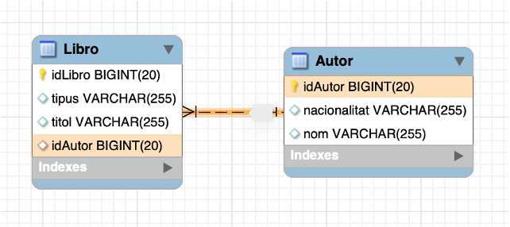
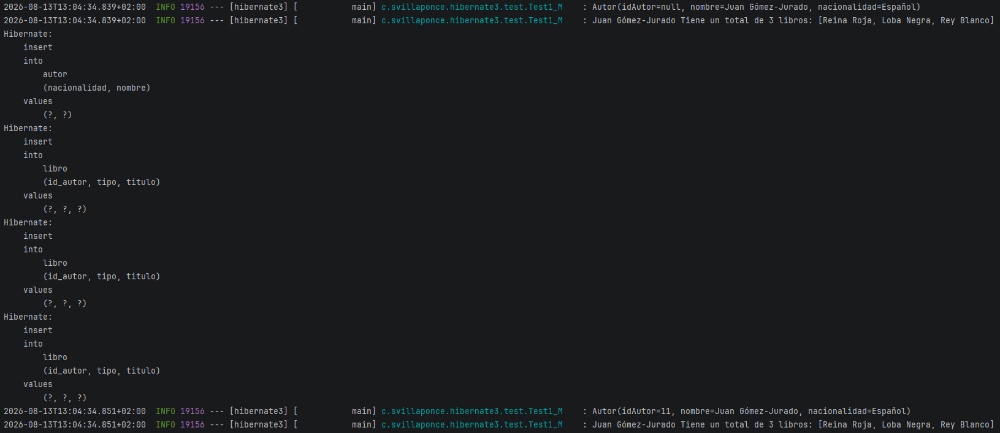
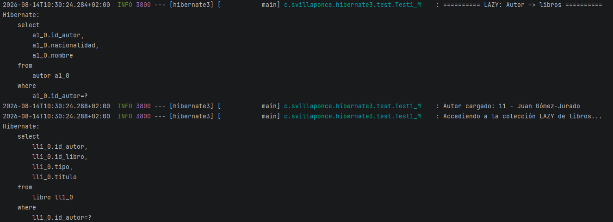

# Bloque 2. Relaciones 1 a N

## 1. Relaciones 1 a muchos

Las relaciones **uno a muchos** se definen cuando encontramos una entidad que puede estar relacionada con muchas otras entidades, pero estas otras entidades solo pueden estar relacionadas con una única entidad. Un caso podría ser el **Autor de un libro**.

- Un autor escribe uno o muchos libros.
- Un libro solo puede ser escrito por un autor.

Hoy en día podemos encontrar casos en los que varios autores han escrito un libro, pero para este ejemplo supondremos que cada libro solo puede ser escrito por un autor.

El esquema relacional que queremos implementar es el siguiente:



!!! warning
    Recuerda...

    Todos los conceptos vistos anteriormente sobre **participaciones, propietario y problemas de recursión** siguen apareciendo aquí, así que es importante que los tengas en cuenta.

## 2. Diseño de las entidades participantes

Pasemos a ver el diseño de las entidades, así como las nuevas anotaciones que aparecerán.

```java
@Data
@NoArgsConstructor
@Entity
@Table(name="libro")
public class Libro {

    @Id
    @GeneratedValue(strategy = GenerationType.IDENTITY)
    private Long idLibro;

    @Column
    private String titulo;

    @Column
    private String tipo;

    @ManyToOne(cascade = CascadeType.PERSIST)
    @JoinColumn(
        name = "id_autor",
        foreignKey = @ForeignKey(name = "FK_LIB_AUT"))
    private Autor elAutor;

    public Libro(String titulo, String tipo, Autor elAutor) {
        super();
        this.titulo = titulo;
        this.tipo = tipo;
        this.elAutor = elAutor;
    }
}
```

```java
@Data
@NoArgsConstructor
@Entity
@Table(name="autor")
public class Autor {

    @Id
    @GeneratedValue(strategy = GenerationType.IDENTITY)
    private Long idAutor;

    @Column
    private String nombre;

    @Column
    private String nacionalidad;

    @OneToMany(
        mappedBy = "elAutor",
        cascade = CascadeType.PERSIST,
        fetch = FetchType.LAZY)
    @ToString.Exclude
    private List<Libro> losLibros = new ArrayList<>();

    public String showLibros() {
        String res = this.nombre + " Tiene un total de "
                + this.losLibros.size() + " libros: ";

        if (losLibros.size() > 0)
            res += "[";

        for (Libro l : losLibros)
            res += l.getTitulo() + ", ";

        return res += "\b\b]";
    }

    public void addLibro(Libro l) {
        if (!losLibros.contains(l)) {
            losLibros.add(l);
            l.setElAutor(this);
        }
    }

    public void removeLibro(Libro l) {
        if (losLibros.contains(l)) {
            losLibros.remove(l);
            l.setElAutor(null);
        }
    }

    public Autor(String nombre, String nacionalidad) {
        super();
        this.nombre = nombre;
        this.nacionalidad = nacionalidad;
    }
}
```

!!! note "En resumen"
    Una de las dos clases debe ser marcada como **propietaria**, entonces:

    - Indicaremos en ella la definición de la **clave ajena**: `@JoinColumn` y sus propiedades.
    - Solo la entidad que está en la parte de **muchos (`@ManyToOne`)** puede ser propietaria de la relación.

    La otra clase, la que está en la parte del **1**, será la que tendrá el **mapeo inverso de la relación**, y entonces indicaremos la anotación `@OneToMany`:

    - Indicamos mediante la propiedad `mappedBy` el **nombre del atributo** de la otra clase que mapea la relación.
    - Definimos la propiedad de **cascada**.
    - Definimos la forma de **carga de los datos asociados** `(fetch)` a la relación.

## 3. Prueba y ejecución

Se ha añadido el siguiente código para probar nuestra relación:

```java
@Component
public class Test1_M {

    private static final Logger myLog = LoggerFactory.getLogger(Test1_M.class);

    @PersistenceContext
    private EntityManager entityManager;

    @Transactional
    public void ejecutar() {

        Autor a = new Autor("Juan Gómez-Jurado", "Español");

        Libro l1 = new Libro("Reina Roja", "Thriller", a);
        a.addLibro(l1);

        Libro l2 = new Libro("Loba Negra", "Thriller", a);
        a.addLibro(l2);

        Libro l3 = new Libro("Rey Blanco", "Thriller", a);
        a.addLibro(l3);

        myLog.info(a.toString());
        myLog.info(a.showLibros());

        entityManager.persist(a);

        myLog.info(a.toString());
        myLog.info(a.showLibros());
    }
}
```

Este código sirve para comprobar la inserción y actualización de datos una vez persistidos para coordinarlos con la BD. En la modificación de este código más adelante veremos como la diferencia entre los distintos tipos de carga `(LAZY/EAGER)` .

La salida del log de Hibernate será la siguiente. Fíjate en que aparecen **4 `INSERT`**, uno en `autor` y 3 en `libro`, como es lógico:

```java
Autor(idAutor=null, nombre=Juan Gómez-Jurado, nacionalidad=Español)
Juan Gómez-Jurado Tiene un total de 3 libros: [Reina Roja, Loba Negra, Rey Blanco]

Hibernate:
    insert
    into
        autor
        (nacionalidad, nombre)
    values
        (?, ?)

Hibernate:
    insert
    into
        libro
        (idAutor, tipo, titulo)
    values
        (?, ?, ?)

Hibernate:
    insert
    into
        libro
        (idAutor, tipo, titulo)
    values
        (?, ?, ?)

Hibernate:
    insert
    into
        libro
        (idAutor, tipo, titulo)
    values
        (?, ?, ?)

Autor(idAutor=11, nombre=Juan Gómez-Jurado, nacionalidad=Español)
Juan Gómez-Jurado Tiene un total de 3 libros: [Reina Roja, Loba Negra, Rey Blanco]
```

## 4. Carga de datos (*Fetching*)

Para concluir este apartado, vamos a explicar un atributo que hemos comentado pero no explicado: **la carga**.

El atributo `fetch` suele aparecer cuando tenemos una relación **1:N o N:M** en una clase que tiene una colección de clases relacionadas (también se puede especificar en una relación 1:1, pero es menos común).

Cuando Hibernate carga un objeto/entidad, cargará sus atributos básicos (`nombre`, `nacionalidad`, etc.), pero **¿qué ocurre con los atributos relacionados? ¿Los carga o no?**

En nuestro ejemplo, cuando cargamos el `Autor`, **¿qué ocurre con los `Libros` que ha escrito? ¿Los carga o no?**

La respuesta es que depende de cómo hayamos configurado la propiedad `fetch` de la relación. Hay dos tipos de carga:

- **`fetch = FetchType.EAGER`** → Literalmente traducido como **ansioso**. No podemos esperar y, cuando se carga el `Autor`, Hibernate resolverá la relación y cargará todos los libros con todos los datos internos de cada libro. Tenemos todos los datos relacionados en ese momento.
- **`fetch = FetchType.LAZY`** → Literalmente como **perezoso**, aunque es más representativo hablar de **carga en diferido**. Si cargamos el `Autor`, Hibernate solo carga los atributos propios del `Autor`, sin cargar sus `Libros`. Ahora bien, cuando intentamos acceder a sus libros desde nuestro programa, Hibernate se activa y los carga. Es decir, en modo `LAZY`, los datos se cargan **cuando se necesitan**.

Se activará incluso en caso de querer calcular el número de libros asociados al autor, `losLibros.size()`  o mostrar los títulos de los libros asociados al autor, etc.

En modo `LAZY`, los datos relacionados se cargan **en diferido**.

Comprobemos cómo cambia. Para probarlo, he creado con ayuda de Gemini un archivo para insertar datos.

```sql
-- Inserción de Autores
INSERT INTO autor (nombre, nacionalidad) VALUES 
('Stephen King', 'Estados Unidos'),
('J.K. Rowling', 'Reino Unido'),
('Haruki Murakami', 'Japón'),
('Eva García Sáenz de Urturi', 'España'),
('Ken Follett', 'Reino Unido'),
('Irene Vallejo', 'España'),
('Quim Monzó', 'España'),
('Alicia Giménez Bartlett', 'España'),
('Margaret Atwood', 'Canadá'),
('Carlos Ruiz Zafón', 'España');

-- Inserción de Libros (5 por cada autor aproximadamente)
-- Nota: El orden de los IDs de autor dependerá del orden de inserción anterior (1 al 10)

-- Stephen King (ID: 1)
INSERT INTO libro (titulo, tipo, id_autor) VALUES 
('Carrie', 'Terror', 1),
('''Salem''s Lot', 'Terror', 1),
('The Shining', 'Terror', 1),
('Rage', 'Thriller', 1),
('The Stand', 'Apocalíptico', 1),
('The Long Walk', 'Distopía', 1),
('The Dead Zone', 'Suspense', 1),
('Firestarter', 'Ciencia ficción', 1),
('Roadwork', 'Drama', 1),
('Cujo', 'Terror', 1),
('The Running Man', 'Distopía', 1),
('The Dark Tower: The Gunslinger', 'Fantasía', 1),
('Christine', 'Terror', 1),
('Pet Sematary', 'Terror', 1),
('Cycle of the Werewolf', 'Terror', 1),
('The Talisman', 'Fantasía', 1),
('Thinner', 'Terror', 1),
('It', 'Terror', 1),
('The Eyes of the Dragon', 'Fantasía', 1),
('The Dark Tower II: The Drawing of the Three', 'Fantasía', 1),
('Misery', 'Thriller', 1),
('The Tommyknockers', 'Ciencia ficción', 1),
('The Dark Tower III: The Waste Lands', 'Fantasía', 1),
('Needful Things', 'Terror', 1),
('Gerald''s Game', 'Thriller', 1),
('Dolores Claiborne', 'Thriller', 1),
('Insomnia', 'Fantasía', 1),
('Rose Madder', 'Fantasía', 1),
('The Green Mile', 'Drama', 1),
('Desperation', 'Terror', 1),
('The Regulators', 'Terror', 1),
('The Dark Tower IV: Wizard and Glass', 'Fantasía', 1),
('Bag of Bones', 'Terror', 1),
('The Girl Who Loved Tom Gordon', 'Suspense', 1),
('Dreamcatcher', 'Ciencia ficción', 1),
('Black House', 'Terror', 1),
('From a Buick 8', 'Terror', 1),
('The Dark Tower V: Wolves of the Calla', 'Fantasía', 1),
('The Dark Tower VI: Song of Susannah', 'Fantasía', 1),
('The Dark Tower VII: The Dark Tower', 'Fantasía', 1),
('The Colorado Kid', 'Misterio', 1),
('Cell', 'Terror', 1),
('Lisey''s Story', 'Romance', 1),
('Blaze', 'Crimen', 1),
('Duma Key', 'Terror', 1),
('Under the Dome', 'Ciencia ficción', 1),
('11/22/63', 'Ciencia ficción', 1),
('The Dark Tower: The Wind Through the Keyhole', 'Fantasía', 1),
('Joyland', 'Misterio', 1),
('Doctor Sleep', 'Terror', 1),
('Mr. Mercedes', 'Policial', 1),
('Revival', 'Terror', 1),
('Finders Keepers', 'Policial', 1),
('End of Watch', 'Policial', 1),
('Sleeping Beauties', 'Terror', 1),
('The Outsider', 'Misterio', 1),
('Elevation', 'Fantasía', 1),
('The Institute', 'Ciencia ficción', 1),
('Later', 'Misterio', 1),
('Billy Summers', 'Thriller', 1),
('Fairy Tale', 'Fantasía', 1),
('Holly', 'Misterio', 1),
('You Like It Darker', 'Relatos', 1);

-- J.K. Rowling (ID: 2)
INSERT INTO libro (titulo, tipo, id_autor) VALUES 
('Harry Potter y la piedra filosofal', 'Fantasía', 2),
('Harry Potter y la cámara secreta', 'Fantasía', 2),
('The Casual Vacancy', 'Drama', 2),
('The Cuckoo''s Calling', 'Crimen', 2),
('Troubled Blood', 'Crimen', 2);

-- Haruki Murakami (ID: 3)
INSERT INTO libro (titulo, tipo, id_autor) VALUES 
('Norwegian Wood', 'Romántico', 3),
('Kafka on the Shore', 'Realismo mágico', 3),
('1Q84', 'Ficción', 3),
('The Wind-Up Bird Chronicle', 'Misterio', 3),
('Killing Commendatore', 'Ficción', 3);

-- Eva García Sáenz de Urturi (ID: 4)
INSERT INTO libro (titulo, tipo, id_autor) VALUES 
('El silencio de la ciudad blanca', 'Thriller', 4),
('Los ritos del agua', 'Thriller', 4),
('Los señores del tiempo', 'Thriller', 4),
('Aquitania', 'Histórico', 4),
('El ángel de la ciudad', 'Thriller', 4);

-- Ken Follett (ID: 5)
INSERT INTO libro (titulo, tipo, id_autor) VALUES 
('The Pillars of the Earth', 'Histórico', 5),
('World Without End', 'Histórico', 5),
('A Column of Fire', 'Histórico', 5),
('The Evening and the Morning', 'Histórico', 5),
('The Armor of Light', 'Histórico', 5);

-- Irene Vallejo (ID: 6)
INSERT INTO libro (titulo, tipo, id_autor) VALUES 
('El infinito en un junco', 'Ensayo', 6),
('La luz sepultada', 'Ficción', 6),
('El silbido del arquero', 'Mitología', 6),
('Hablar de libros', 'Ensayo', 6),
('Manifiesto por la lectura', 'Ensayo', 6);

-- Quim Monzó (ID: 7)
INSERT INTO libro (titulo, tipo, id_autor) VALUES 
('El perquè de tot plegat', 'Relatos', 7),
('La magnitud de la tragèdia', 'Novela', 7),
('Mil cretins', 'Relatos', 7),
('Guadalajara', 'Relatos', 7),
('Vuitanta-sis contes', 'Antología', 7);

-- Alicia Giménez Bartlett (ID: 8)
INSERT INTO libro (titulo, tipo, id_autor) VALUES 
('Ritos de muerte', 'Policial', 8),
('Día de perros', 'Policial', 8),
('Mensajeros de la oscuridad', 'Policial', 8),
('La presidenta', 'Thriller', 8),
('Donde nadie te encuentre', 'Histórico', 8);

-- Margaret Atwood (ID: 9)
INSERT INTO libro (titulo, tipo, id_autor) VALUES 
('The Handmaid''s Tale', 'Distopía', 9),
('The Testaments', 'Distopía', 9),
('Alias Grace', 'Histórico', 9),
('Oryx and Crake', 'Ciencia ficción', 9),
('The Blind Assassin', 'Ficción', 9);

-- Carlos Ruiz Zafón (ID: 10)
INSERT INTO libro (titulo, tipo, id_autor) VALUES 
('L''ombra del vent', 'Misterio', 10),
('El joc de l''àngel', 'Misterio', 10),
('El presoner del cel', 'Misterio', 10),
('El laberint dels esperits', 'Misterio', 10),
('Marina', 'Juvenil', 10);
```

!!! warning "Nuevo archivo `importLibros.sql`"
    Recuerda que ya tenemos un primer archivo de importación SQL. ¿Cómo gestiona Hibernate la existencia de varios archivos?

    Deberás añadir las siguientes propiedades al archivo `application.properties`:

    ```java
    spring.jpa.properties.hibernate.hbm2ddl.import_files_sql_extractor=org.hibernate.tool.schema.internal.script.MultiLineSqlScriptExtractor

    spring.jpa.properties.hibernate.hbm2ddl.import_files=import.sql,importLibros.sql
    ```

    La primera propiedad indica a Hibernate qué extractor utilizar para procesar scripts SQL multilínea.

    La segunda propiedad especifica los archivos de importación que Hibernate debe ejecutar, en el orden indicado:

    1. `import.sql` 
    2. `importLibros.sql`

Observemos cómo cambia la salida del log de Hibernate cuando cargamos un autor.

#### 4.1. Carga `Lazy`



Modificamos el código del test anterior para comprobar los dos tipos de carga:

```java
@Component
public class Test1_M {

    private static final Logger myLog = LoggerFactory.getLogger(Test1_M.class);

    @PersistenceContext
    private EntityManager entityManager;

    @Transactional
    public void ejecutar() {

        Autor autor = new Autor("Juan Gómez-Jurado", "Español");

        Libro libro1 = new Libro("Reina Roja", "Thriller", autor);
        Libro libro2 = new Libro("Loba Negra", "Thriller", autor);
        Libro libro3 = new Libro("Rey Blanco", "Thriller", autor);

        List<Libro> libros = new ArrayList<>();
        libros.add(libro1);
        libros.add(libro2);
        libros.add(libro3);
        autor.setLosLibros(libros);

        Profesor profesor = new Profesor("Ana Tutor");
        Grupo grupo = new Grupo("DAM", "1", 2026);
        grupo.setTutor(profesor);

        entityManager.persist(autor);
        entityManager.persist(grupo);
        entityManager.flush();

        Long idAutor = autor.getIdAutor();
        Long idLibro = libro1.getIdLibro();
        Long idGrupo = grupo.getIdGrupo();
        Long idProfesor = profesor.getIdProfe();

        entityManager.clear();

        myLog.info("========== LAZY: Autor -> libros ==========");
        Autor autorDb = entityManager.find(Autor.class, idAutor);
        myLog.info("Autor cargado: {} - {}", autorDb.getIdAutor(), autorDb.getNombre());
        myLog.info("Accediendo a la colección LAZY de libros...");
        myLog.info(autorDb.showLibros());

        entityManager.clear();

        myLog.info("========== EAGER: Libro -> autor ==========");
        Libro libroDb = entityManager.find(Libro.class, idLibro);
        myLog.info("Libro cargado: {} - {}", libroDb.getIdLibro(), libroDb.getTitulo());
        myLog.info("Autor asociado (se carga con EAGER): {}", libroDb.getElAutor().getNombre());

        entityManager.clear();

        myLog.info("========== EAGER: Grupo -> tutor ==========");
        Grupo grupoDb = entityManager.find(Grupo.class, idGrupo);
        myLog.info("Grupo cargado: {} - {}", grupoDb.getIdGrupo(), grupoDb.getNivel());
        myLog.info("Tutor asociado (EAGER por defecto en @OneToOne): {}", grupoDb.getTutor().getNomProfe());

        entityManager.clear();

        myLog.info("========== EAGER: Profesor -> grupo ==========");
        Profesor profesorDb = entityManager.find(Profesor.class, idProfesor);
        myLog.info("Profesor cargado: {} - {}", profesorDb.getIdProfe(), profesorDb.getNomProfe());
        myLog.info("Grupo asociado desde el lado inverso: {}", profesorDb.getElGrupo().getNivel());
    }
}
```



#### 4.2. Carga `Eager`


El `Select` que podemos ver con las relaciones uno a muchos a través de un left join con la clave ajena
