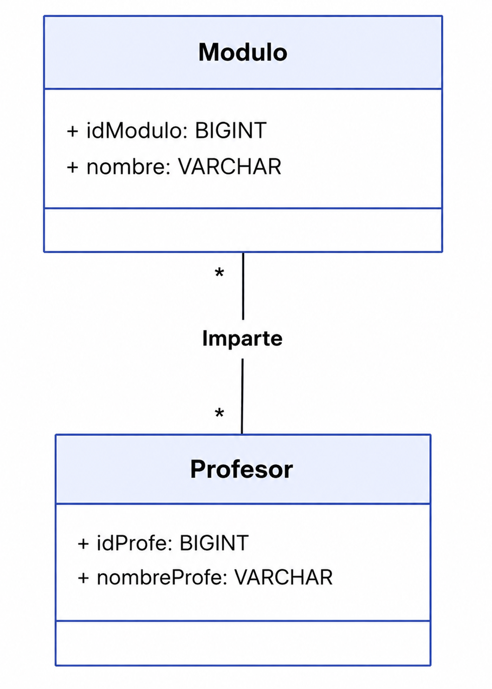
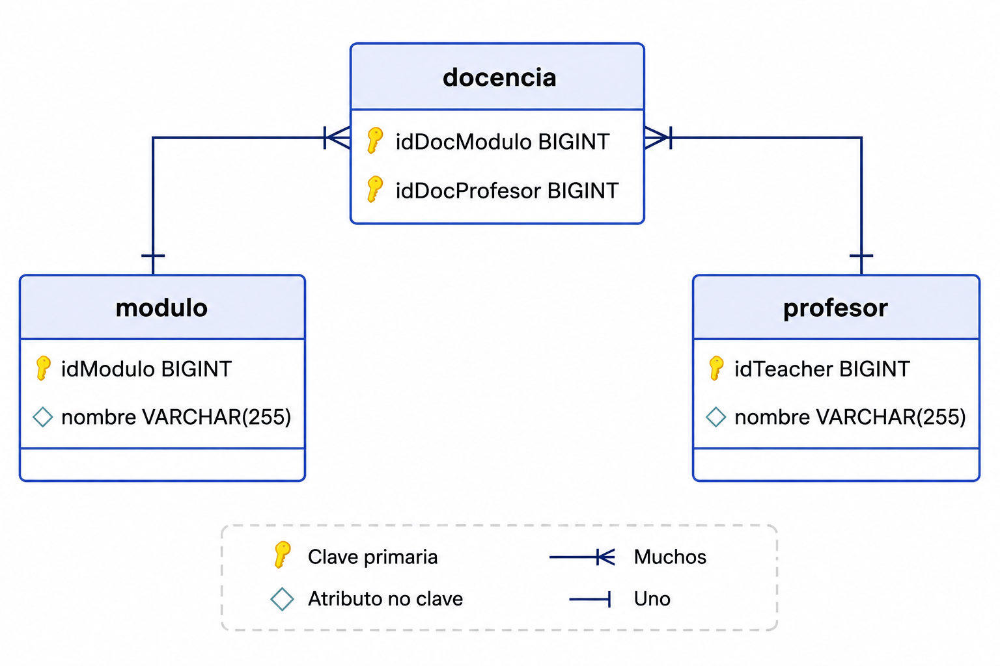

# Bloque 3. Relaciones N a M

## 1. Relaciones muchos a muchos

Las relaciones **muchos a muchos**, junto con las relaciones **1:N**, son las más comunes en el mundo real. Se definen cuando dos entidades pueden participar dentro de una relación más de una vez. Por ejemplo:

- Un profesor puede impartir varios módulos, y un módulo puede ser impartido por varios profesores.
- Una app móvil puede ejecutarse en varios sistemas operativos, y un sistema operativo puede soportar varias apps móviles.
- Etc.

Esta relación en el **modelo relacional** se representa:

- Mediante una **tabla intermedia** que contiene las claves primarias de las dos entidades relacionadas.
- De esta tabla saldrán **dos claves ajenas** que apuntarán a las dos entidades relacionadas, concretamente a sus claves primarias.
- Visualmente, en el SGBD esta tabla contendrá las relaciones entre las claves principales de las dos entidades relacionadas.

## 2. ¿Tabla nueva, clase nueva?

Centrándonos ahora en los **diagramas de clases**, este tipo de relaciones muchos a muchos se representa mediante una asociación entre las dos clases relacionadas.

Esta asociación se puede anotar con una etiqueta que indique la **multiplicidad** (por ejemplo, `"1.."` o `"*"`) para mostrar que cada instancia de una clase puede estar asociada con múltiples instancias de la otra clase.



Codificado de manera simple en Java quedaría así:

```java
class Profesor {
    ...
    private Set<Modulo> losModulos; // Relación muchos a muchos
}

class Modulo {
    ...
    private Set<Profesor> losProfesores; // Relación muchos a muchos
}
```

### En resumen

Podemos concluir que:

- En el **modelo relacional**, las relaciones muchos a muchos se representan mediante una **tabla intermedia** que contiene las claves primarias de las dos entidades relacionadas.
- En nuestras **clases**, las relaciones muchos a muchos se representan mediante una **asociación entre las dos clases relacionadas**, normalmente bidireccional.

A continuación veremos cómo quedaría anotado con Hibernate, explicándolo a medida que lo hacemos dentro del código.

## 3. Definimos la relación

Vamos a definir la relación muchos a muchos en las dos clases que participan en ella, pero, como siempre, delegaremos la responsabilidad en una de las dos. Esta puede considerarse la **propietaria de la relación**, y será la que contenga la definición de la tabla intermedia.

### 3.1. Clase no propietaria

Comenzamos por la parte sencilla, que es la no propietaria, que en este caso será la clase `Modulo`.

```java
@Data
@NoArgsConstructor
@Entity
@Table(name = "modulo")
public class Modulo {

    @Id
    @GeneratedValue(strategy = GenerationType.IDENTITY)
    private Long idModulo;

    @Column
    private String nombre;

    public Modulo(String nombre) {
        super();
        this.nombre = nombre;
    }

    @ToString.Exclude
    @EqualsAndHashCode.Exclude
    @ManyToMany(
        cascade = CascadeType.PERSIST,
        fetch = FetchType.LAZY,
        mappedBy = "losModulos")
    private Set<Profesor> losProfesores = new HashSet<>();

    public void addProfesor(Profesor p) {
        if (p != null && !losProfesores.contains(p)) {
            losProfesores.add(p);
            p.addModulo(this);
        }
    }
}
```

### 3.2. Clase propietaria

Ahora vamos a definir la clase propietaria, que en este caso será la clase `Profesor`.

```java
@Data
@NoArgsConstructor
@Entity
@Table(name = "profesor")
public class Profesor {

    @Id
    @GeneratedValue(strategy = GenerationType.IDENTITY)
    private Long idTeacher;

    @Column
    private String nombre;

    public Profesor(String nombre) {
        this.nombre = nombre;
    }

    @ToString.Exclude
    @EqualsAndHashCode.Exclude
    @ManyToMany(
        cascade = CascadeType.PERSIST,
        fetch = FetchType.LAZY)
    @JoinTable(
        name = "docencia",
        joinColumns = {
            @JoinColumn(
                name = "idDocProfesor",
                foreignKey = @ForeignKey(name = "FK_DOC_PROF"))
        },
        inverseJoinColumns = {
            @JoinColumn(
                name = "idDocModulo",
                foreignKey = @ForeignKey(name = "FK_DOC_MOD"))
        }
    )
    private Set<Modulo> losModulos = new HashSet<>();

    public String mostrarModulos() {
        String res = "Módulos de " + this.nombre + "\n";
        for (Modulo m : losModulos) {
            res += m.toString() + "\n";
        }
        return res;
    }

    public void addModulo(Modulo m) {
        if (m != null && !losModulos.contains(m)) {
            losModulos.add(m);
            m.addProfesor(this);
        }
    }
}
```

La relación creada será la siguiente:



## 4. Prueba y ejecución

Se han añadido algunos registros a la base de datos mediante un script de importación generado con ayuda de Gemini, que tienes enlazado a continuación como `importDocencia.sql`.

Finalmente, se ha preparado un `CommandLineRunner` para probar la relación y mostrar los resultados por consola:

```java
@Component
public class TestN_M {

    private static final Logger myLog = LoggerFactory.getLogger(TestN_M.class);

    @PersistenceContext
    private EntityManager entityManager;

    @Transactional
    public void ejecutar() {

        Profesor p = entityManager.find(Profesor.class, 1L);

        myLog.info(p.toString());
        myLog.info(p.mostrarModulos());

        // añadimos nuevos
        Profesor profe = new Profesor("Joan Gerard");
        profe.addModulo(new Modulo("Programación de Inteligencia Artificial"));
        profe.addModulo(new Modulo("Sistemas de Big Data"));
        profe.addModulo(new Modulo("Sistemas de aprendizaje automático"));
        profe.addModulo(new Modulo("Proyecto intermodular"));

        entityManager.persist(profe);
        myLog.info(profe.toString());
        myLog.info(profe.mostrarModulos());

    }
}
```

### 4.1. Estudio de las salidas por consola

#### Creación de las tablas

Se crean las tres tablas: `docencia`, `modulo` y `profesor`. En la tabla `docencia` se añaden las claves ajenas que apuntan a las tablas `profesor` y `modulo`.

```java
Hibernate:
    create table docencia (
        idDocModulo bigint not null,
        idDocProfesor bigint not null,
        primary key (idDocModulo, idDocProfesor)
    ) engine=InnoDB

Hibernate:
    create table modulo (
        idModulo bigint not null auto_increment,
        nombre varchar(255),
        primary key (idModulo)
    ) engine=InnoDB

Hibernate:
    create table profesor (
        idTeacher bigint not null auto_increment,
        nombre varchar(255),
        primary key (idTeacher)
    ) engine=InnoDB

Hibernate:
    alter table docencia
    add constraint FK_DOC_MOD
    foreign key (idDocModulo)
    references modulo (idModulo)

Hibernate:
    alter table docencia
    add constraint FK_DOC_PROF
    foreign key (idDocProfesor)
    references profesor (idTeacher)
```

La tabla `docencia` utiliza como **clave primaria compuesta** la combinación de `idDocModulo` e `idDocProfesor`, que a su vez son las claves ajenas que permiten relacionar profesores y módulos.

#### Consulta del profesor y sus módulos asociados

Se realiza un `SELECT` para seleccionar el profesor. Se muestra por pantalla. Al mostrar los módulos asociados, se realiza la **carga en diferido**, ejecutando una consulta con un `JOIN` entre la tabla intermedia y la tabla de módulos. Finalmente, se muestran los módulos.

```java
# Consulta del profesor
Hibernate:
    select
        p1_0.idTeacher,
        p1_0.name
    from
        profesor p1_0
    where
        p1_0.idTeacher=?

# Muestra del profesor
Profesor(idTeacher=1, name=Joan Garcia)

# Consulta de los módulos asociados al profesor
Hibernate:
    select
        em1_0.idDocProfesor,
        em1_1.idModulo,
        em1_1.nombre
    from
        docencia em1_0
    join
        modulo em1_1
            on em1_1.idModulo=em1_0.idDocModulo
    where
        em1_0.idDocProfesor=?

# Mostramos los módulos
Módulos de Joan Garcia
Modulo(idModulo=3, nombre=Programación)
Modulo(idModulo=2, nombre=Bases de Datos)
```

#### Creación de un nuevo profesor y asociación de nuevos módulos

Se crea un profesor y se le asocian **4 módulos**. Al guardarlo implica realizar **9 `INSERT`**:

- El profesor.
- Los 4 módulos.
- Las 4 relaciones entre ese profesor y los 4 módulos en la tabla intermedia.

```java
# El profesor
Hibernate: insert into profesor (name) values (?)

# Los 4 módulos
Hibernate: insert into modul (name) values (?)
Hibernate: insert into modul (name) values (?)
Hibernate: insert into modul (name) values (?)
Hibernate: insert into modul (name) values (?)

# Las 4 relaciones en la tabla intermedia
Hibernate: insert into docencia (idDocProfesor,idDocModulo) values (?,?)
Hibernate: insert into docencia (idDocProfesor,idDocModulo) values (?,?)
Hibernate: insert into docencia (idDocProfesor,idDocModulo) values (?,?)
Hibernate: insert into docencia (idDocProfesor,idDocModulo) values (?,?)
```

Finalmente, mostramos el profesor: `Profesor(idTeacher=13, name=Joan Gerard)`

Y mostramos los módulos asociados al profesor:

```java
Módulos de Joan Gerard
Modulo(idModulo=13, name=Sistemas de aprendizaje automático)
Modulo(idModulo=14, name=Programación de Inteligencia Artificial)
Modulo(idModulo=15, name=Sistemas de Big Data)
Modulo(idModulo=16, name=Proyecto intermodular)
```

!!! tip "Reducir espacio en las consultas del log"
    Para reducir el espacio en el log, puedes modificar la propiedad de `application.properties`:

    ```
    spring.jpa.properties.hibernate.format_sql=true
    ```

    Esta propiedad puede configurarse como `true` o `false`:

    - **`true`**: Hibernate formateará las consultas SQL en el log, haciéndolas más legibles, pero ocupando más espacio en cuanto a líneas.
    - **`false`**: Hibernate no formateará las consultas SQL en el log, mostrando **una sola línea por consulta**.
