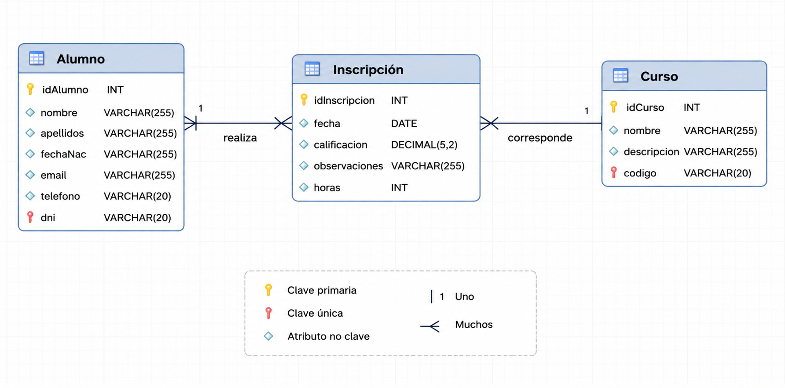

# Bloque 4. Relaciones N a M con atributos

## 1. Relaciones muchos a muchos con atributos

Cuando estudiábamos problemas de diseño de bases de datos, a menudo podían aparecer las siguientes restricciones:

- Una relación **N:M**, donde existen atributos que solo dependen de la relación y no de los elementos que relaciona. Por ejemplo, en una relación N:M llamada `compra` entre `propietario` y `vehículo`, queremos indicar la **fecha de compra**, que solo depende de la relación y no de los elementos relacionados. En el diseño, este atributo colgaba de la relación y, por tanto, terminaba en la tabla generada por la relación N:M, que en este caso era `compra`.
- En ocasiones, las relaciones **N:M** pueden plantearse como **dos relaciones 1:N**, donde la tabla intermedia de la relación N:M se convierte en una tabla normal, y los atributos que dependen de la relación N:M pasan a ser atributos de esta nueva tabla.

Pues bien, esto es lo que utiliza Hibernate para implementar las relaciones **N:M con atributos**. Hibernate convertirá la relación N:M en **dos relaciones 1:N**, y la tabla intermedia de la relación N:M se convertirá en una tabla normal, donde los atributos que dependen de la relación N:M serán atributos de esta nueva tabla.

## 2. Modelo a implementar

Vamos a resolver el siguiente modelo:



Como podemos ver, se trata de una relación entre `Alumno` y `Curso`, denominada **Inscripción**. En la propia relación vamos a almacenar la **fecha de matrícula**, así como un booleano que indique si el curso ha sido superado o no.

## 3. Problema a resolver

### 3.1. Dificultad

Hibernate solo permite anotar un atributo como `@Id`.

***¿Cuál es el problema?***  Nosotros necesitamos **dos**, uno para cada clave ajena de la tabla intermedia.

***¿Cómo podemos resolverlo?***

### 3.2. Clases incrustadas al rescate

La solución será utilizar una **clase incrustada** para representar la clave primaria compuesta:

- Definiremos una nueva clase, que podrá ser incrustada, y que contendrá los dos atributos de la clave compuesta.
- Añadiremos en la tabla intermedia un único atributo de tipo `clave_compuesta`, y este será marcado como `@Id`.
- Sus atributos serán marcados como participantes de dos relaciones **1:N** entre la tabla intermedia y las tablas que relaciona.
- De esta manera, los atributos de la clave compuesta serán, al mismo tiempo, claves ajenas que apuntan a las tablas relacionadas.

## 4. Solución

Vamos a mostrar la solución, como siempre, con código comentado.

### 4.1. Clases de entidades relacionadas: Alumno y Curso

```java
@Data
@NoArgsConstructor
@ToString
@Entity
@Table(name="alumno")
public class Alumno {

    @Id
    @GeneratedValue(strategy = GenerationType.IDENTITY)
    private Long idAlumno;

    @Column
    private String nombre;

    @Column
    private String apellidos;

    @Column
    private int edad;

    @Column
    private String poblacion;

    @Column
    private String direccion;

    @ToString.Exclude
    @OneToMany(
        mappedBy = "alumno",
        cascade = CascadeType.PERSIST,
        fetch = FetchType.LAZY)
    private List<Inscripcion> inscripciones = new ArrayList<>();

    public Alumno(String nombre, String apellidos, int edad,
                  String poblacion, String direccion) {
        this.nombre = nombre;
        this.apellidos = apellidos;
        this.edad = edad;
        this.poblacion = poblacion;
        this.direccion = direccion;
    }
}
```

```java
@Data
@NoArgsConstructor
@ToString
@Entity
@Table(name="curso")
public class Curso implements Serializable {

    static final long serialVersionUID = 17L;

    @Id
    @GeneratedValue(strategy = GenerationType.IDENTITY)
    private Long idCurso;

    @Column
    private String nombre;

    @Column
    private String descripcion;

    @OneToMany(
        mappedBy = "curso",
        cascade = CascadeType.PERSIST,
        fetch = FetchType.LAZY)
    @ToString.Exclude
    private List<Inscripcion> inscripciones = new ArrayList<>();

    public Curso(String nombre, String descripcion) {
        this.nombre = nombre;
        this.descripcion = descripcion;
    }
}
```

### 4.2. Creación de una clase para la clave compuesta

```java
@Data
@ToString
@Embeddable
public class ClaveCompuestaInscripcion {
    private Long idCurso;
    private Long idAlumno;
}
```

Fíjate en que esta clase solo tiene los dos atributos `idCurso` e `idAlumno`. Lo que la hace especial es que está anotada con `@Embeddable`, indicando que se trata de una clase que será incrustada dentro de otra clase y que no será una entidad por sí sola.

## 4.3. Clase de la tabla intermedia

En la clase `Inscripcion` es donde tenemos el trabajo de:

- Crear el identificador compuesto.
- Crear las claves ajenas que salen desde `Inscripcion` hacia `Alumno` y `Curso`.

Veámoslo con detalle.

```java
@Data
@ToString
@Entity
@Table(name="inscripcion")
public class Inscripcion {

    @EmbeddedId
    private ClaveCompuestaInscripcion idInscripcion = new ClaveCompuestaInscripcion();

    @ManyToOne
    @MapsId("idCurso")
    @JoinColumn(name="idCurso")
    private Curso curso;

    @ManyToOne
    @MapsId("idAlumno")
    @JoinColumn(name="idAlumno")
    private Alumno alumno;

    @Column(name = "fecha", columnDefinition = "DATETIME")
    private Date fecha;

    @Column
    private boolean apto;
}
```

!!! note "Nombre de las claves"
    Fíjate en que estos nombres de las claves ajenas coinciden con los atributos de la clase `ClaveCompuestaInscripcion`, pero podrían ser distintos.

## 4.4. Ejemplo de uso

```java
@Component
public class TestN_M_A {

    private static final Logger myLog = LoggerFactory.getLogger(TestN_M_A.class);

    @PersistenceContext
    private EntityManager entityManager;

    @Transactional
    public void ejecutar() {

        SimpleDateFormat format = new SimpleDateFormat("dd/MM/yyyy");

        Alumno alumno = new Alumno(
            "Joan",
            "Garcia",
            25,
            "Valencia",
            "Mayor 1"
        );

        Curso curso = new Curso(
            "Spring Boot",
            "Aprende a crear API's REST con Spring Boot"
        );

        try {
            Inscripcion i = new Inscripcion(
                curso,
                alumno,
                format.parse("23/04/2026"),
                true
            );

            entityManager.persist(i);

        } catch (ParseException e) {
            // TODO Auto-generated catch block
            e.printStackTrace();
        }
    }
}
```

Y la salida esperada:

```java
Hibernate: insert into alumno (apellidos,direccion,edad,nombre,poblacion) values (?,?,?,?,?)
Hibernate: insert into curso (descripcion,nombre) values (?,?)
Hibernate: insert into inscripcion (apto,fecha,idAlumno,idCurso) values (?,?,?,?)
```

!!! note "Propuesto"
    ¿Cómo quedaría en caso de que un `Alumno` pudiera repetir un `Curso` varias veces, por ejemplo si no está apto? ¿Te atreves a implementarlo?

    **Consejo:** quizá tengas que ampliar la clave primaria...

---

➡️ **Práctica de esta unidad:** [Práctica 7](../practicas/practica-up5-1.md)
